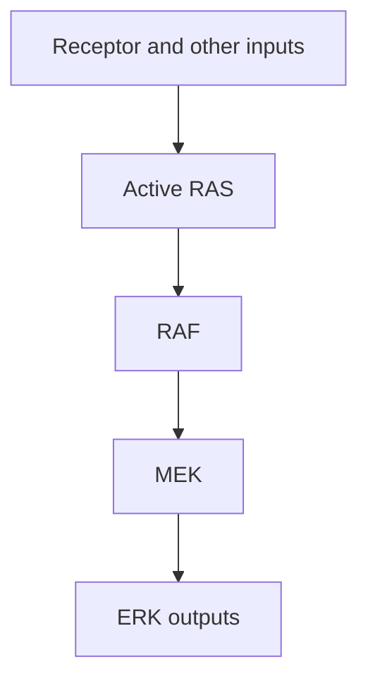

# RAS–RAF–MEK–ERK: a growth-signal relay

## In one sentence

The RAS–RAF–MEK–ERK pathway relays signals through a molecular switch and protein kinases to change cellular activity and gene expression.

## The intuition

Think of a relay team carrying a message between stations. Seeing the last runner move does not identify who started the race. Blocking one station can also change feedback elsewhere. The analogy ends at the chain: the biological network has branches, shared inputs and feedback rather than one fixed route.

## How it works

This pathway is one **mitogen-activated protein kinase (MAPK)** cascade. A mitogen is a signal that can promote cell division. The MAPK family contains other cascades too; “MAPK activity” should name the actual branch.

[Receptor tyrosine kinases](/wiki/education/concepts/cancer-biology/signaling-pathways/receptor-tyrosine-kinases) can help turn on **RAS**, a small protein that acts as a molecular switch. RAS binds guanosine triphosphate (**GTP**) in its active state and guanosine diphosphate (**GDP**) in its inactive state. Partners control exchange and GTP breakdown. Particular RAS alterations can change this regulation.

Active RAS helps engage **RAF** family kinases. A **kinase** transfers phosphate groups to proteins. RAF activates **MEK**, MAPK/ERK kinase, which activates **ERK**, extracellular signal-regulated kinase. ERK modifies downstream proteins involved in cellular behavior and gene regulation.

The relay is regulated at several levels. Feedback and alternative inputs can change its response over time. A downstream ERK signal does not uniquely identify a receptor, RAS alteration or BRAF alteration upstream.

*This simplified relay locates steps; it omits feedback and other MAPK branches.*

## Why it matters in cancer

Some cancers contain activating alterations in RAS or RAF proteins. The exact allele and context matter. The original BRAF discovery study established activity for particular mutations; it did not make every change in the gene equivalent.

Interventions also differ by target and biochemical setting. In model experiments, certain RAF inhibitors lowered ERK signaling in mutant-BRAF cells but increased it in other RAS-active, wild-type-BRAF settings. This **paradoxical activation** warns against treating a pathway label as a universal instruction to inhibit it.

Keep three questions separate: did the intended molecular target respond, did that response impair the cancer model, and does clinical evidence support benefit in the relevant disease and setting? None follows automatically from a high RNA score.

## How it is measured

| Field | What to document |
|---|---|
| Input and tissue cost | Preserved tissue for DNA/protein assays; viable cells or models for perturbation |
| Outputs | Exact DNA allele, RAS activation assays or specified MEK/ERK phosphosites, with normalized protein signals |
| Controls | Preservation, total protein, timing, target specificity and independent perturbation |
| Thresholds and validation | No universal MAPK-high cutoff selects a drug; a specific clinical biomarker needs its own assay and evidence |
| Limits | Phosphorylation indicates a sampled state, not the unique upstream cause or survival dependence |

[Phosphoproteomics](/wiki/education/concepts/measurement/proteins-and-spatial/phosphoproteomics) can sample several sites. Interpret the preservation method and cell mixture before comparing samples. Early biochemical effects and later growth/death should be measured separately.

## Common confusions

- **MAPK versus this one branch:** other MAPK cascades respond to different inputs.
- **Gene name versus allele effect:** activating, impairing and uncertain variants differ.
- **Lower ERK phosphorylation versus killing:** a cell can compensate or continue growing.
- **Pathway inhibition versus guaranteed direction:** some intervention contexts increase downstream signaling.

## Try it

A fictional compound reduces ERK phosphorylation within an hour. Viable-cell counts and growth remain unchanged over the measured interval. Has pathway dependence been proved?

**Answer:** No. A downstream biochemical change is supported. Confirm the intended target and measure an attributed functional consequence with independent controls. Patient benefit remains a separate evidence question.

## Explain it back

“An ERK readout locates ___, but it does not identify ___ or prove ___.”

One answer: “a downstream state; the sole upstream cause; that growth depends on the pathway.”

## Takeaway

**Trace the exact relay and alteration, then test the direction and consequence of the intervention.**

## Related concepts

- [Oncogenes and tumor suppressors](/wiki/education/concepts/cancer-biology/what-cancer-is/oncogene-and-tumor-suppressor), for gain and loss of function.
- [MYC](/wiki/education/concepts/cancer-biology/signaling-pathways/myc), a transcriptional regulator whose activity can be influenced by growth signals.

## Sources

Source check: October 9, 2026; expert and learner review pending. The exercise is fictional. Experimental inhibitor effects are mechanism examples, not treatment recommendations.

- [Moodie et al., 1993: active RAS interactions with RAF](https://pubmed.ncbi.nlm.nih.gov/8503013/).
- [Kyriakis et al., 1992: RAF activates MAP kinase kinase](https://pubmed.ncbi.nlm.nih.gov/1322500/).
- [Davies et al., 2002: particular BRAF mutations in cancer](https://pubmed.ncbi.nlm.nih.gov/12068308/).
- [Poulikakos et al., 2010: context-dependent paradoxical RAF-inhibitor effects](https://pubmed.ncbi.nlm.nih.gov/20179705/).

<!-- BEGIN GENERATED USED IN -->
## Used in

Browse the [concept index](/wiki/education/concepts/index) for related learning paths.
<!-- END GENERATED USED IN -->
