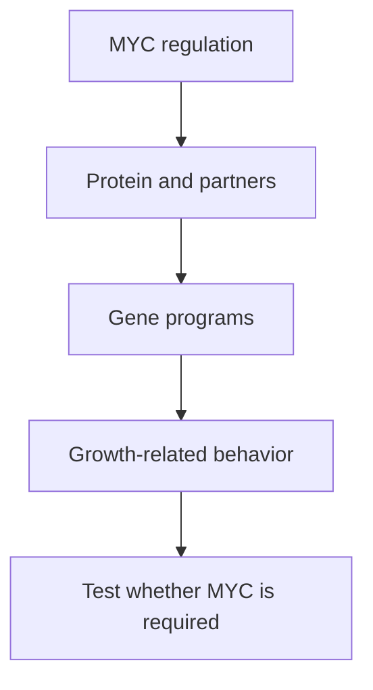

# MYC: coordinating growth-related gene expression

## In one sentence

MYC is a transcriptional regulator that helps coordinate gene programs involved in cell growth, metabolism and proliferation.

## The intuition

Imagine a coordinator who helps a workshop expand production. More copies of the coordinator's job description do not prove the coordinator is present, working or indispensable. The analogy helps separate DNA, RNA, protein and function. MYC is not a manager making decisions; it acts through molecular interactions and regulatory context.

## How it works

**MYC** names a gene and its protein product; reports must specify which layer was measured. A **transcriptional regulator** influences the production of RNA from genes, as explained in the [central dogma](/wiki/education/concepts/biology-basics/genetics/central-dogma).

MYC can pair with another protein, **MAX**, to bind particular DNA sequences. The proteins and surrounding regulatory machinery influence which genes respond. Their actions connect processes such as protein production, nutrient use and cell-cycle progression.

More MYC does not simply mean every gene receives the same boost. Primary studies distinguish selective gene regulation from broader increases in RNA that accompany changing cell state. Some effects are direct; others occur because cells grow, divide or change their programs.

Cancer can deregulate MYC through added gene copies or altered signaling and regulation. These routes are not equivalent. DNA copy gain, abundant MYC RNA, MYC protein and a growth-associated signature provide different observations. None alone establishes **MYC dependence**, meaning that disrupting MYC function compromises the tested cells.

*Amount, regulatory activity and functional dependence are separate evidence layers.*

## Why it matters in cancer

MYC is a [proto-oncogene](/wiki/education/concepts/cancer-biology/what-cancer-is/oncogene-and-tumor-suppressor): its normal growth-related function can contribute to cancer when deregulated. But a breast-cancer subtype is not an individual functional assay. A study of triple-negative breast cancer found MYC-related patterns in human tumors and tested vulnerability in selected models. It did not establish universal MYC dependence or a drug-selection rule for every patient.

MYC also supports normal proliferating tissues. A genetically controlled mouse study showed tumor regression and effects on normal regenerating tissues after MYC inhibition. That model establishes biology; it cannot substitute for a particular medicine's exposure, safety and clinical evidence.

[BET bromodomain proteins](/wiki/education/concepts/cancer-biology/signaling-pathways/bet-bromodomain-proteins) are related transcriptional regulators, but BET inhibition and MYC inhibition are different interventions. A changed MYC message does not prove that it caused a later response.

## How it is measured

| Field | What to document |
|---|---|
| Input and tissue cost | Preserved DNA/RNA, fixed tissue for staining or viable models for functional experiments |
| Outputs | Gene copy number, RNA counts, protein staining or binding measurements; name the layer and cell population |
| Controls | Cell composition, proliferation state, assay specificity and independent MYC perturbation with suitable restoration |
| Thresholds and validation | No universal MYC-high cutoff proves dependence; a signature needs its own definition and validation |
| Limits | High amount or a correlated gene program does not establish selective killing, drug attribution or patient benefit |

A useful functional experiment confirms MYC disruption before interpreting growth and death. Controls should distinguish MYC's role from general damage to transcription and compare relevant normal cells. A single compound is usually insufficient to attribute the mechanism.

## Common confusions

- **Amplification versus expression:** added DNA copies and active transcription differ.
- **Expression versus dependence:** a prominent regulator may not be an irreplaceable bottleneck.
- **Subtype versus individual state:** a group average does not classify every tumor.
- **MYC program versus direct binding:** correlated RNA can include indirect effects.

## Try it

A fictional tissue sample has high MYC RNA. Its protein has not been measured. A compound reduces growth and changes many transcripts. Is MYC dependence established?

**Answer:** No. These observations leave protein activity and attribution unresolved. Confirm the cell source, then use independent MYC perturbation and functional controls. Clinical response is another question.

## Explain it back

“To claim MYC dependence, I need more than ___; I need ___.”

One answer: “high RNA or a subtype label; an attributed functional effect after disrupting MYC.”

## Takeaway

**Measure the MYC layer you mean, and test dependence rather than assigning it from a label.**

## Related concepts

- [RAS–RAF–MEK–ERK](/wiki/education/concepts/cancer-biology/signaling-pathways/mapk-ras-raf), a growth-signal relay.
- [Tumor heterogeneity](/wiki/education/concepts/cancer-biology/what-cancer-is/tumor-heterogeneity), for variation within the sampled population.

## Sources

Source check: October 9, 2026; expert and learner review pending. The exercise is fictional. Preclinical dependencies do not establish clinical efficacy.

- [Blackwood and Eisenman, 1991: the MYC–MAX DNA-binding complex](https://pubmed.ncbi.nlm.nih.gov/2006410/).
- [Sabò et al., 2014: selective MYC transcriptional regulation](https://pubmed.ncbi.nlm.nih.gov/25043028/).
- [Horiuchi et al., 2012: MYC patterns and intervention experiments in TNBC models](https://pubmed.ncbi.nlm.nih.gov/22430491/).
- [Soucek et al., 2008: genetically controlled MYC inhibition in mice](https://pubmed.ncbi.nlm.nih.gov/18716624/).

<!-- BEGIN GENERATED USED IN -->
## Used in

Browse the [concept index](/wiki/education/concepts/index) for related learning paths.
<!-- END GENERATED USED IN -->
