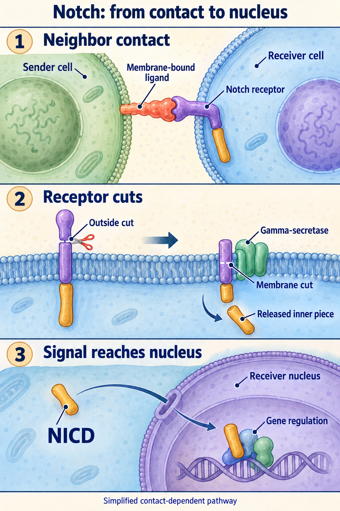
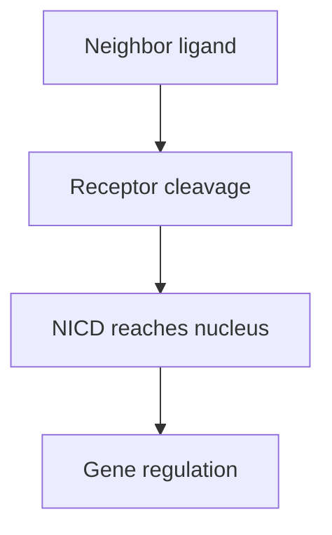

# Notch signaling: a message between neighboring cells

## In one sentence

Notch signaling commonly begins with contact between a ligand-bearing cell and a receptor-bearing neighbor, leading to release of a fragment that regulates gene expression.

## The intuition

Think of a neighbor delivering a message across a shared fence. Who sends it and who receives it matter. Notch commonly works through contact between cells, rather than a freely circulating message. The analogy ends when we reach the molecular cutting steps that carry the signal inward.

## How it works

A membrane-bound ligand from the Delta-like or Jagged families can engage a Notch receptor on another cell. This interaction permits a series of cuts in the receptor. A protease is an enzyme that cuts proteins. An extracellular cutting step is followed by cleavage within the membrane.

**Gamma-secretase** participates in the membrane cleavage. The released **Notch intracellular domain (NICD)** can enter the nucleus and work with other proteins to change transcription, the production of RNA messages. This explains how a signal at the surface changes gene regulation. [Schroeter 1998](https://pubmed.ncbi.nlm.nih.gov/9620803/), [De Strooper 1999](https://pubmed.ncbi.nlm.nih.gov/10206645/).

Different ligand, receptor, and cell combinations produce different outcomes. Notch helps regulate cell identity and behavior during development and tissue maintenance. A receptor's mere presence does not establish that the cutting sequence or nuclear response occurred.

*Contact can lead to receptor cuts that release the Notch intracellular domain (NICD) into the receiver cell and then its nucleus. Shapes and successive positions are schematic; receptor maturation and sender pulling are omitted. Activation alone does not establish a growth effect.*

*Sender, receptor processing and nuclear response are separate observations.*

## Why it matters in cancer

Cancer can alter developmental signals. The relevant signaling cells may be malignant cells, vessel cells, or other neighbors. Activating NOTCH1 mutations were identified in T-cell acute lymphoblastic leukemia. Inactivating alterations in a head-and-neck squamous cancer study instead suggested a tumor-suppressor role. These are different disease contexts; neither assigns a direction to an uncharacterized allele. A claim about “Notch activity” therefore needs a cell type and a specific biological question.

Blocking a ligand and blocking gamma-secretase interrupt different parts of the system. Gamma-secretase also acts on proteins beyond Notch. A response to a broad perturbation does not automatically identify the relevant ligand or receptor.

## A worked example

A fictional tissue has high DLL4, a Notch ligand, around blood vessels. Most of the signal comes from vessel cells. Tumor cells do not show increased nuclear NICD in an adequate assay.

The tissue supports a vascular ligand observation. It does not yet support active Notch signaling inside malignant cells. Researchers could next examine the receiving cell population, nuclear signal, and suitable downstream targets under controlled conditions.

## Common confusions

- **Ligand amount versus received signal:** a sender can be present without an effective receiver.
- **Total Notch versus NICD:** receptor abundance differs from the released signaling fragment.
- **Vessel signal versus tumor-cell signal:** location changes the interpretation.
- **A variant versus an inhibitor:** changing a protein's sequence is not equivalent to blocking a defined step.

## How it is measured

Complementary research readouts include the sending and receiving cell populations, receptor cleavage, nuclear NICD, and responsive transcripts such as HES or HEY genes. These transcripts have context-dependent regulation and should not serve as a single definitive test. Functional experiments can compare contact conditions and pathway perturbations, with controls for general effects on cell health.

Staining uses tissue sections; live perturbations require viable cells or models. Outputs include a validated nuclear-NICD staining score or normalized responsive RNA. Preservation, antibody specificity and cell composition can change results. No universal Notch-positive cutoff establishes treatment eligibility; each readout has its own research or clinical validation context.

## Try it

A fictional contact-blocking experiment reduces nuclear NICD in tumor cells. Growth remains unchanged. Has Notch dependence been shown?

**Answer:** The experiment supports reduced received signaling under those conditions. It has not shown a growth requirement. Check cell identity, contact-specific controls, independent pathway perturbation and whether another route compensates.

## Explain it back

“Notch receptor amount tells me ___; nuclear NICD addresses ___; growth dependence needs ___.”

One answer: “what is present; received signaling; an attributed functional effect.”

## Takeaway

**Locate the sending and receiving cells, then distinguish pathway activation from its effect on survival.**

## Related concepts

[Ligands and receptors](/wiki/education/concepts/biology-basics/signaling/ligand-and-receptor) provides the foundation. [Wnt–β-catenin](/wiki/education/concepts/cancer-biology/signaling-pathways/wnt-beta-catenin) is another developmental signal with different machinery. [The signaling lesson](/wiki/education/molecular-profiling/evee-pathways/03-notch-wnt-and-fgfr) compares contact, secreted, and receptor-kinase signals.

## Sources

Source check: 2026-10-09. General mechanism education; the worked example is fictional. Expert and learner review pending.

- [Schroeter 1998: release of the Notch intracellular domain](https://pubmed.ncbi.nlm.nih.gov/9620803/).
- [Mumm 2000: ligand-regulated extracellular cleavage](https://pubmed.ncbi.nlm.nih.gov/10882062/).
- [De Strooper 1999: gamma-secretase-like cleavage in Notch processing](https://pubmed.ncbi.nlm.nih.gov/10206645/).
- [Weng 2004: activating NOTCH1 mutations in T-cell leukemia](https://pubmed.ncbi.nlm.nih.gov/15472075/).
- [Agrawal 2011: inactivating NOTCH1 mutations in head-and-neck squamous cancer](https://pubmed.ncbi.nlm.nih.gov/21798897/).

<!-- BEGIN GENERATED USED IN -->
## Used in

- [Notch, Wnt, and FGFR: locate the signal before choosing a target](/wiki/education/molecular-profiling/evee-pathways/03-notch-wnt-and-fgfr)
- [Pathway mechanisms: a supporting lesson library](/wiki/education/molecular-profiling/evee-proposed-pathways)
<!-- END GENERATED USED IN -->
