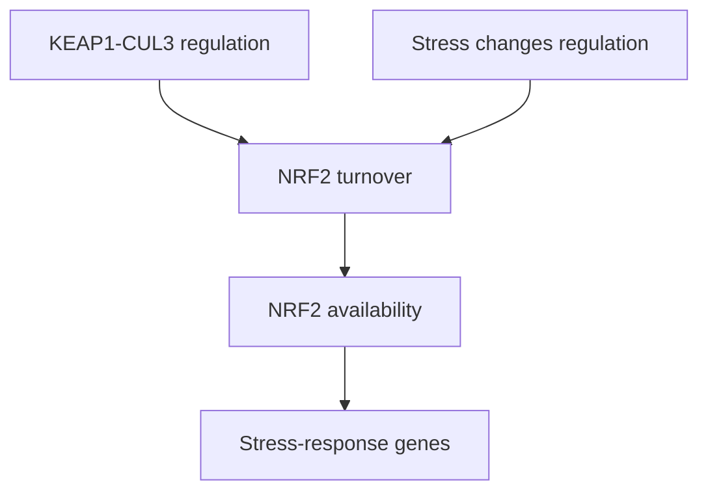

# NRF2–KEAP1: regulating a stress-defense program

## In one sentence

KEAP1 helps control NRF2 turnover, while stabilized NRF2 can activate genes that protect cells from oxidative and chemical stress.

## The intuition

A cell needs an emergency-response program, but leaving it permanently on changes how the cell behaves. NRF2 helps activate that program. KEAP1 helps control its availability. A shield can protect a healthy cell and can also protect a cancer cell; the surrounding context decides what that protection means.

## How it works

**Nuclear factor erythroid 2-related factor 2 (NRF2)** is a transcription factor, a protein that helps regulate gene expression. The gene encoding it is named **NFE2L2**. **Kelch-like ECH-associated protein 1 (KEAP1)** serves as an adaptor that links NRF2 to a ubiquitin-ligase complex organized around **cullin 3 (CUL3)**. Under suitable unstressed conditions, this machinery promotes NRF2 turnover through the proteasome. [Kobayashi 2004](https://pubmed.ncbi.nlm.nih.gov/15282312/).

Oxidative or electrophilic stress can alter KEAP1-dependent regulation and reduce NRF2 destruction. Electrophiles are chemicals that react with electron-rich parts of other molecules. More NRF2 can then participate in nuclear gene regulation. This need not mean that KEAP1 physically lets go of every NRF2 molecule. The mechanism concerns altered turnover and regulation, not simply a latch opening. [Zhang 2004](https://pubmed.ncbi.nlm.nih.gov/15572695/).

The resulting program includes enzymes involved in antioxidant defense, detoxification, and metabolism. Different target genes and cell types respond differently. CUL3 also works with other adaptors and substrates. A CUL3 variant cannot be assigned a specific NRF2 consequence from its name alone.

*Stress changes turnover control; the diagram does not imply that every KEAP1–NRF2 interaction breaks apart.*

## Why it matters in cancer

The program can help normal cells withstand stress. Sustained NRF2 activity can also help some cancers survive. Preclinical oncogene-driven models demonstrate that NRF2 regulation can support detoxification and tumor development under particular conditions. [DeNicola 2011](https://pubmed.ncbi.nlm.nih.gov/21734707/).

Protection and dependence are distinct. High defenses may resist a stressor. A cell may also become reliant on one defense, but that reliance needs a perturbation experiment. Neither outcome follows automatically from antioxidant RNA abundance.

## A worked example

A fictional culture has abundant NQO1 RNA, a transcript associated with the stress program. Researchers also find nuclear NRF2 and several responsive proteins. A controlled KEAP1 restoration reduces these readouts.

This supports a KEAP1-related regulatory consequence in the model. Survival after a defined stressor still needs testing. The observations do not show that the culture is sensitive to ferroptosis, or that an NRF2-directed treatment would improve a patient's outcome.

## Common confusions

- **NRF2 protein versus NFE2L2 gene:** one names the regulator and the other its gene.
- **A stress transcript versus a full mechanism:** several causes can change one readout.
- **CUL3 versus one substrate:** a shared scaffold has multiple jobs.
- **Defense versus vulnerability:** stronger protection can mean resistance; dependence is a separate experimental claim.

## How it is measured

Researchers combine NRF2 localization, protein turnover, several responsive genes, and genetic perturbation. They may measure glutathione or damage under a defined stress. These measurements require appropriate tissue preservation; turnover and rescue tests need viable models. Outputs include localization, normalized protein/RNA and chemical damage measures. None supplies a universal treatment-selection cutoff.

Broadly toxic compounds can lower short-lived proteins without selectively inhibiting NRF2. In A549 cancer-cell experiments, brusatol inhibited global protein synthesis, rather than selectively targeting this regulator. Early controls for general translation and independent perturbations therefore matter.

## Try it

A fictional model has a CUL3 variant and high antioxidant RNA. A translation-inhibiting compound lowers NRF2 and kills the cells. Does this establish a CUL3-driven NRF2 dependency?

**Answer:** No. The variant's effect and the cause of the RNA pattern remain untested. Broad translation inhibition can lower NRF2 alongside many other proteins. Establish the pathway state, allele effect and specific functional requirement separately.

## Explain it back

“An antioxidant program may show ___; a dependency requires ___.”

One answer: “protection or a stress response; a controlled loss of a defined function that matters to survival.”

## Takeaway

**Stress defenses can protect a cancer cell, but their abundance does not identify which defense it needs.**

## Related concepts

[Reactive oxygen species](/wiki/education/concepts/cancer-biology/metabolism-and-stress/reactive-oxygen-species) explains the chemistry and readout limits. [Ferroptosis](/wiki/education/concepts/cancer-biology/cell-death-and-survival/ferroptosis) describes one form of lipid-damage-driven death. [Oxidative phosphorylation](/wiki/education/concepts/cancer-biology/metabolism-and-stress/oxidative-phosphorylation) explains a different energy process. [The stress lesson](/wiki/education/molecular-profiling/evee-pathways/04-cul3-nrf2-ferroptosis-and-bet) tests the gaps between them.

## Sources

Source check: 2026-10-09. General mechanism education; the worked example is fictional. Expert and learner review pending.

- [Kobayashi 2004: KEAP1, CUL3, and NRF2 turnover](https://pubmed.ncbi.nlm.nih.gov/15282312/).
- [Zhang 2004: redox-regulated KEAP1 ubiquitin-ligase activity](https://pubmed.ncbi.nlm.nih.gov/15572695/).
- [DeNicola 2011: NRF2-dependent detoxification in oncogene-driven models](https://pubmed.ncbi.nlm.nih.gov/21734707/).
- [Vartanian 2016: brusatol and global protein-synthesis inhibition](https://pubmed.ncbi.nlm.nih.gov/26711467/).

<!-- BEGIN GENERATED USED IN -->
## Used in

- [Stress defenses and chromatin readers: test the direction](/wiki/education/molecular-profiling/evee-pathways/04-cul3-nrf2-ferroptosis-and-bet)
- [Oxidative metabolism and stress: energy, damage, and dependence](/wiki/education/molecular-profiling/evee-pathways/05-oxidative-metabolism-and-stress)
- [Pathway mechanisms: a supporting lesson library](/wiki/education/molecular-profiling/evee-proposed-pathways)
<!-- END GENERATED USED IN -->
