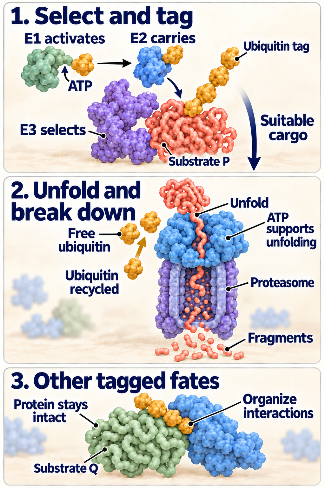
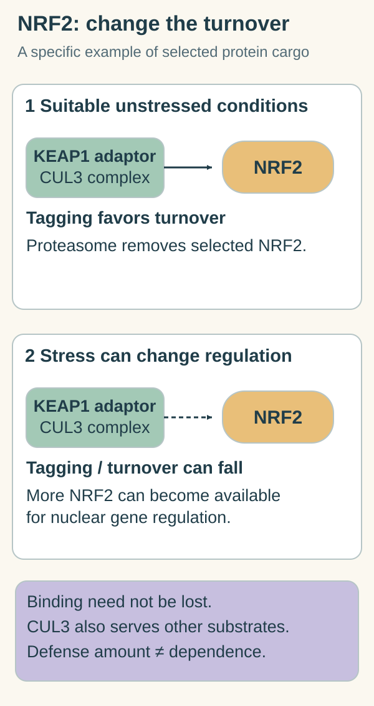
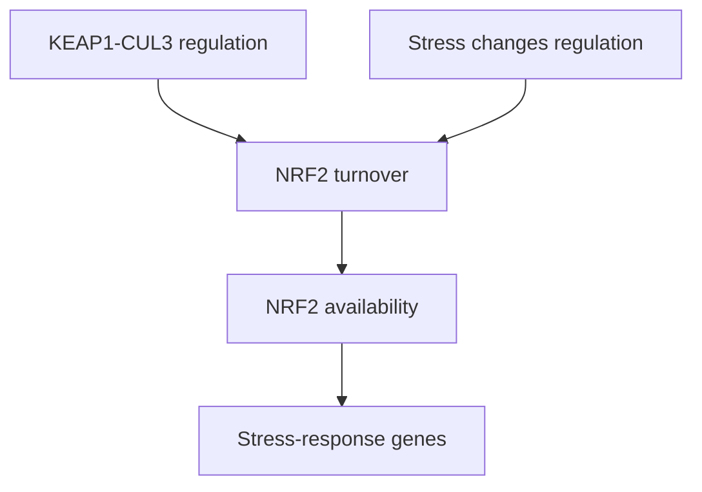

# NRF2–KEAP1: regulating a stress-defense program

## In one sentence

KEAP1 helps control NRF2 turnover, while stabilized NRF2 can activate genes that protect cells from oxidative and chemical stress.

## The intuition

A cell needs an emergency-response program, but leaving it permanently on changes how the cell behaves. NRF2 helps activate that program. KEAP1 helps control its availability. A shield can protect a healthy cell and can also protect a cancer cell; the surrounding context decides what that protection means.

## How it works

The cargo scene shows selection, tagging, destruction and ubiquitin reuse. The inset below names NRF2 as one selected substrate of KEAP1/CUL3 regulation; CUL3 also works with other adaptors and substrates.

Read the same regulator and substrate in both conditions. Stress can reduce KEAP1-dependent tagging and NRF2 destruction, making more NRF2 available for nuclear regulation; this need not break every KEAP1–NRF2 interaction. The arrows describe regulation, not creation of NRF2, and neither defense abundance nor a change in the CUL3 scaffold proves dependence or ferroptosis sensitivity. <a href="https://pubmed.ncbi.nlm.nih.gov/15572695/">Primary redox-regulated ligase study</a>.

**Nuclear factor erythroid 2-related factor 2 (NRF2)** is a transcription factor, a protein that helps regulate gene expression. The gene encoding it is named **NFE2L2**. **Kelch-like ECH-associated protein 1 (KEAP1)** serves as an adaptor that links NRF2 to a ubiquitin-ligase complex organized around **cullin 3 (CUL3)**. Under suitable unstressed conditions, this machinery promotes NRF2 turnover through the proteasome. [Kobayashi 2004](https://pubmed.ncbi.nlm.nih.gov/15282312/).

Oxidative or electrophilic stress can alter KEAP1-dependent regulation and reduce NRF2 destruction. Electrophiles are chemicals that react with electron-rich parts of other molecules. More NRF2 can then participate in nuclear gene regulation. This need not mean that KEAP1 physically lets go of every NRF2 molecule. The mechanism concerns altered turnover and regulation, not simply a latch opening. [Zhang 2004](https://pubmed.ncbi.nlm.nih.gov/15572695/).

The resulting program includes enzymes involved in antioxidant defense, detoxification, and metabolism. Different target genes and cell types respond differently. CUL3 also works with other adaptors and substrates, so a change in CUL3 cannot be assigned a specific NRF2 consequence from its name alone.

*Stress changes turnover control; the diagram does not imply that every KEAP1–NRF2 interaction breaks apart.*

## Why it matters in cancer

The program can help normal cells withstand stress. Sustained NRF2 activity can also help some cancers survive. Preclinical oncogene-driven models demonstrate that NRF2 regulation can support detoxification and tumor development under particular conditions. [DeNicola 2011](https://pubmed.ncbi.nlm.nih.gov/21734707/).

The best-documented human example is lung cancer. In non-small-cell lung cancer, somatic KEAP1 mutations were found in 10 of 54 tumors (19%), often with loss of the other copy; the loss of KEAP1 left NRF2 active and switched on antioxidant, detoxification and drug-efflux genes, which may help tumor cells withstand chemotherapy. [Singh 2006](https://pubmed.ncbi.nlm.nih.gov/17020408/).

Protection and dependence are distinct. High defenses may resist a stressor. A cell may also become reliant on one defense, but that reliance needs a perturbation experiment. Neither outcome follows automatically from antioxidant RNA abundance.

## A worked example

A fictional culture has abundant NQO1 RNA, a transcript associated with the stress program. Researchers also find nuclear NRF2 and several responsive proteins. A controlled KEAP1 restoration reduces these readouts.

This supports a KEAP1-related regulatory consequence in the model. Survival after a defined stressor still needs testing. The observations do not show that the culture is sensitive to ferroptosis, or that an NRF2-directed treatment would improve a patient's outcome.

## Common confusions

- **NRF2 protein versus NFE2L2 gene:** one names the regulator and the other its gene.
- **A stress transcript versus a full mechanism:** several causes can change one readout.
- **The scaffold versus one substrate:** CUL3 works with many adaptors and substrates, not only KEAP1 and NRF2.
- **Defense versus vulnerability:** stronger protection can mean resistance; dependence is a separate experimental claim.

## How it is measured

Researchers combine NRF2 localization, protein turnover, several responsive genes, and genetic perturbation. They may measure glutathione or damage under a defined stress. These measurements require appropriate tissue preservation; turnover and rescue tests need viable models. Outputs include localization, normalized protein/RNA and chemical damage measures. None supplies a universal treatment-selection cutoff.

Broadly toxic compounds can lower short-lived proteins without selectively inhibiting NRF2. In A549 cancer-cell experiments, brusatol inhibited global protein synthesis, rather than selectively targeting this regulator. Early controls for general translation and independent perturbations therefore matter.

## Try it

A fictional lung cancer line has lost both working copies of KEAP1. Predict what happens to NRF2 protein and to its target genes, and name one experiment that would show the cells depend on NRF2.

Show answer

Without KEAP1, NRF2 escapes tagging and destruction, so NRF2 protein builds up in the nucleus and its antioxidant and detoxification genes rise. To test dependence, remove NRF2 specifically (for example by genetic knockdown) and compare growth or survival under a defined stress with control cells; restoring KEAP1 should reverse the program. A broad drug that lowers NRF2 by blocking all protein production, such as brusatol in cell experiments, would not isolate the NRF2 effect.

## Explain it back

“An antioxidant program may show ___; a dependency requires ___.”

One answer: “protection or a stress response; a controlled loss of a defined function that matters to survival.”

## Takeaway

**Stress defenses can protect a cancer cell, but their abundance does not identify which defense it needs.**

## Related concepts

[Reactive oxygen species](/wiki/education/concepts/cancer-biology/metabolism-and-stress/reactive-oxygen-species) explains the chemistry and readout limits. [Ferroptosis](/wiki/education/concepts/cancer-biology/cell-death-and-survival/ferroptosis) describes one form of lipid-damage-driven death. [Oxidative phosphorylation](/wiki/education/concepts/cancer-biology/metabolism-and-stress/oxidative-phosphorylation) explains a different energy process. [The stress lesson](/wiki/education/guides/from-variant-to-drug/10-test-the-direction-of-a-stress-defense) tests the gaps between them.

## Sources

Source check: 2026-11-07. General mechanism education; the worked example is fictional. Expert and learner review pending.

- [Singh 2006: KEAP1 mutations and NRF2 activation in non-small-cell lung cancer](https://pubmed.ncbi.nlm.nih.gov/17020408/).
- [Kobayashi 2004: KEAP1, CUL3, and NRF2 turnover](https://pubmed.ncbi.nlm.nih.gov/15282312/).
- [Zhang 2004: redox-regulated KEAP1 ubiquitin-ligase activity](https://pubmed.ncbi.nlm.nih.gov/15572695/).
- [DeNicola 2011: NRF2-dependent detoxification in oncogene-driven models](https://pubmed.ncbi.nlm.nih.gov/21734707/).
- [Vartanian 2016: brusatol and global protein-synthesis inhibition](https://pubmed.ncbi.nlm.nih.gov/26711467/).

<!-- BEGIN GENERATED USED IN -->
## Used in

- [Test the direction of a stress defense](/wiki/education/guides/from-variant-to-drug/10-test-the-direction-of-a-stress-defense)
- [From a variant to a drug claim](/wiki/education/guides/from-variant-to-drug/index)
<!-- END GENERATED USED IN -->
