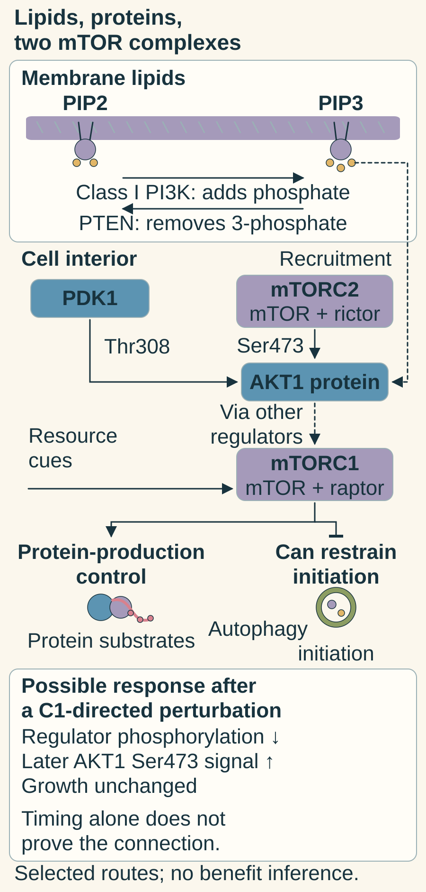

# PI3K–AKT–mTOR: growth signals and resource use

## In one sentence

PI3K–AKT–mTOR signaling links growth cues and available resources to cellular programs such as protein production, metabolism, and recycling.

## The intuition

A workshop needs both a request to build and enough supplies. Growth cues resemble the request; nutrients and energy resemble the supplies. This network coordinates them. It branches and responds to its own outputs, so a straight arrow diagram is only a starting sketch.

The cell has no manager choosing a plan. Molecular location, partners and timing determine which connections operate.

## How it works

**Phosphoinositide 3-kinase (PI3K)** is a family of [kinases](/wiki/education/concepts/biology-basics/signaling/signal-transduction-and-kinases) that modify lipids. In this growth-signaling route, **class I PI3K** produces **phosphatidylinositol 3,4,5-trisphosphate (PIP3)** at membranes. This lipid helps recruit proteins to the right location. It is not phosphorylation of a protein. **Phosphatase and tensin homolog (PTEN)** can remove the lipid's phosphate at position 3, opposing this signal.

**AKT**, also called protein kinase B, modifies proteins. Its activation involves recruitment and [phosphorylation](/wiki/education/concepts/biology-basics/signaling/phosphorylation) at specific sites. **3-phosphoinositide-dependent protein kinase 1 (PDK1)** phosphorylates threonine 308, abbreviated **Thr308**, in the well-studied AKT1 route. **Mechanistic target of rapamycin complex 2 (mTORC2)** phosphorylates serine 473, or **Ser473**. A report should name the form and site rather than simply say “phospho-AKT.”

**Mechanistic target of rapamycin (mTOR)** is a protein kinase that works in distinct complexes. **mTOR complex 1 (mTORC1)** integrates growth and nutrient signals and regulates protein production and [autophagy](/wiki/education/concepts/cancer-biology/cell-death-and-survival/autophagy). mTORC2 has different partners and functions, including AKT regulation. Sharing mTOR does not make the complexes interchangeable.

AKT reaches mTORC1 indirectly, through a brake. The protein **TSC2**, working with TSC1, keeps a small switch protein called **RHEB** turned off, and RHEB is what switches mTORC1 on. AKT phosphorylates and inhibits TSC2, which releases RHEB and lets mTORC1 work. [Inoki 2002](https://pubmed.ncbi.nlm.nih.gov/12172553/); [Inoki 2003](https://pubmed.ncbi.nlm.nih.gov/12869586/).

When growth conditions favor production, mTORC1 can restrain autophagy-initiation machinery. Reducing that signal can release the restraint; completed recycling still requires downstream machinery. Initiation is not the same as flux.

The pathway also brakes itself. Active mTORC1 switches on **S6 kinase 1 (S6K1)**, which phosphorylates and suppresses **insulin receptor substrate 1 (IRS-1)**, an adaptor that growth-factor receptors use to activate PI3K. Strong mTORC1 signaling therefore turns down its own input, a [negative feedback loop](/wiki/education/concepts/biology-basics/signaling/feedback-loops). [Harrington 2004](https://pubmed.ncbi.nlm.nih.gov/15249583/).

Blocking mTORC1 removes that brake. O'Reilly and colleagues found that the mTOR inhibitor everolimus (RAD001) increased IRS-1 and activated AKT in cancer-cell lines and in treated patients' tumors. That explains one way a pathway drug can provoke a rebound; it is not proof that rebound happens in every tumor or that a particular combination improves outcomes. [O'Reilly 2006](https://pubmed.ncbi.nlm.nih.gov/16452206/).

In the map below, **phosphatidylinositol 4,5-bisphosphate (PIP2)** is the membrane-lipid substrate, the complex partners follow [raptor experiments](https://pubmed.ncbi.nlm.nih.gov/12150926/), and the indirect AKT-to-mTORC1 link stands for the TSC2–RHEB steps described above.

Phosphate on a lipid differs from phosphorylation of a protein. Complex boxes show selected partners and jobs, not all subunits or exact organelle locations; autophagy initiation is not completed recycling. The lower observations restate the fictional exercise and do not prove feedback wiring, dependence or benefit.

## Why it matters in cancer

Cancer-associated changes can disturb this network. Activating mutations in **PIK3CA**, the gene for a PI3K catalytic subunit, and loss of the PTEN brake are among the most common pathway changes in breast cancer. Drugs aimed at this network are approved in breast cancer, but in hormone receptor-positive, HER2-negative disease rather than TNBC: for example, the AKT inhibitor capivasertib with fulvestrant is approved for advanced disease carrying a PIK3CA, AKT1 or PTEN alteration, selected with a companion diagnostic test. [FDA 2023 capivasertib approval](https://www.fda.gov/drugs/resources-information-approved-drugs/fda-approves-capivasertib-fulvestrant-breast-cancer); [PI3K and AKT inhibitors](/wiki/education/concepts/therapeutics/targeted-small-molecules/pi3k-akt-inhibitors).

Some cells depend on a branch; others compensate through another route. A variant alone does not establish gain of function, loss of function or drug sensitivity, and an approval in one subtype does not transfer to another.

A [ribonucleic acid (RNA)](/wiki/education/concepts/biology-basics/molecules/rna-and-mrna) gene-set score summarizes messages associated with the pathway. It does not directly measure lipid production, kinase activity or survival dependence.

## How it is measured

Specify the specimen, protein and site, time after perturbation, comparator and normalization. Readouts may use phosphosite signal relative to parent-protein amount, lipid concentration or synthesis rates. A larger signal can reflect more protein as well as a larger modified fraction. Preservation and antibody specificity matter.

One downstream site is not a universal pathway meter. Pair biochemical measurements with appropriate engagement and specificity controls, then measure growth and death when testing dependence. A pathway diagram cannot substitute for these experiments.

## Common confusions

- **Lipid versus protein phosphorylation:** PI3K's product and AKT's substrates are different molecular kinds.
- **mTORC1 versus mTORC2:** the complex changes the question being tested.
- **Initiation versus completed recycling:** releasing a restraint need not increase flux.
- **A changed signal versus dependence:** cells can tolerate or compensate for a biochemical change.

## Try it

In a fictional culture, an mTORC1-directed perturbation lowers phosphorylation of a protein-production regulator. AKT1 Ser473 signal later rises. Growth remains unchanged. Has the intervention failed, or proved mTORC1 is essential?

**Answer:** Neither conclusion follows. The first readout supports a biochemical effect; the later change is compatible with feedback or another network response. Test the proposed connection rather than infer it from timing alone. Unchanged growth provides no growth-dependence result under these conditions, and death needs its own measurement.

**Read the map:** A lipid assay reports more PIP3; an antibody assay reports a changed AKT1 Ser473 signal. Are both protein-phosphorylation results?

**Answer:** No. PIP3 is a phosphorylated lipid; Ser473 is a site on AKT1 protein. The mTORC2 arrow concerns that protein site, while mTORC1 has separate production and initiation jobs. Neither measurement alone establishes growth dependence.

## Explain it back

“PI3K modifies ___; AKT and mTOR modify ___; a dependence claim additionally needs ___.”

One answer: “lipids; proteins; controlled functional perturbation and cellular outcomes.”

## Takeaway

**Name the molecular branch, measured site and time before interpreting the network—or predicting dependence.**

## Related concepts

- [Ligands and receptors](/wiki/education/concepts/biology-basics/signaling/ligand-and-receptor): incoming cues.
- [The growth-and-resource lesson](/wiki/education/molecular-profiling/evee-pathways/02-lipid-and-mtor).

## Sources and scope

Source check: November 7, 2026. General mechanism education; the culture is fictional. Expert and learner review remain pending.

- [Maehama and Dixon (1998)](https://pubmed.ncbi.nlm.nih.gov/9593664/): PTEN removal of the PIP3 lipid phosphate in biochemical and human 293-cell experiments.
- [Alessi et al. (1997)](https://pubmed.ncbi.nlm.nih.gov/9368760/): PDK1-mediated AKT/PKB phosphorylation and lipid-dependent recruitment context.
- [Sarbassov et al. (2005)](https://pubmed.ncbi.nlm.nih.gov/15718470/): rictor–mTOR complex phosphorylation of AKT Ser473 in cellular and biochemical experiments.
- [Ganley et al. (2009)](https://pubmed.ncbi.nlm.nih.gov/19258318/): nutrient-regulated initiation machinery; not a completed-flux or clinical-benefit test.
- [O'Reilly et al. (2006)](https://pubmed.ncbi.nlm.nih.gov/16452206/): feedback release in cancer models and patient-tumor pharmacodynamic observations.
- [Inoki et al. (2002)](https://pubmed.ncbi.nlm.nih.gov/12172553/) and [Inoki et al. (2003)](https://pubmed.ncbi.nlm.nih.gov/12869586/): AKT phosphorylation of TSC2, and TSC2 as the switch-off protein for RHEB.
- [Harrington et al. (2004)](https://pubmed.ncbi.nlm.nih.gov/15249583/): S6K1 suppression of IRS-1 as negative feedback on PI3K signaling.
- [FDA (2023)](https://www.fda.gov/drugs/resources-information-approved-drugs/fda-approves-capivasertib-fulvestrant-breast-cancer): capivasertib with fulvestrant for HR-positive, HER2-negative advanced breast cancer with PIK3CA, AKT1 or PTEN alterations.

<!-- BEGIN GENERATED USED IN -->
## Used in

- [PI3K, AKT, and mTOR: competing effects on repair and recycling](/wiki/education/guides/from-variant-to-drug/06-pi3k-akt-mtor-and-repair)
- [Lipid supply and mTOR: measuring resource control](/wiki/education/molecular-profiling/evee-pathways/02-lipid-and-mtor)
- [Pathway mechanisms: a supporting lesson library](/wiki/education/molecular-profiling/evee-proposed-pathways)
<!-- END GENERATED USED IN -->
