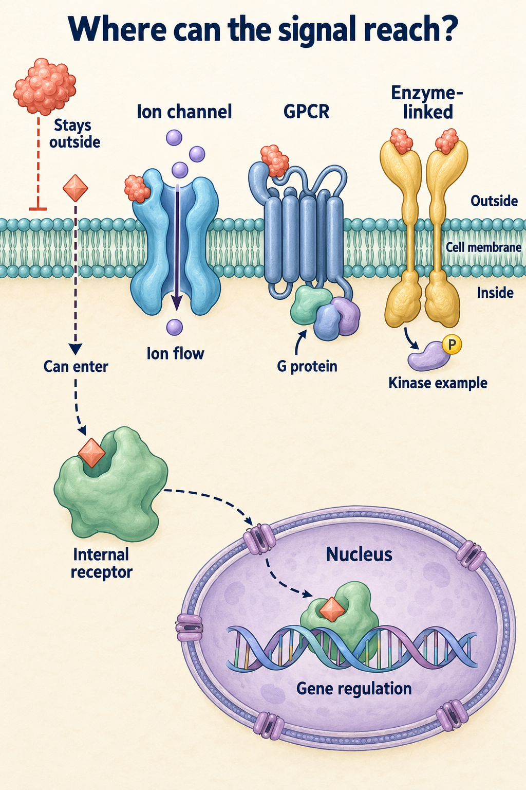
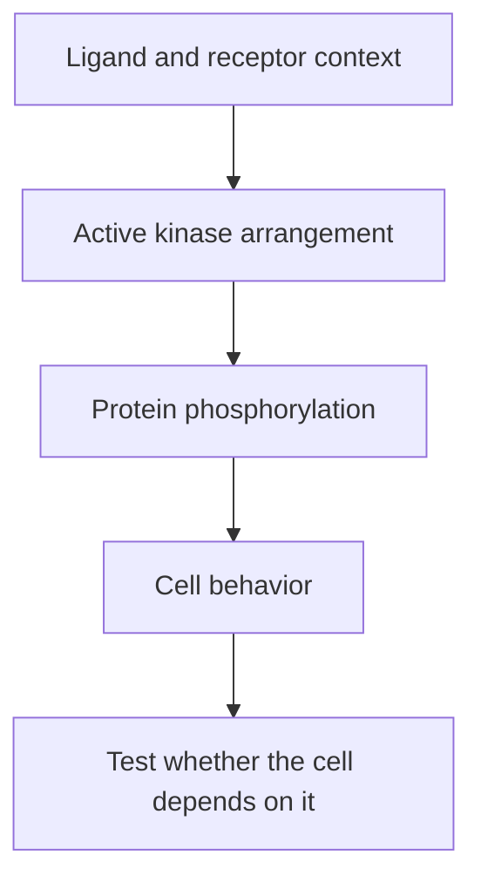

# Receptor tyrosine kinases: turning a surface signal into protein phosphorylation

## In one sentence

Receptor tyrosine kinases are membrane receptors whose intracellular kinase machinery transfers phosphate groups to proteins to transmit a signal.

## The intuition

Think of a door sensor connected to several machines inside a workshop. Detecting a visitor can start the machinery, but having more sensors does not prove the machinery is running. The analogy stops at the wiring: receptors are flexible proteins, and their partners and chemical modifications control the signal.

## How it works

Locate the paired kinase example: ligand-binding regions are outside, each chain crosses the cell membrane, and kinase machinery lies inside. This is one selected arrangement; different receptor tyrosine kinase families activate differently. Amount, phosphorylation and growth dependence remain separate observations. <a href="https://pubmed.ncbi.nlm.nih.gov/16777603/">EGFR asymmetric-kinase mechanism</a>.

A [ligand](/wiki/education/concepts/biology-basics/signaling/ligand-and-receptor) is a binding partner. Many receptor tyrosine kinases, often shortened to **RTKs**, have a ligand-binding region outside the cell, a membrane-spanning region, and kinase machinery inside. A **kinase** transfers a phosphate group; a tyrosine kinase acts on tyrosine, one amino acid in proteins.

Ligand binding can bring receptors into an active arrangement. In the **epidermal growth factor receptor (EGFR)** family, an asymmetric interaction between kinase domains helps activate the machinery. Different receptor families use different arrangements. Activation is not simply one universal phosphorylation switch.

Activated receptors can phosphorylate tyrosines on themselves and other proteins. These changes create binding sites or alter protein function. Several intracellular branches can then change growth, survival or metabolism. One is the [RAS–RAF–MEK–ERK growth-signal relay](/wiki/education/concepts/cancer-biology/signaling-pathways/mapk-ras-raf), a mitogen-activated protein kinase (MAPK) cascade. Its downstream state does not uniquely identify the receptor that initiated it. [Phosphoproteomics](/wiki/education/concepts/measurement/proteins-and-spatial/phosphoproteomics) measures sampled phosphorylation sites; a single downstream site does not identify which receptor supplied the signal.

**Fibroblast growth factor receptors (FGFRs)** provide another example. Their ligand interactions can involve helper molecules. Primary structural work used FGF, FGFR and heparin to study receptor assembly; related heparan-sulfate molecules occur on cells and in surrounding tissue. Ligand supply, receptor family member and cellular context all matter.

*The signal can be measured at several steps; dependence requires a separate experiment.*

## Why it matters in cancer

Cancer can alter receptor sequence, copy number, ligand supply or downstream regulation. These are different hypotheses.

**HER2 is the RTK that defines a breast cancer subtype.** HER2 (gene name ERBB2) belongs to the EGFR family. In a 1987 study of 189 primary breast cancers, the HER2 gene was amplified, present in 2 to more than 20 extra-fold copies, in 30% of tumors, and amplification predicted earlier relapse and shorter survival. [Slamon 1987](https://pubmed.ncbi.nlm.nih.gov/3798106/). Too many copies put too many receptors on the cell surface, which keeps growth signaling switched on. The antibody trastuzumab, which binds HER2, added to first-line chemotherapy lengthened median survival from 20.3 to 25.1 months in a randomized trial in HER2-overexpressing metastatic breast cancer. [Slamon 2001](https://pubmed.ncbi.nlm.nih.gov/11248153/). "Triple-negative" means the tumor lacks the estrogen and progesterone receptors and does not overexpress or amplify HER2; low-level HER2 staining can still be present. See [HER2](/wiki/education/concepts/breast-cancer/receptors-and-subtypes/her2) for how HER2 is scored, including the HER2-low categories.

The HER2 story also shows the limits of each measurement: the gene count, the amount of surface protein and the dependence of the cell on the signal are three separate questions, and the drug works only where the cell actually depends on it.

A drug also has its own target profile. A compound described as an “FGFR inhibitor” need not inhibit each FGFR equally at the tested exposure. Confirm engagement of the actual receptor before interpreting growth. Lower receptor phosphorylation supports a biochemical effect; selective killing and patient benefit require additional evidence.

## How it is measured

| Question | Useful research measurement | Limit |
|---|---|---|
| Is the receptor present? | Protein staining, with cell identity and location | Total amount is not activation |
| Is the circuit responding? | Receptor and downstream phosphorylation, before and after a defined signal | Sites can have several upstream causes |
| Is it needed? | Genetic perturbation and an independent inhibitor, followed by growth/death and restoration controls | A model dependence is not a clinical result |

Fixed tissue can support validated staining. Phosphorylation experiments need suitable preservation; live perturbations consume viable cells or models. Outputs may be staining scores or normalized phosphosite signals. There is no universal RTK-positive cutoff that selects a medicine. Specify the assay, receptor, exposure, comparator and validation context.

## Common confusions

- **RNA versus surface protein:** a message does not establish accessible receptor protein.
- **Amount versus activity:** many receptors can be present without an active circuit.
- **Activity versus dependence:** a cell can keep growing after one signal falls.
- **Family name versus exact target:** receptor members, variants and drug profiles are not interchangeable.

## Try it

Two fictional breast cancer cell lines both carry the receptor gene for HER2. Line 1 has the gene amplified and very high surface HER2; line 2 has two normal copies and low surface HER2. A HER2-blocking antibody lowers HER2 phosphorylation in both, but slows growth only in line 1. What does that tell you?

Show answer

Line 1 depends on HER2 signaling; line 2 has the receptor but does not need it to grow. Lower phosphorylation shows the drug reached its target in both, which is a biochemical effect, not dependence. Amount, activity and dependence are three separate observations, and only the third predicts a growth response in these cells.

## Explain it back

“Receptor amount tells me ___; phosphorylation helps test ___; dependence requires ___.”

One answer: “what is present; the signaling state; an attributed functional effect.”

## Takeaway

**Name the receptor, locate the active step, and test its importance before drawing a drug-response conclusion.**

## Related concepts

- [HER2](/wiki/education/concepts/breast-cancer/receptors-and-subtypes/her2), the RTK measured in every breast cancer pathology report.
- [PI3K–AKT–mTOR](/wiki/education/concepts/cancer-biology/signaling-pathways/pi3k-akt-mtor), a downstream signaling network.
- [Notch signaling](/wiki/education/concepts/cancer-biology/signaling-pathways/notch-signaling), which uses receptor cleavage rather than an RTK mechanism.
- [Ex vivo drug screening](/wiki/education/concepts/measurement/functional-models/ex-vivo-drug-screen), for functional evidence and its limits.

## Sources

Source check: November 7, 2026; expert and learner review pending. The practice culture is fictional. Structural and model experiments do not establish clinical selection.

- [Stauber et al., 2000: FGF–FGFR structural interactions](https://pubmed.ncbi.nlm.nih.gov/10618369/).
- [Zhang et al., 2006: EGFR kinase activation through an asymmetric dimer](https://pubmed.ncbi.nlm.nih.gov/16777603/).
- [Slamon et al., 1987: HER2 amplification in 30% of 189 primary breast cancers and its association with relapse and survival](https://pubmed.ncbi.nlm.nih.gov/3798106/).
- [Slamon et al., 2001: trastuzumab plus chemotherapy in HER2-overexpressing metastatic breast cancer](https://pubmed.ncbi.nlm.nih.gov/11248153/).

<!-- BEGIN GENERATED USED IN -->
## Used in

- [Notch, Wnt, and FGFR: locate the signal before choosing a target](/wiki/education/molecular-profiling/evee-pathways/03-notch-wnt-and-fgfr)
<!-- END GENERATED USED IN -->
