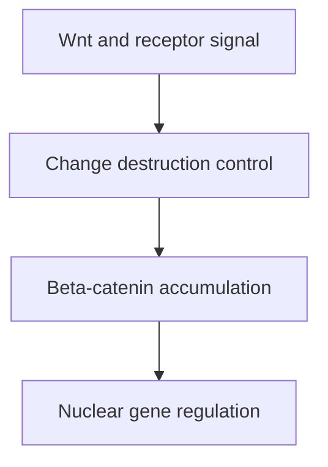

# Wnt–β-catenin: signaling through controlled protein stability

## In one sentence

Canonical Wnt signaling changes the control of β-catenin breakdown, allowing β-catenin to help regulate gene expression.

## The intuition

Imagine a message carrier that is normally removed quickly. A signal lets more of the carrier remain and reach a control room. In canonical Wnt signaling, regulated β-catenin stability helps carry the message. β-catenin also has a separate role at cell junctions, so its location matters.

## How it works

**Wnt ligands** are secreted signaling proteins. In canonical signaling, they engage Frizzled and low-density lipoprotein receptor-related protein 5 or 6 (**LRP5/6**) as co-receptor machinery. Primary LRP6 experiments demonstrated this partner role. This changes how the cell handles the protein β-catenin.

Without an effective Wnt signal, a **destruction complex** helps phosphorylate β-catenin and mark it for ubiquitin-dependent degradation. Phosphorylation means attaching a phosphate group. Proteins including Axin and adenomatous polyposis coli (APC) organize this regulation. Experiments identified sequential kinase steps that prepare β-catenin for destruction. [Liu 2002](https://pubmed.ncbi.nlm.nih.gov/11955436/).

With canonical Wnt signaling, β-catenin can accumulate and enter the nucleus, where it works with transcription-regulating proteins. This can change genes involved in cell identity and growth. Wnt proteins can also signal through routes that do not use β-catenin; this page concerns the canonical route.

**Porcupine (PORCN)** is an enzyme that supplies a lipid modification needed for proper Wnt secretion. Inhibiting this upstream step can reduce ligand-dependent signaling. It need not overcome a downstream alteration that keeps β-catenin active without the ligand.

*An upstream signal and a downstream escape from destruction can lead to similar outputs.*

## Why it matters in cancer

A cancer may alter the ligand supply, receptor system, destruction complex, or another regulatory step. These alterations are not interchangeable. The intervention has to fit where the signal originates and what keeps it active.

A fall in a pathway-responsive transcript can establish a biochemical response. It does not establish that the tumor shrinks or that normal tissues can tolerate the intervention.

## A worked example

Two fictional cultures have nuclear β-catenin. Culture A loses the signal when Wnt ligand secretion is blocked. Culture B retains it because a downstream control is disrupted in the model.

A supports an upstream ligand-dependent hypothesis. B points toward a different source of activation. Neither finding alone demonstrates selective killing. Measuring viability and using independent controls remain separate tasks.

## Common confusions

- **All Wnt versus canonical Wnt:** β-catenin is not the readout for every Wnt route.
- **Total versus nuclear β-catenin:** the protein also participates in cell adhesion.
- **Pathway activity versus ligand dependence:** a downstream change can bypass an upstream intervention.
- **Target engagement versus response:** altering a transcript is not the same outcome as improving patient health.

## How it is measured

Research assays can examine β-catenin localization, responsive transcripts such as AXIN2, and transcriptional reporters. Compare before and after a defined perturbation. Staining consumes tissue sections; RNA assays consume extracted material; reporters and perturbations need viable models. Outputs include nuclear staining, RNA counts or relative reporter activity. Each readout has limits, including cell composition and effects on transcription more broadly. No universal Wnt-high cutoff predicts a drug response; specify the assay and model validation. A phase I WNT974 study illustrates why tissue target engagement and clinical response must be reported separately. [Rodon 2021](https://pubmed.ncbi.nlm.nih.gov/33941878/).

## Try it

A fictional model has lower AXIN2 RNA after secretion blockade, but unchanged viable-cell growth. Which step in the claim chain remains unsupported?

**Answer:** The RNA change supports a pathway output effect, with suitable controls. It does not establish growth dependence or clinical benefit. A downstream activation mechanism and general transcription effects also need evaluation.

## Explain it back

“Canonical Wnt affects ___; secretion blockade tests ___; a response prediction still needs ___.”

One answer: “β-catenin regulation; an upstream ligand-dependent route; functional and clinical evidence.”

## Takeaway

**Identify whether the signal still needs its upstream ligand before judging an upstream intervention.**

## Related concepts

[Ubiquitin and the proteasome](/wiki/education/concepts/cancer-biology/cell-death-and-survival/ubiquitin-and-proteasome) explains protein turnover. [Notch signaling](/wiki/education/concepts/cancer-biology/signaling-pathways/notch-signaling) supplies a neighboring developmental pathway. [The signaling lesson](/wiki/education/molecular-profiling/evee-pathways/03-notch-wnt-and-fgfr) compares where different interventions act.

## Sources

Source check: 2026-10-09. General mechanism education; the worked example is fictional. Expert and learner review pending.

- [Tamai 2000: LRP6 as a Wnt co-receptor](https://pubmed.ncbi.nlm.nih.gov/11029007/).
- [Liu 2002: sequential phosphorylation and β-catenin degradation](https://pubmed.ncbi.nlm.nih.gov/11955436/).
- [van Noort 2002: Wnt and β-catenin phosphorylation](https://pubmed.ncbi.nlm.nih.gov/11834740/).
- [Takada 2006: PORCN-dependent lipid modification and Wnt secretion](https://pubmed.ncbi.nlm.nih.gov/17141155/).
- [Rodon 2021: WNT974 phase I target-engagement and response measurements](https://pubmed.ncbi.nlm.nih.gov/33941878/).

<!-- BEGIN GENERATED USED IN -->
## Used in

- [Notch, Wnt, and FGFR: locate the signal before choosing a target](/wiki/education/molecular-profiling/evee-pathways/03-notch-wnt-and-fgfr)
- [Pathway mechanisms: a supporting lesson library](/wiki/education/molecular-profiling/evee-proposed-pathways)
<!-- END GENERATED USED IN -->
