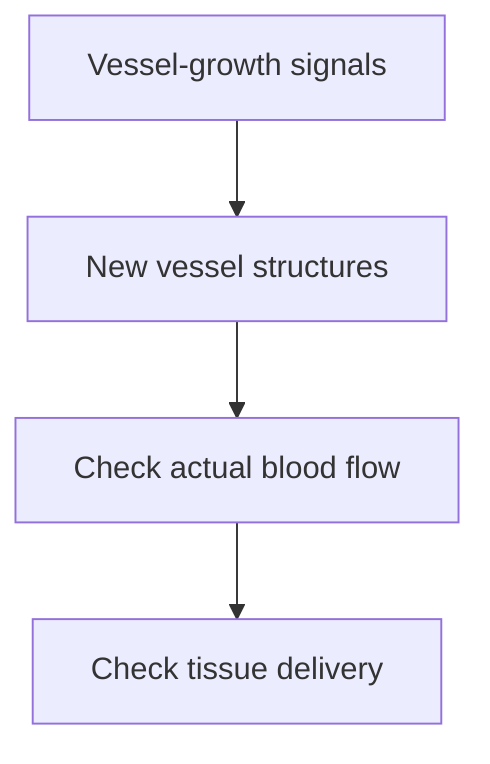

# Angiogenesis: new vessels and the flow question

## In one sentence

Angiogenesis is the growth of new blood vessels from existing vessels, a process that can support both normal tissue repair and tumor growth.

## The intuition

A growing neighborhood may need new roads. But counting roads does not tell you whether traffic moves along them. New vessels and useful blood flow are similarly different questions.

The analogy has a limit: vessels are living structures with signaling, permeability and pressure. They are not passive pipes. Changing vessel growth can change delivery in more than one direction.

## How it works

**Endothelial cells** line blood vessels. During angiogenesis, signals can prompt them to grow, migrate and organize new vessel structures. **Vascular endothelial growth factor (VEGF)** is one signaling family involved. VEGF binding to its receptors activates responses in endothelial cells. Other signals and neighboring support cells also matter. [NCI's explanation](https://www.cancer.gov/about-cancer/treatment/types/immunotherapy/angiogenesis-inhibitors-fact-sheet) introduces this process.

Angiogenesis occurs in development and healing as well as cancer. Tumors can produce vessel-growth signals or influence neighboring cells to produce them. Yet studied tumors can also use existing vessels, called **vessel co-option**. Angiogenesis is therefore one route to a blood supply, not the only possible route in every tumor. [Holash et al., 1999](https://pubmed.ncbi.nlm.nih.gov/10373119/).

Tumor vessels can be irregular, leaky or poorly supported. **Perfusion** means blood actually flowing through tissue. Vessel density, permeability and perfusion are related but distinct. Tissue oxygenation also depends on diffusion distance and oxygen consumption; seeing vessels does not rule out [hypoxia](/wiki/education/concepts/cancer-biology/tumor-microenvironment/hypoxia).

The final two arrows are assessment steps, not a guarantee that new vessels improve delivery.

Blocking VEGF signaling can reduce vessel formation. Under some experimental conditions it also prunes immature vessels and improves the structure or function of remaining vessels: **vascular normalization**. Too much vessel loss or a different exposure can instead impair supply. There is no universal dose, timing window or outcome implied by the word “normalization.”

## Why it matters in cancer

Blood vessels influence oxygen, nutrient and drug delivery, and provide routes that cells can enter or leave. An antiangiogenic treatment therefore changes part of the [tumor microenvironment](/wiki/education/concepts/cancer-biology/tumor-microenvironment/tumor-microenvironment), rather than simply switching all cancer cells off.

Primary experiments illustrate the nuance. Tong and colleagues studied VEGFR2 blockade and transport into tumors. Winkler and colleagues studied a temporary normalization window and radiation response in mouse brain-tumor models. These studies support mechanisms under their tested conditions, not a schedule or benefit prediction for another cancer. [Tong et al., 2004](https://pubmed.ncbi.nlm.nih.gov/15172975/), [Winkler et al., 2004](https://pubmed.ncbi.nlm.nih.gov/15607960/).

## Common confusions

- **Vessel growth versus blood flow:** structures can exist without adequate local perfusion.
- **VEGF expression versus dependence:** a signal's presence does not show that blocking it will help.
- **Normalization versus removal:** improving selected vessel functions is different from eliminating the entire blood supply.
- **“Starving the tumor” versus clinical benefit:** an appealing metaphor does not establish treatment efficacy, selectivity or safety.

## How it is measured

Tissue staining can estimate vessel density in a selected area, often as vessels per square millimeter under specified counting rules. Imaging can assess contrast delivery and exchange under a particular acquisition and model. Those outputs are not interchangeable with oxygen measurements.

Keep tissue site, time, treatment exposure, area denominator and method beside the result. A VEGF RNA level is an expression readout, not a direct vessel-growth or perfusion measurement. Showing benefit requires treatment-specific clinical comparisons beyond these biological readouts.

## Try it

In a fictional experiment, vessel counts fall after an intervention while tracer delivery into the sampled tumor improves. Is that impossible?

**Answer:** no. Fewer vessels and better delivery can coexist if the remaining vessels function differently. The observation needs its actual transport measurement and controls. It does not prove that the intervention improves survival or that all tumors would respond similarly.

**Explain it back:** why would you measure flow as well as vessel number?

**Takeaway:** angiogenesis concerns vessel growth; delivery and treatment benefit each need their own evidence.

## Related concepts

- [Hypoxia](/wiki/education/concepts/cancer-biology/tumor-microenvironment/hypoxia)
- [Extracellular matrix](/wiki/education/concepts/cancer-biology/tumor-microenvironment/extracellular-matrix)

## Sources and scope

Source check: October 10, 2026. General vessel biology and selected preclinical mechanisms; no individual treatment recommendation. Expert and learner review remain pending.

- [NCI: angiogenesis inhibitors](https://www.cancer.gov/about-cancer/treatment/types/immunotherapy/angiogenesis-inhibitors-fact-sheet) — official introduction to endothelial signaling and the treatment category; the dated product inventory is not reproduced here.
- [Holash et al., 1999](https://pubmed.ncbi.nlm.nih.gov/10373119/) — co-option, regression and subsequent angiogenesis in studied tumor models.
- [Tong et al., 2004](https://pubmed.ncbi.nlm.nih.gov/15172975/) — VEGFR2 blockade, vessel function and molecular transport in experimental tumors.
- [Winkler et al., 2004](https://pubmed.ncbi.nlm.nih.gov/15607960/) — normalization and radiation response in studied mouse brain-tumor models.

<!-- BEGIN GENERATED USED IN -->
## Used in

- [The journey through a solid tumor](/wiki/education/cellular-therapies/08-solid-tumor-barriers)
- [Understand how the immune system recognizes cancer](/wiki/education/guides/how-the-immune-system-fights-cancer/index)
<!-- END GENERATED USED IN -->
