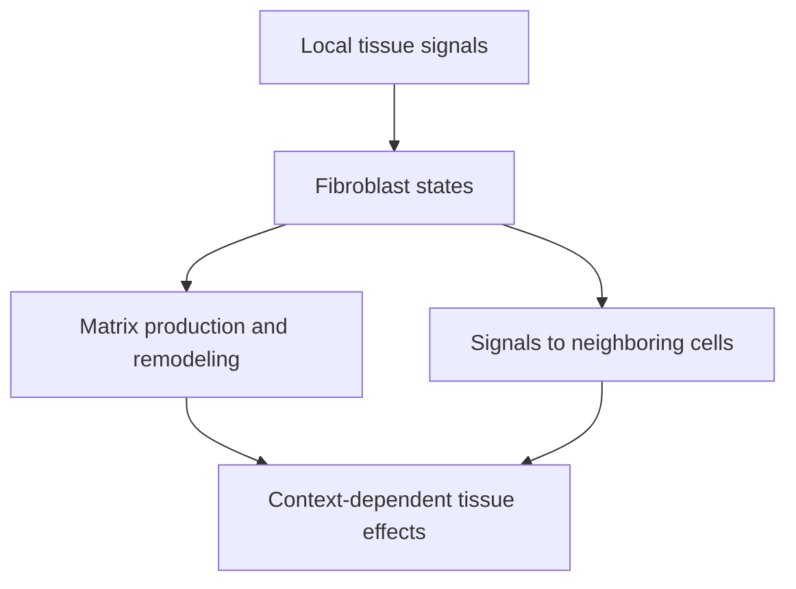

# Cancer-associated fibroblasts: support cells within tumor stroma

## In one sentence

Cancer-associated fibroblasts are fibroblast cells in a tumor's surrounding tissue that can shape its matrix, signals and interactions with other cells.

## The intuition

Picture a neighborhood's builders and maintenance workers. They shape paths, repair structures and exchange messages with nearby residents. Their effects depend on what they build and where they work. The analogy has limits: fibroblasts are diverse cells, and a tumor changes their states through biological signals rather than instructions.

## How it works

**Stroma** is the supporting tissue around and between other tissue structures. It includes [extracellular matrix](/wiki/education/concepts/cancer-biology/tumor-microenvironment/extracellular-matrix), vessels and several cell populations. Stroma is not synonymous with fibroblasts, and a stromal signal is not automatically a malignant-cell signal.

**Fibroblasts** help produce and remodel connective tissue. In tumors, cancer-associated fibroblasts, often shortened to **CAFs**, can deposit matrix, alter its organization and exchange signals with cancer, immune and vascular cells. They are generally distinct from the malignant epithelial cells in many solid tumors.

CAFs are not one uniform cell type with a single universal marker. Their origins and states vary. Primary pancreatic-cancer work identified myofibroblastic cells near tumor structures and inflammatory fibroblasts farther away. Those categories were defined in that context; they are not an exhaustive classification for every breast tumor.

Fibroblast states can respond to neighboring cells and local conditions. A marker labels a feature under an assay definition, not necessarily a permanent lineage or one fixed function. Cell location and combinations of measurements matter.

*Fibroblast amount does not identify the direction of its effect.*

## Why it matters in cancer

Some fibroblast activities can support tumor growth or alter immune-cell access. Others can restrain progression in particular contexts. In one pancreatic mouse model, removing selected myofibroblasts worsened disease and immunosuppression. That finding does not establish the same effect in all tumors; it does invalidate the assumption that removing every CAF is necessarily helpful.

Similarly, dense matrix can influence T-cell movement, but “many fibroblasts” does not prove **immune exclusion**, a spatial pattern in which immune cells remain outside malignant-cell regions. Demonstrate location and investigate the mechanism. A fibroblast-rich breast sample cannot inherit a barrier conclusion from a human lung-slice experiment without further evidence.

## How it is measured

| Field | What to document |
|---|---|
| Input and tissue cost | Fixed tissue sections or appropriately prepared cells; spatial and dissociation methods consume material |
| Outputs | Defined marker-positive cells, cell density, cell states and location relative to tumor structures |
| Controls | Marker combinations, morphology, cell identification, sampled regions and assay specificity |
| Thresholds and validation | No universal CAF-high cutoff determines function or treatment benefit; specify the classification and validation context |
| Limits | Bulk RNA may reflect more cells or different expression per cell; one marker does not identify every fibroblast or its effect |

[Multiplex immunofluorescence](/wiki/education/concepts/measurement/proteins-and-spatial/multiplex-immunofluorescence) can help locate cell populations. Dissociated-cell measurements lose some spatial information. Functional experiments need controlled models and cannot reproduce every feature of the original tissue.

## Common confusions

- **Stroma versus CAFs:** the tissue compartment is broader than one cell population.
- **Fibroblast abundance versus activity:** more cells need not mean the same matrix or signaling function.
- **Dense collagen versus immune exclusion:** cell location and migration require their own evidence.
- **Cancer-associated versus uniformly cancer-promoting:** effects vary by state and setting.

## Try it

A fictional breast section contains many fibroblast-like cells and abundant collagen. No immune-cell locations were scored. May the researcher call the tumor immune-excluded?

**Answer:** No. The observations describe a stromal feature. Map immune and malignant-cell regions with suitable controls. Then test whether matrix, signaling or another process explains any spatial pattern.

## Explain it back

“CAFs are part of ___; their effect depends on ___ rather than ___ alone.”

One answer: “stroma; their state and tissue context; their abundance.”

## Takeaway

**Identify the fibroblast state, location and measured function before assigning a tumor-promoting or immune-blocking role.**

## Related concepts

- [Hypoxia](/wiki/education/concepts/cancer-biology/tumor-microenvironment/hypoxia), for local oxygen stress.
- [Bulk RNA sequencing](/wiki/education/concepts/measurement/transcriptomics/bulk-rna-seq), for mixed-cell signals.

## Sources

Source check: October 9, 2026; expert and learner review pending. The exercise is fictional. Pancreatic and lung findings retain their disease and model boundaries.

- [Sahai et al., 2020: a consensus framework for CAF heterogeneity](https://pubmed.ncbi.nlm.nih.gov/31980749/).
- [Öhlund et al., 2017: distinct fibroblast populations in pancreatic cancer](https://pubmed.ncbi.nlm.nih.gov/28232471/).
- [Özdemir et al., 2014: effects of selected myofibroblast depletion in pancreatic models](https://pubmed.ncbi.nlm.nih.gov/24856586/) ([2015 correction](https://doi.org/10.1016/j.ccell.2015.11.002)).
- [Salmon et al., 2012: matrix architecture and T-cell movement in human lung-tumor slices](https://pubmed.ncbi.nlm.nih.gov/22293174/).

<!-- BEGIN GENERATED USED IN -->
## Used in

- [See what is inside a tissue sample](/wiki/education/multi-omics-foundations/01-epithelial-and-breast-tissue)
<!-- END GENERATED USED IN -->
