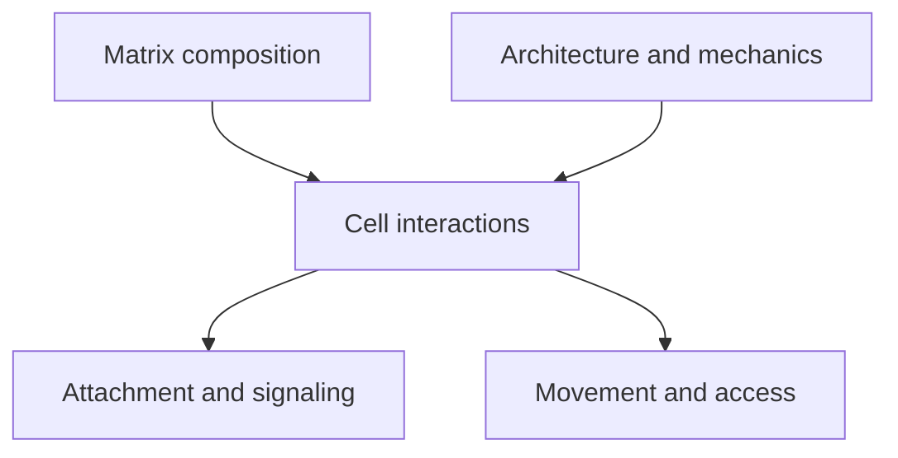

# Extracellular matrix: the material between cells

## In one sentence

The extracellular matrix is a network of molecules outside cells that provides structure and influences how cells attach, move and receive signals.

## The intuition

Imagine a neighborhood's scaffolding, paths and surfaces. Their arrangement shapes how people move and what they can reach. Counting bricks alone does not describe the routes. The analogy has limits: matrix molecules also bind cell receptors and signaling molecules, and cells continually rebuild the material.

## How it works

The **extracellular matrix (ECM)** contains structural proteins such as collagen and fibronectin, together with other proteins and carbohydrate-rich molecules. Its composition differs across tissues and locations. A thin basement membrane and a broader connective-tissue network are related forms of matrix, not identical structures.

[Fibroblasts](/wiki/education/concepts/cancer-biology/tumor-microenvironment/cancer-associated-fibroblasts-and-stroma) are important producers and remodelers, but other cells contribute too. Production, enzymatic breakdown and crosslinking change matrix amount and organization over time.

Cells connect to matrix through receptors such as **integrins**. These connections can transmit chemical and mechanical information. In studied breast models, collagen crosslinking increased stiffness and altered signaling and invasion. This is evidence for a mechanism in those systems, not a rule that every collagen-rich specimen behaves alike.

Matrix can provide routes for movement or restrict them. Fiber orientation, pore structure, density and cell behavior all matter. Human lung-tumor slices showed T cells moving differently in loose and dense regions. “Matrix is a wall” misses both useful paths and barriers.

*Amount, architecture and mechanical properties are separate measurements.*

## Why it matters in cancer

Matrix remodeling can alter tissue shape, cancer-cell invasion and immune-cell positioning. These processes interact with tumor and stromal signals. A matrix observation supplies a biological hypothesis; it does not by itself identify the cause of immune exclusion or predict a response to treatment.

The same caution applies to **stiffness**, a material's resistance to deformation. Collagen abundance is not a direct stiffness measurement. Crosslinking, organization and other material components affect mechanics. A bulk collagen RNA signal is several steps further from a mechanical result.

## How it is measured

| Field | What to document |
|---|---|
| Input and tissue cost | Fixed sections for stains or imaging; fresh or otherwise suitable tissue for mechanical and live-migration experiments |
| Outputs | Stained area, fiber orientation, local architecture or stiffness in specified mechanical units |
| Controls | Region selection, tissue preparation, image method, loading conditions and cell identity |
| Thresholds and validation | No universal ECM-high cutoff establishes exclusion or benefit; define the feature, assay and validation context |
| Limits | A stain does not directly measure migration or stiffness; an RNA profile does not establish matrix architecture |

A mechanical method may report elastic modulus in pascals, but results depend on scale, preparation and measurement conditions. Distinguish a local measurement from a whole-tumor description. Live-cell imaging can test movement under defined conditions and consumes viable material.

## Common confusions

- **ECM versus cells:** the matrix lies outside cells; its producers are separate.
- **Amount versus arrangement:** equal collagen area can conceal different fiber patterns.
- **Collagen versus stiffness:** crosslinking and other features also matter.
- **Spatial pattern versus mechanism:** locating T cells outside tumor regions does not prove matrix caused it.

## Try it

Two fictional sections have the same collagen-stained area. One has aligned fibers around malignant-cell regions; the other has a loose network. Can the researcher assume equal cell access?

**Answer:** No. The measured amount matches, but architecture differs. Score cell locations and test movement with appropriate methods. Even then, additional signals may contribute, and no drug response follows automatically.

## Explain it back

“A collagen stain describes ___; stiffness and cell movement need ___.”

One answer: “a sampled matrix feature; their own measurements and controls.”

## Takeaway

**Describe matrix amount, architecture and mechanics separately before explaining what cells can do within it.**

## Related concepts

- [Tumor heterogeneity](/wiki/education/concepts/cancer-biology/what-cancer-is/tumor-heterogeneity), for variation across sampled regions.
- [Multiplex immunofluorescence](/wiki/education/concepts/measurement/proteins-and-spatial/multiplex-immunofluorescence), for mapping cells alongside tissue structures.

## Sources

Source check: October 9, 2026; expert and learner review pending. The exercise is fictional. Experimental findings are scoped to their tissues and models.

- [Levental et al., 2009: collagen crosslinking, mechanics and signaling in breast models](https://pubmed.ncbi.nlm.nih.gov/19931152/).
- [Paszek et al., 2005: matrix stiffness and epithelial signaling](https://pubmed.ncbi.nlm.nih.gov/16169468/).
- [Salmon et al., 2012: matrix architecture and T-cell movement in human lung tumors](https://pubmed.ncbi.nlm.nih.gov/22293174/).

<!-- BEGIN GENERATED USED IN -->
## Used in

- [See what is inside a tissue sample](/wiki/education/multi-omics-foundations/01-epithelial-and-breast-tissue)
<!-- END GENERATED USED IN -->
