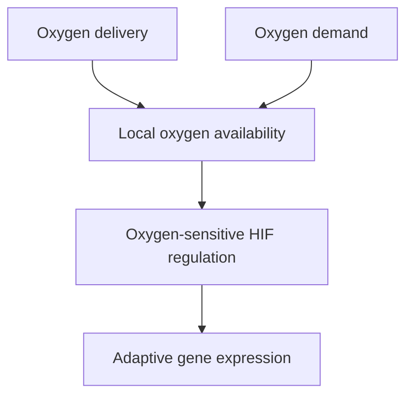

# Hypoxia: oxygen supply falling short of tissue needs

## In one sentence

Hypoxia is a condition in which oxygen availability is insufficient for a tissue's local needs.

## The intuition

Imagine a workshop whose deliveries cannot keep up with local demand. Some rooms may have enough supplies while another runs short. Having roads nearby does not prove deliveries arrive. The analogy helps explain why oxygen supply and demand both matter; tissues exchange gases and respond through chemistry rather than inventory orders.

## How it works

Oxygen reaches tissue through blood flow and then moves toward cells. Delivery, vessel function, diffusion distance and oxygen consumption together influence local availability. A tumor can contain regions with different oxygen conditions, and those conditions can change over time.

**Hypoxia** does not mean complete absence of oxygen. It is also different from a permanent mitochondrial defect. [Oxidative phosphorylation](/wiki/education/concepts/cancer-biology/metabolism-and-stress/oxidative-phosphorylation) requires oxygen, but a tissue's oxygen shortage may arise from supply, demand or both.

Cells adapt partly through **hypoxia-inducible factors (HIFs)**, transcriptional regulators that affect gene expression. HIF-1 includes an oxygen-regulated alpha protein and a partner beta protein. Under suitable oxygenated conditions, enzymes modify the alpha protein, allowing the **von Hippel–Lindau (VHL)** protein complex to mark it for removal.

When oxygen-dependent modification is limited, HIF-alpha can persist and support an adaptive transcriptional program. That program can change metabolism and signals affecting blood-vessel growth. Other molecular changes can also alter HIF regulation. Therefore HIF protein or a hypoxia-associated RNA signature is not a direct oxygen meter.

*Supply, demand and the cellular response are related but require different measurements.*

## Why it matters in cancer

Uneven vessel function and tissue demands can produce local stress. Hypoxia can influence metabolism and other cell behaviors, including interactions with surrounding tissue. It is a feature to investigate in a specific place and time, not a label that predicts every cancer's behavior.

The [Warburg effect](/wiki/education/concepts/cancer-biology/metabolism-and-stress/warburg-effect) describes substantial lactate production with oxygen available. It cannot be used as proof of hypoxia. Conversely, detecting a hypoxia-response program does not establish which nutrient sustains the cells or which process they require for survival.

Changing oxygen in a culture tests that experimental setting. It does not establish that changing a person's oxygen exposure reverses immune exclusion or improves a treatment. Clinical benefit requires disease-specific evidence beyond the proposed mechanism.

## How it is measured

| Field | What to document |
|---|---|
| Input and tissue cost | In-situ oxygen measurements or suitable tissue for response-marker assays; sampled regions and preparation matter |
| Outputs | Local oxygen partial pressure, defined response-protein staining or an explicitly defined RNA signature |
| Controls | Location, time, calibration, handling, cell identity and factors that alter HIF independently of oxygen |
| Thresholds and validation | No universal hypoxia cutoff applies to every method and purpose; specify the endpoint and validated definition |
| Limits | Vessel density is not blood flow; HIF amount is not a direct oxygen concentration; an average can hide poorly oxygenated regions |

Direct physiological measurements and indirect biological-response assays answer different questions. Tissue removal changes delivery conditions. Collection delay can therefore change the state being sampled. Record whether the question concerns the original tissue, a preserved marker or an ex-vivo model.

## Common confusions

- **Hypoxia versus no oxygen:** reduced availability can be enough to trigger responses.
- **Vessels versus delivery:** vessel presence does not demonstrate adequate flow.
- **HIF RNA versus HIF protein regulation:** a message does not show the protein's stability or activity.
- **Hypoxia signature versus personal prognosis:** a research association is not an individual forecast.

## Try it

A fictional biopsy has a high hypoxia-associated RNA score but no direct oxygen measurement. May the researcher assign an exact oxygen level or conclude all regions are hypoxic?

**Answer:** No. The score supports a defined response-pattern observation. Check cell mixture and alternative regulation, then use a suitable spatial or physiological method for the oxygen question.

## Explain it back

“Hypoxia describes ___; a HIF signature measures ___.”

One answer: “local oxygen availability relative to needs; a response program with its own limits.”

## Takeaway

**Keep oxygen availability, adaptive signaling and functional consequences as separate questions.**

## Related concepts

- [Unfolded protein response](/wiki/education/concepts/cancer-biology/metabolism-and-stress/er-stress-and-unfolded-protein-response), for another stress-adaptation program.
- [Cancer-associated fibroblasts](/wiki/education/concepts/cancer-biology/tumor-microenvironment/cancer-associated-fibroblasts-and-stroma), for neighboring-cell context.

## Sources

Source check: October 9, 2026; expert and learner review pending. The exercise is fictional. No oxygen-based treatment recommendation follows from these mechanisms.

- [Wang et al., 1995: HIF-1 components and oxygen-sensitive regulation](https://pubmed.ncbi.nlm.nih.gov/7539918/).
- [Jaakkola et al., 2001: oxygen-dependent HIF modification and VHL recognition](https://pubmed.ncbi.nlm.nih.gov/11292861/).
- [Semenza, 2012: HIF regulation, physiology and disease](https://pubmed.ncbi.nlm.nih.gov/22304911/).

<!-- BEGIN GENERATED USED IN -->
## Used in

- [Oxidative metabolism and stress: energy, damage, and dependence](/wiki/education/molecular-profiling/evee-pathways/05-oxidative-metabolism-and-stress)
<!-- END GENERATED USED IN -->
