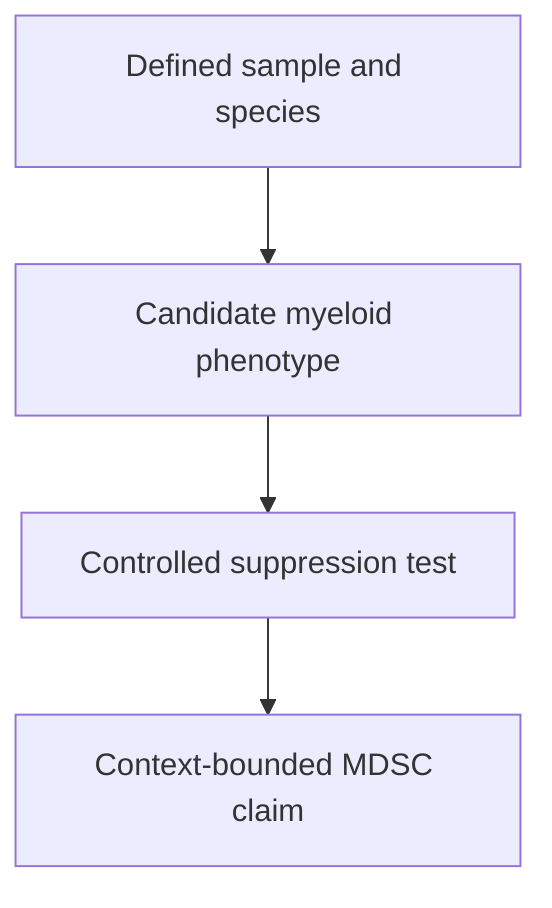

# Myeloid-derived suppressor cells: phenotype plus function

## In one sentence

Myeloid-derived suppressor cells are heterogeneous myeloid-cell populations characterized by immune-suppressive activity together with an appropriate phenotype and biological context.

## The intuition

A uniform may suggest which team someone belongs to. It does not prove what they did during a match. Cell markers work like that: they help identify candidate cells, while a functional test asks whether those cells suppress a response.

The analogy breaks if it makes suppression sound like a permanent personal trait. The measured activity depends on the responding cells, stimulation, cell ratio and conditions. These populations can be heterogeneous and change over time.

## How it works

**Myeloid cells** include monocytes, neutrophils and related immune-cell populations. **Myeloid-derived suppressor cells (MDSCs)** are not one separate developmental lineage with a unique universal marker. The name groups populations studied for suppressive activity in contexts such as cancer and chronic inflammation.

Two major research groups are **monocytic MDSCs (M-MDSCs)** and **polymorphonuclear MDSCs (PMN-MDSCs)**, the latter resembling neutrophils. Phenotype, morphology and tested activity belong together. The characterization standards explicitly distinguish these from **MDSC-like cells** when suppressive function is absent or inadequately established. [Bronte et al., 2016](https://pubmed.ncbi.nlm.nih.gov/27381735/).

Phenotyping rules differ across species and sample preparations. Human blood studies often use CD14 and low [human leukocyte antigen (HLA)-DR](/wiki/education/concepts/immunology/antigen-presentation/hla) expression for monocytic candidates, or CD15/CD66b with other markers for polymorphonuclear candidates. Mouse panels commonly use Ly6C and Ly6G. A mouse gate is not a human definition. Neither “CD11b-positive” nor “CD11b-positive, CD3-negative” alone establishes MDSCs.

The map shows an evidence sequence. A marker result cannot skip the functional question.

Studied suppressive mechanisms include altered amino-acid availability, reactive molecules and inhibitory signaling. Which mechanism matters depends on the cell population and experimental setting. Measuring an enzyme or [ribonucleic acid (RNA)](/wiki/education/concepts/biology-basics/molecules/rna-and-mrna) signature does not demonstrate its activity or the full suppressive effect.

## Why it matters in cancer

MDSCs can restrain immune responses in experimental tumor settings. That helps researchers ask why immune activation or vaccine-induced responses may fail to produce effective tumor control. It does not mean every tumor contains the same suppressor population or that lowering a count improves outcome.

Condamine and colleagues linked the marker LOX-1 to a suppressive human PMN population in studied cancer samples, alongside functional and molecular measurements. It illustrates the value of combining layers; it does not make LOX-1 a universal stand-alone test for every MDSC subtype or cancer. [Condamine et al., 2016](https://pubmed.ncbi.nlm.nih.gov/28417112/).

## Common confusions

- **All neutrophils or monocytes versus MDSCs:** related phenotypes do not establish the same function.
- **A tissue stain versus a suppression test:** location and markers do not directly measure an effect on responding cells.
- **Blood frequency versus tissue burden:** sample compartments and denominators differ.
- **A lower count versus clinical benefit:** treatment effects and clinical outcomes require separate evidence.

## How it is measured

A research assay pairs [flow cytometry](/wiki/education/concepts/measurement/immune-monitoring/flow-cytometry) or another cell-identification method with a functional readout. Report species, sample, preparation, gating and whether the result is a fraction of recovered cells or an absolute concentration.

For a T-cell suppression experiment, record candidate-cell purity and viability, stimulated T cells alone, suitable comparator myeloid cells, cell ratios and incubation time. Outputs may include the fraction of T cells dividing or cytokine production relative to controls. Poor T-cell stimulation or cell death can mimic reduced activity. Density separation, freezing and sorting can change recovery, particularly for granulocytic populations. [Assay recommendations](https://pubmed.ncbi.nlm.nih.gov/29785656/) explain these limitations. No universal clinical cutoff follows from the assay category.

## Try it

A fictional abstract reports fewer CD11b-positive, CD3-negative blood cells after a procedure. Can you call this removal of suppressive MDSCs?

**Answer:** not from that gate alone. It describes a broad reported phenotype. Subset characterization, sampling denominator and a relevant suppression test are missing. Even a confirmed change in suppressive cells would not by itself establish clinical efficacy.

**Explain it back:** why does the word “suppressor” require more than a marker label?

**Takeaway:** identify the population and test its activity before interpreting an MDSC count as a mechanism.

## Related concepts

- [Tumor-associated macrophages](/wiki/education/concepts/cancer-biology/tumor-microenvironment/tumor-associated-macrophages)
- [Regulatory T cells](/wiki/education/concepts/immunology/t-cells/regulatory-t-cells)

## Sources and scope

Source check: October 10, 2026. Research characterization standards and study-specific evidence; not a clinical treatment-selection algorithm. Expert and learner review remain pending.

- [Bronte et al., 2016](https://pubmed.ncbi.nlm.nih.gov/27381735/) — consensus phenotype, function and species-specific characterization standards.
- [Condamine et al., 2016](https://pubmed.ncbi.nlm.nih.gov/28417112/) — primary human PMN-MDSC/LOX-1 experiments in studied cancer samples.
- [Bruger et al., 2018](https://pubmed.ncbi.nlm.nih.gov/29785656/) — functional assay recommendations and control limitations.

<!-- BEGIN GENERATED USED IN -->
## Used in

- [The journey through a solid tumor](/wiki/education/cellular-therapies/08-solid-tumor-barriers)
- [Understand how the immune system recognizes cancer](/wiki/education/guides/how-the-immune-system-fights-cancer/index)
- [Read an immune map without overreading it](/wiki/education/reading-a-tumor/immune-hot-vs-cold)
<!-- END GENERATED USED IN -->
