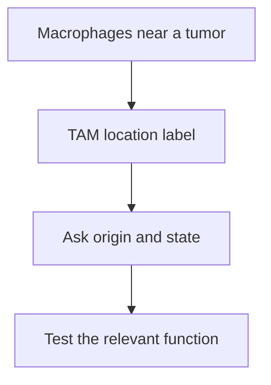

# Tumor-associated macrophages: location does not fix function

## In one sentence

Tumor-associated macrophages are macrophages found within or around tumor tissue, whose origins, states and functions can differ across settings.

## The intuition

Calling someone a hospital worker tells you where they work, not whether they are a nurse, cleaner or laboratory technician. “Tumor-associated” similarly tells you where macrophages are found. It does not finish the description of their job.

The analogy breaks because a macrophage can perform several activities and change them over time. A location label is useful, but we still need to ask what these cells do under the observed conditions.

## How it works

**Macrophages** engulf material and participate in defense, repair and tissue maintenance. In a tumor, **tumor-associated macrophages (TAMs)** interact with cancer cells, immune cells, fibroblasts and vessels.

Their origins need not be identical. Some arise from recruited **monocytes**, circulating myeloid cells that can develop into macrophages. Others can come from resident populations already established in tissue. In studied mouse pancreatic-cancer models, Zhu and colleagues traced both monocyte-derived and tissue-resident contributions, including embryonically established macrophages. That is evidence against assuming one origin for all TAMs; it is not a census of every human tumor. [Zhu et al., 2017](https://pubmed.ncbi.nlm.nih.gov/28813661/).

Their [states](/wiki/education/concepts/immunology/innate-and-unconventional-cells/macrophage-states) depend on local signals and history. Possible activities include engulfing dead cells, presenting antigens, remodeling matrix, influencing vessel growth or altering other immune cells' responses. Not every TAM performs every activity. The same broad activity can have different consequences in different settings.

Location, origin, state and function are four questions rather than interchangeable names.

Some experimental TAM populations suppress T-cell responses or support tumor progression. Others can participate in tumor-cell clearance under particular conditions. In a pancreatic-cancer mouse model, CD40 stimulation produced macrophage-dependent tumoricidal activity and stromal changes. The accompanying small human study did not establish that all human TAMs could be beneficially switched. [Beatty et al., 2011](https://pubmed.ncbi.nlm.nih.gov/21436454/).

## Why it matters in cancer

Macrophages can influence immune access, tissue structure and responses to treatment. Their presence therefore helps organize research questions. It does not select a macrophage-depleting or reprogramming therapy.

An observational association between a macrophage pattern and survival is different from showing that an intervention improves survival. Tissue location, cancer type, treatment exposure and measurement rules can change the meaning of a count. Removing a cell population can also remove useful activities; abundance alone does not establish the balance of effects.

## Common confusions

- **TAM versus M2:** location is not a universal activation state.
- **CD68 or CD163 staining versus suppression:** a marker does not demonstrate the effect on T cells.
- **Blood monocytes versus tissue TAMs:** circulating cells do not supply a direct count of the tumor population.
- **TAMs versus TAM receptors:** the TYRO3, AXL and MERTK receptor family shares the acronym but names proteins, not macrophages.

## How it is measured

[Multiplex tissue imaging](/wiki/education/concepts/measurement/proteins-and-spatial/multiplex-immunofluorescence) can identify selected protein patterns and neighborhoods. Cell-resolved [ribonucleic acid (RNA)](/wiki/education/concepts/biology-basics/molecules/rna-and-mrna) assays describe expression programs. A tissue count should retain panel, cell-classification rules, tumor versus stromal region, area or cell denominator, site and time.

Developmental origin usually needs evidence beyond a single marker, such as lineage-tracing experiments in suitable models. Functional assays ask whether a defined macrophage population changes engulfment, T-cell responses or another activity. Tissue dissociation, viability and culture conditions can alter the recovered population or its behavior.

Human multiplex imaging has shown macrophage-containing neighborhoods in sampled triple-negative breast cancers. It describes tissue organization and associations, not a universal suppression assay. [Keren et al., 2018](https://pubmed.ncbi.nlm.nih.gov/30193111/).

## Try it

A fictional biopsy has more CD163-positive macrophages after treatment. A second experiment finds that isolated cells reduce stimulated T-cell proliferation. Are those the same finding?

**Answer:** no. The biopsy describes a marker-defined tissue population. The experiment tests a particular activity under its culture conditions. Linking them requires matching cell definitions and sampling context. Neither result alone shows that removing these cells would help a patient.

**Explain it back:** what does “tumor-associated” tell you, and what does it leave open?

**Takeaway:** a TAM label locates a macrophage; context and experiments establish its activities.

## Related concepts

- [Macrophage states](/wiki/education/concepts/immunology/innate-and-unconventional-cells/macrophage-states)
- [Myeloid-derived suppressor cells](/wiki/education/concepts/cancer-biology/tumor-microenvironment/myeloid-derived-suppressor-cells)
- [Angiogenesis](/wiki/education/concepts/cancer-biology/tumor-microenvironment/angiogenesis)

## Sources and scope

Source check: October 10, 2026. Mouse origin and intervention experiments and observational human tissue imaging are kept distinct. Expert and learner review remain pending.

- [Zhu et al., 2017](https://pubmed.ncbi.nlm.nih.gov/28813661/) — TAM origins and differing programs in studied mouse pancreatic-cancer models.
- [Beatty et al., 2011](https://pubmed.ncbi.nlm.nih.gov/21436454/) — macrophage mechanism in a pancreatic mouse model, alongside a small human CD40-agonist study.
- [Keren et al., 2018](https://pubmed.ncbi.nlm.nih.gov/30193111/) — human triple-negative breast-cancer immune composition and spatial organization.

<!-- BEGIN GENERATED USED IN -->
## Used in

- [The journey through a solid tumor](/wiki/education/cellular-therapies/08-solid-tumor-barriers)
- [Understand how the immune system recognizes cancer](/wiki/education/guides/how-the-immune-system-fights-cancer/index)
- [Read an immune map without overreading it](/wiki/education/reading-a-tumor/immune-hot-vs-cold)
<!-- END GENERATED USED IN -->
