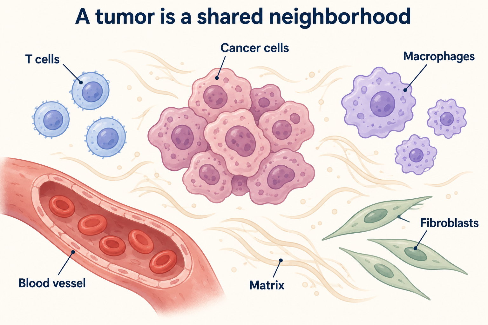
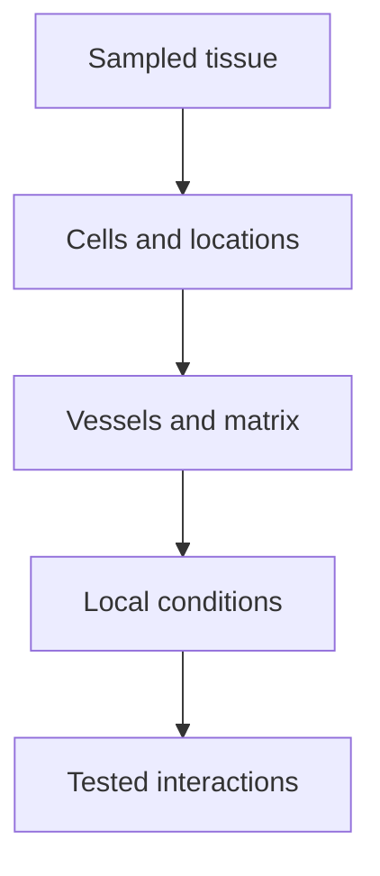

# Tumor microenvironment: the shared tissue setting

## In one sentence

The tumor microenvironment is the local tissue setting in and around a tumor, including neighboring cells, vessels, extracellular material and physical conditions.

## The intuition

Picture one shared neighborhood: cancer cells live beside immune cells, fibroblasts, blood vessels and the material between cells. Each can change conditions for the others. Studying only the cancer cells misses some of that story.

The neighborhood analogy helps you remember interactions. It breaks when it gives cells intentions or permanent jobs. A macrophage is not automatically a villain; a nearby T cell is not automatically attacking cancer. The same cell type can behave differently under different signals.

*The cancer cells and their neighbors are distinct populations; who is present does not establish what each is doing. This schematic does not show measured proportions.*

## How it works

A **malignant clone** is a group of cancer cells descended from a common ancestor. Its genetic changes are one part of tumor biology. The surrounding [stroma](/wiki/education/concepts/biology-basics/cells/epithelium-and-stroma) also contains nonmalignant cells and extracellular material. These neighbors do not become members of that malignant clone merely by being nearby.

The tissue setting has several connected layers:

- **Cells:** immune cells, [fibroblasts](/wiki/education/concepts/cancer-biology/tumor-microenvironment/cancer-associated-fibroblasts-and-stroma) and vessel-lining cells interact with cancer cells.
- **Messages:** [cytokines and chemokines](/wiki/education/concepts/immunology/immune-regulation/cytokine-and-chemokine) change activation, recruitment and other responses.
- **Structure:** the [extracellular matrix](/wiki/education/concepts/cancer-biology/tumor-microenvironment/extracellular-matrix) provides support and influences movement.
- **Conditions:** oxygen, nutrients and waste products vary across regions. [Hypoxia](/wiki/education/concepts/cancer-biology/tumor-microenvironment/hypoxia) describes a local oxygen shortfall.

These are relationships, not a fixed recipe for every tumor. Cancer cells can alter their surroundings, and the surroundings can influence cancer-cell survival, movement and immune access. Different sites, regions and sampling times can show different arrangements.

The arrows guide a sequence of questions. They do not show a causal chain from cell counts to immune function.

## Why it matters in cancer

Human tissue studies can reveal patterns hidden in an average measurement. Keren and colleagues used multiplexed protein imaging in sampled triple-negative breast cancers to describe immune composition and spatial organization. Those observational patterns did not establish a treatment-selection test. [Keren et al., 2018](https://pubmed.ncbi.nlm.nih.gov/30193111/).

Experiments can ask a different question: does changing one component change cell behavior? In viable human lung-tumor slices, matrix structure influenced T-cell positioning and movement. That finding belongs to the studied tissue and experiment; it is not a universal instruction to remove tumor stroma. [Salmon et al., 2012](https://pubmed.ncbi.nlm.nih.gov/22293174/).

## Common confusions

- **Microenvironment versus cancer genome:** neighboring normal cells and physical conditions are not cancer mutations.
- **Composition versus function:** more macrophages or T cells does not establish what they are doing.
- **Spatial closeness versus interaction:** proximity alone does not prove recognition, signaling or killing.
- **One biopsy versus all disease:** a sampled region is a window into a changing tissue ecosystem.

## How it is measured

Start with the question. [Multiplex immunofluorescence](/wiki/education/concepts/measurement/proteins-and-spatial/multiplex-immunofluorescence) measures selected proteins and locations in tissue sections. [Spatial transcriptomics](/wiki/education/concepts/measurement/proteins-and-spatial/spatial-transcriptomics) measures [ribonucleic acid (RNA)](/wiki/education/concepts/biology-basics/molecules/rna-and-mrna) under defined capture and cell-assignment rules. Functional experiments test responses under specified conditions.

A useful report retains site, collection time, treatment exposure, region selection and denominator. Cells per square millimeter and a fraction of all detected cells answer different questions. Dissociation can change which cells are recovered; image segmentation can misassign boundaries. There is no universal “TME score” that establishes treatment benefit.

## Try it

A fictional biopsy contains many macrophages near cancer-cell nests. Its RNA profile has an inflammatory signature. What can you conclude?

**Answer:** the sample shows a macrophage-rich neighborhood and a measured expression pattern. It does not establish which cells produced every RNA signal, whether macrophages suppress T cells, or which treatment would help. Cell-resolved measurements and functional tests address different parts of that uncertainty.

**Explain it back:** how can the cancer genome and the surrounding tissue each matter without being the same measurement?

**Takeaway:** read the tumor as interacting cells and conditions, then ask which interaction the evidence actually measures.

## Related concepts

- [Tumor-associated macrophages](/wiki/education/concepts/cancer-biology/tumor-microenvironment/tumor-associated-macrophages)
- [Angiogenesis](/wiki/education/concepts/cancer-biology/tumor-microenvironment/angiogenesis)
- [Hot, excluded and cold tumor patterns](/wiki/education/concepts/immunology/tumor-immunology/hot-excluded-cold-tumor)

## Sources and scope

Source check: October 10, 2026. This is a tissue-biology foundation, not an individual response forecast. Expert and learner review remain pending.

- [NCI: tumor microenvironment](https://www.cancer.gov/publications/dictionaries/cancer-terms/def/tumor-microenvironment) — official definition of surrounding cells, molecules and vessels.
- [Keren et al., 2018](https://pubmed.ncbi.nlm.nih.gov/30193111/) — observational multiplex imaging in human triple-negative breast-cancer tissue.
- [Salmon et al., 2012](https://pubmed.ncbi.nlm.nih.gov/22293174/) — matrix and T-cell movement in viable human lung-tumor slices.

<!-- BEGIN GENERATED USED IN -->
## Used in

- [The journey through a solid tumor](/wiki/education/cellular-therapies/08-solid-tumor-barriers)
- [How engineered immune cells can attack a solid tumor](/wiki/education/guides/engineered-cell-therapy/index)
- [Understand how the immune system recognizes cancer](/wiki/education/guides/how-the-immune-system-fights-cancer/index)
- [Read each label as an answer to a question](/wiki/education/guides/start-here/01-read-the-labels)
- [Find the step an immune response can lose](/wiki/education/oncology-101/4-escape-mechanisms)
- [Oncology 101: immune foundations](/wiki/education/oncology-101/index)
- [Read an immune map without overreading it](/wiki/education/reading-a-tumor/immune-hot-vs-cold)
<!-- END GENERATED USED IN -->
