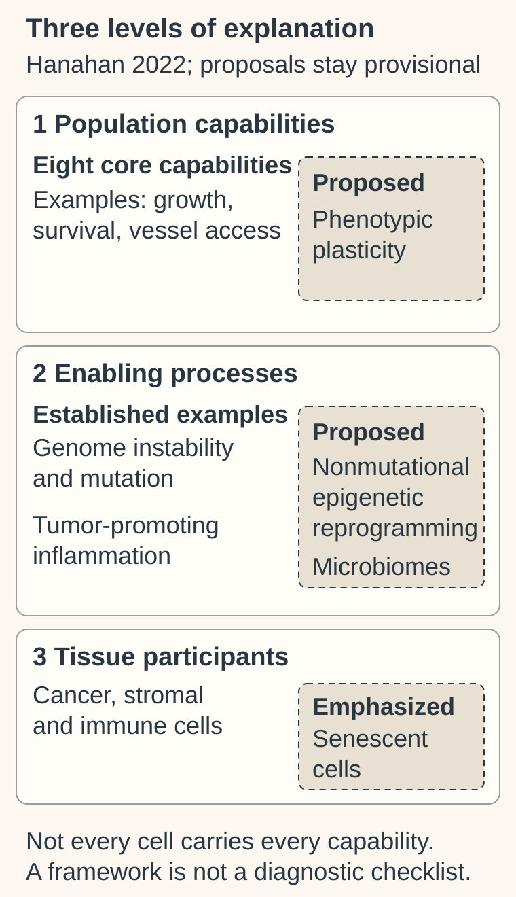

# Hallmarks of cancer: capabilities and enabling processes

## In one sentence

The hallmarks of cancer are a versioned framework that groups cancer's biological capabilities and distinguishes them from processes and tissue conditions that help those capabilities develop.

## The intuition

Think of a workshop. “Keep producing” describes something it can do. “Generate new designs” describes a process that may help it acquire new abilities. “Nearby suppliers” describes its surroundings. Those are connected, but they are different kinds of explanation.

The hallmarks framework makes similar distinctions in cancer biology. Its analogy is organizational, not intentional: cancer cells do not plan a project. It is also a research map, not a checklist for diagnosing one specimen.

**Before you start:** [cancer](/wiki/education/concepts/cancer-biology/what-cancer-is/cancer) introduces altered behavior in tissue context; [oncogenes and tumor suppressors](/wiki/education/concepts/cancer-biology/what-cancer-is/oncogene-and-tumor-suppressor) introduces different gene roles.

## How it works

This original map organizes the 2022 framework by explanatory level. Eight core capabilities are retained in the nearby table; the image gives selected examples. Genome instability/mutation and tumor-promoting inflammation are established enabling characteristics in that version. Dashed boxes keep the 2022 proposals or emphasis attached to their level: phenotypic plasticity, nonmutational epigenetic reprogramming, microbiomes and senescent tissue participants. They are not four equivalent established hallmarks, a diagnostic checklist, or proof that every cell carries every capability.

**Keep the framework's version attached.** The original 2000 proposal described six capabilities. The 2011 update retained those six, proposed two emerging capabilities, and distinguished two enabling characteristics. In the 2022 account, the earlier emerging capabilities had joined the core set. The 2022 paper also proposed additional dimensions for investigation. These are developments in a conceptual framework, not successive clinical test standards. [2011](https://pubmed.ncbi.nlm.nih.gov/21376230/), [2022](https://doi.org/10.1158/2159-8290.CD-21-1059).

The eight core capabilities in the 2022 account can be expressed as questions:

| Capability question | What it asks about |
|---|---|
| Can growth messages stay active? | Signals that support continued growth |
| Can growth restraints be weakened? | Responses to instructions that normally limit growth |
| Can cells survive death signals? | Resistance to cell-death processes |
| Can division capacity persist? | Avoiding limits on repeated cell division |
| Can a population obtain a blood supply? | Making vessels or accessing existing vasculature |
| Can cells invade and colonize elsewhere? | Tissue invasion and distant establishment |
| Can nutrient use change? | Metabolism that supports the population |
| Can useful immune control be avoided? | Escape from immune destruction |

**Enabling characteristics ask a different question: what helps these capabilities emerge?** Genome instability and mutation provide variation. Tumor-promoting inflammation can support growth and other processes. This does not mean all inflammation promotes cancer or every mutation contributes to a capability.

**The 2022 additions are not four equivalent established hallmarks.** The paper proposes changing differentiation programs, or **phenotypic plasticity**, as a capability. It discusses [nonmutational epigenetic reprogramming](/wiki/education/concepts/biology-basics/genetics/epigenetics-and-methylation) and differing microbial communities as possible enabling characteristics. It also emphasizes [senescent cells](/wiki/education/concepts/cancer-biology/cell-death-and-survival/senescence) as important participants in the surrounding tissue. Calling these “four more hallmarks” erases those distinctions.

## Why it matters in cancer

The framework helps connect a molecular finding to a biological question. A growth-related gene change may suggest altered signaling; it does not establish invasion, immune escape or every other capability.

Capabilities also involve a [tumor microenvironment](/wiki/education/concepts/cancer-biology/tumor-microenvironment/tumor-microenvironment), rather than isolated cancer cells alone. For example, [angiogenesis](/wiki/education/concepts/cancer-biology/tumor-microenvironment/angiogenesis) concerns new vessels, while obtaining a blood supply can also involve existing vessels. Cooperation and tissue context make “one cell must score positive for every hallmark” an unsuitable default.

## How it is measured

There is no universal hallmark unit or cutoff. Researchers measure a defined process: division over time, cell death under controlled conditions, tissue invasion, vessel relationships or immune function. Scores built from measured [RNA (ribonucleic acid)](/wiki/education/concepts/measurement/transcriptomics/bulk-rna-seq) can suggest programs worth investigating. They do not directly measure every capability or establish a clinical treatment benefit.

## Common confusions

- A capability and a process enabling it are different explanatory levels.
- The number and status of proposed dimensions depend on the publication version.
- A framework label is not a diagnosis, stage or validated treatment-selection score.
- One pathway result cannot establish all the functions assigned to a tumor.

## Try it

A fictional report finds more mutations and labels the specimen “metastatic because genome instability is a hallmark.” What went wrong?

**Answer:** Genome instability is an enabling characteristic in this framework. The finding does not establish distant disease. Invasion and [metastasis](/wiki/education/concepts/cancer-biology/what-cancer-is/metastasis-and-dormancy) need their own evidence; the causal contribution of the measured changes also remains to be tested.

## Explain it back

“A capability describes ___; an enabling process describes ___; neither alone tells me ___.”

**One possible answer:** “What a cancer population can do; something helping that ability develop; the diagnosis or best treatment for one person.”

## Takeaway

**Use the hallmarks as a versioned map of biological questions, with capabilities, enabling processes and tissue participants kept distinct.**

## Related concepts

- [Apoptosis](/wiki/education/concepts/cancer-biology/cell-death-and-survival/apoptosis-and-bcl2-family) — one regulated cell-death process.
- [Immune escape](/wiki/education/concepts/immunology/tumor-immunology/immune-escape) — ways useful immune control can fail.

## Sources and scope

Source-checked October 10, 2026. Framework education and a fictional interpretation exercise; expert and learner review remain pending.

- [Hanahan and Weinberg, 2011](https://pubmed.ncbi.nlm.nih.gov/21376230/) — complete primary abstract checked for six capabilities, two emerging capabilities and two enabling characteristics.
- [Hanahan, 2022](https://doi.org/10.1158/2159-8290.CD-21-1059) — primary introduction and Figure 1 checked for the earlier versions, eight core capabilities and distinct provisional additions.
- [NCI: What is cancer?](https://www.cancer.gov/about-cancer/understanding/what-is-cancer) — introductory growth, survival, vessel and immune-control behaviors; the framework's version distinctions come from the papers above.

<!-- BEGIN GENERATED USED IN -->
## Used in

- [Read each label as an answer to a question](/wiki/education/guides/start-here/01-read-the-labels)
- [Oncology 101: immune foundations](/wiki/education/oncology-101/index)
<!-- END GENERATED USED IN -->
