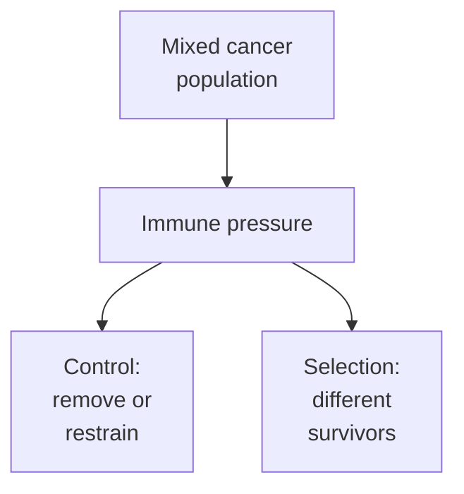

# Cancer immunoediting

## In one sentence

Cancer immunoediting is immune pressure that can both control tumors and shape which cancer-cell populations survive.

## The intuition

Imagine a mixed population facing a selective challenge. Some members are removed more readily than others, so the survivors can differ from the starting population. Immune responses can similarly limit cancer while influencing the kinds of cancer cells that remain.

Cancer cells are not planning their escape. Selection can favor pre-existing variants, and further changes can arise over time. The analogy also leaves out growth, tissue conditions and nonimmune treatments, which create other pressures.

**Before you start:** [tumor heterogeneity](/wiki/education/concepts/cancer-biology/what-cancer-is/tumor-heterogeneity) explains population differences; [immune escape](/wiki/education/concepts/immunology/tumor-immunology/immune-escape) describes ways cancer can avoid useful immune control.

## How it works

The framework contains three processes. **Elimination** means immune responses remove transformed cells. **Equilibrium** means immune restraint holds a surviving population in check. **Escape** means cells grow despite immune pressure, for example because recognition is reduced or the response is suppressed. These processes can occur independently or in sequence; they are not a mandatory three-stage calendar for every tumor.

Early mouse work showed both control and selection: lymphocytes and interferon gamma helped prevent tumor development while favoring surviving tumors with reduced immunogenicity, meaning less capacity to provoke rejection. The study tested particular genetically defined hosts and tumor models. It did not establish how often each process occurs in any person's cancer. [Shankaran and colleagues](https://pubmed.ncbi.nlm.nih.gov/11323675/).

Equilibrium needs more evidence than slow growth. In a chemical-carcinogenesis mouse model, changing immune function revealed transformed cells that had been held in check. Such perturbations helped distinguish immune restraint from simple absence of a tumor. A quiet scan after treatment cannot, by itself, identify occult immune equilibrium. [Koebel and colleagues](https://pubmed.ncbi.nlm.nih.gov/18026089/).

Editing can occur by **selection rather than a newly induced mutation**. In a defined mouse sarcoma experiment, T-cell pressure favored pre-existing clones lacking a strongly recognized mutant antigen. Investigators combined sequencing, recognition experiments and immune perturbations to establish that mechanism. The result demonstrates one route; it does not mean every disappearing mutation was removed by T cells. [Matsushita and colleagues](https://pubmed.ncbi.nlm.nih.gov/22318521/).

Human evidence is harder to isolate. A longitudinal pancreatic-cancer study compared primary and recurrent tumors and modeled [neoantigen](/wiki/education/concepts/immunology/antigen-presentation/neoantigen) quality and clonal evolution. Findings supported immune selection in that defined cohort. They did not directly observe every selection event, test a vaccine intervention, or produce a universal individual recurrence forecast. Sampling, treatment history and model assumptions remain important. [Łuksza and colleagues](https://www.nature.com/articles/s41586-022-04735-9).

*Control and selection can coexist. Elimination, equilibrium and escape describe possible processes, not phases assigned automatically from one result.*

## Why it matters in cancer

Immunoediting helps explain how an immune system can control some cancer cells while a less recognizable population survives. It gives researchers hypotheses about target coverage, recognition and changing tumor populations.

The framework does not establish that an individual's postoperative tumor has entered escape or that a treatment caused a particular molecular change. Different lesions can also face different immune and treatment conditions. Proposed mechanisms need evidence beyond the story suggested by the framework.

## How it is measured

Useful investigations combine tumor samples over time, clone and antigen measurements, immune recognition or function, and appropriate comparison conditions. Sequencing can describe population changes; [functional cytotoxicity assays](/wiki/education/concepts/measurement/immune-monitoring/functional-cytotoxicity-assays) test killing under specified conditions. Neither alone reconstructs the entire history.

Apparent antigen loss can reflect sampling, assay detection, gene-expression change or selection by another treatment. The causal question is whether immune pressure explains the change better than these alternatives. One expression snapshot or negative blood test cannot assign an immunoediting process.

## Common confusions

- Immunoediting includes immune control and selection; it is broader than escape alone.
- Equilibrium is immune restraint, not a synonym for every stable scan or treatment response.
- A surviving clone need not have acquired a new mutation because of immune pressure.
- An immune-rich sample does not establish effective recognition or identify a phase.
- Model or cohort evidence does not automatically explain an individual's treatment course.

## Try it

In a fictional controlled experiment, antigen-A cells and antigen-B cells grow together. With A-reactive T cells, B cells become dominant; without those T cells, the mixture remains similar. B cells were already present initially. What explanation is supported?

**Answer:** The comparison supports immune selection favoring pre-existing B cells in that model. It does not require T cells to create B cells or prove that the same process explains every human relapse. Confirming the recognition route and excluding other differences strengthens the interpretation.

## Explain it back

“Immune pressure can control a population and change its composition. To explain a particular change, we need ___.” One answer is “longitudinal, functional and comparison evidence.”

## Takeaway

Use immunoediting to form testable explanations, while keeping the model, population and alternatives visible.

## Related concepts

- [Neoantigens](/wiki/education/concepts/immunology/antigen-presentation/neoantigen)
- [Cancer-immunity cycle](/wiki/education/concepts/immunology/tumor-immunology/cancer-immunity-cycle)
- [Perturbations and controls](/wiki/education/concepts/evidence-and-statistics/study-design/perturbation-and-controls)

## Sources and scope

Source-checked October 10, 2026. General education and a fictional experiment; expert and learner review remain pending. Three primary mouse studies establish defined mechanisms; the pancreatic study provides bounded human longitudinal/model evidence.

- [Shankaran et al., 2001: lymphocytes, interferon gamma and tumor immunogenicity](https://pubmed.ncbi.nlm.nih.gov/11323675/).
- [Koebel et al., 2007: immune equilibrium in a mouse carcinogenesis model](https://pubmed.ncbi.nlm.nih.gov/18026089/).
- [Matsushita et al., 2012: T-cell-dependent selection of antigen-lacking clones](https://pubmed.ncbi.nlm.nih.gov/22318521/).
- [Łuksza et al., 2022: neoantigen quality and pancreatic-cancer evolution](https://www.nature.com/articles/s41586-022-04735-9).

<!-- BEGIN GENERATED USED IN -->
## Used in

- [How a personalized cancer vaccine is designed](/wiki/education/guides/personalized-cancer-vaccine/index)
<!-- END GENERATED USED IN -->
