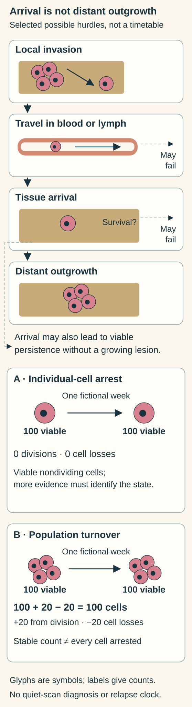

# Metastasis and dormancy: arrival, survival and outgrowth

## In one sentence

Metastasis is cancer establishing itself at a distant site, while tumor dormancy describes viable cancer cells or populations persisting without sustained detectable growth.

## The intuition

Scattering seeds is different from growing a new garden. A seed must survive its journey, arrive in suitable ground and establish growth. Cancer cells face distinct barriers too. Some survive without producing an enlarging lesion.

Cells are not literal seeds, and the environment is not passive soil. Cells, blood vessels, immune responses and surrounding tissue interact. The analogy cannot tell us whether unseen cells exist or when they might grow.

**Before you start:** [cancer](/wiki/education/concepts/cancer-biology/what-cancer-is/cancer) introduces tissue behavior; the [cell cycle](/wiki/education/concepts/biology-basics/cells/cell-cycle) distinguishes division from other cellular states.

## How it works

**The metastatic cascade** groups several hurdles: invading nearby tissue, entering and surviving transport through blood or lymph, leaving vessels at another site, surviving there and establishing growth. It is a useful outline, rather than a compulsory sequence in which every cancer cell succeeds. Many disseminated cells fail to form a growing metastasis. [NCI overview](https://www.cancer.gov/types/metastatic-cancer).

**Arrival is not colonization.** A circulating tumor cell is in the bloodstream; a disseminated tumor cell has reached tissue beyond the original site. Detecting either does not establish an enlarging distant lesion. Conversely, an imaging test cannot see every individual cell. Regional lymph-node involvement and distant metastasis are different [staging findings](/wiki/education/concepts/breast-cancer/grade-and-stage/tnm-staging).

**Dormancy can occur at different scales.** In cellular dormancy, individual viable cells can remain outside active division, in a quiescent state. In population-level dormancy, some cells may divide while loss or restraint prevents sustained net growth. Restricted blood supply and immune control are possible contributors. Stable population size therefore does not prove that every cell stopped cycling. [Aguirre-Ghiso's mechanism review](https://pubmed.ncbi.nlm.nih.gov/17957189/).

The [tumor microenvironment](/wiki/education/concepts/cancer-biology/tumor-microenvironment/tumor-microenvironment) can affect survival and outgrowth. Ghajar and colleagues studied breast-cancer models in mice and engineered microvascular cultures. Stable versus sprouting vessel regions supplied different cues affecting quiescence or outgrowth. The model mechanism neither diagnoses dormancy from a person's scan nor establishes a universal reactivation trigger. [Primary study](https://pubmed.ncbi.nlm.nih.gov/23728425/).

**Dormancy is not cell death.** It also differs from [senescence](/wiki/education/concepts/cancer-biology/cell-death-and-survival/senescence), another state involving persistent cell-cycle arrest and other features. Naming either state requires more than a low proliferation marker.

The hurdles describe possible routes, not compulsory success. The lower counts restate the fictional culture exercise: viable nondivision differs from balanced population turnover, even at the same final count. Glyphs are symbols, not enumerated cells; neither inset diagnoses unseen cells from a scan or predicts relapse.

## Why it matters in cancer

Metastatic breast cancer found in the lung remains breast cancer, rather than automatically becoming a new lung primary. Tissue identity and molecular evidence help distinguish these possibilities.

Persistence, later recurrence and dormancy are connected questions, but they are not interchangeable labels. A [recurrence pattern](/wiki/education/concepts/breast-cancer/natural-history/tnbc-recurrence-timing-and-sites) describes events in a defined group. A dormancy mechanism supplies no universal relapse clock or personal recurrence probability. A quiet scan also cannot distinguish absence of cells from cells below detection or from successful growth restraint.

## How it is measured

Clinical investigations use imaging and tissue examination to establish disease sites. Research uses cell tracking, repeated counts, division and death measurements, and controlled environmental changes. [Perturbations and controls](/wiki/education/concepts/evidence-and-statistics/study-design/perturbation-and-controls) help test what maintains a state.

Counts are cells per defined sample or volume; growth rates need a time interval. No single universal blood or scan threshold diagnoses every form of dormancy. Sampling and test sensitivity stay attached to a negative result.

## Common confusions

- Local invasion, regional spread and distant metastasis describe different extents.
- Detecting a traveling cell is not proof of successful distant outgrowth.
- Stable size is not proof that all cells are quiescent.
- Dormancy is neither harmlessness nor a guaranteed future recurrence.
- A negative scan does not demonstrate a particular dormancy mechanism.

## Try it

Two fictional cultures each contain 100 viable cancer cells after a week. In A, none divided or died. In B, 20 divisions were balanced by 20 cell losses. Does equal final size establish the same cellular state?

**Answer:** No. The counts are identical, but A illustrates viable nondividing cells; additional evidence would distinguish quiescence from senescence or another arrest. B illustrates balanced population turnover under the stated assumptions. Tracking division and loss distinguishes them. Neither culture gives a human recurrence date.

## Explain it back

“Reaching another site establishes ___; forming a growing lesion requires ___; a quiet scan cannot prove ___.”

**One possible answer:** “Dissemination; survival and outgrowth; that no cells remain or that they are dormant.”

## Takeaway

**Separate travel, survival, detectable outgrowth and the evidence for dormancy before telling a story about recurrence.**

## Related concepts

- [Immunoediting](/wiki/education/concepts/cancer-biology/what-cancer-is/immunoediting) — immune restraint needs its own evidence.
- [Epithelial–mesenchymal transition](/wiki/education/concepts/biology-basics/cells/epithelial-mesenchymal-transition) — altered features do not alone prove metastasis.

## Sources and scope

Source-checked October 10, 2026. General mechanisms and a fictional counting exercise; no personal prognosis or surveillance plan. Expert and learner review remain pending.

- [NCI: Metastatic cancer](https://www.cancer.gov/types/metastatic-cancer) — distant spread, primary-site identity and barriers to establishment.
- [Aguirre-Ghiso, 2007](https://pubmed.ncbi.nlm.nih.gov/17957189/) — complete primary review abstract checked for cellular, angiogenic and immune dormancy mechanisms; full text was not accessible in this check.
- [Ghajar et al., 2013](https://pubmed.ncbi.nlm.nih.gov/23728425/) — primary mouse and microvascular-culture work; relevant introduction, model descriptions and findings checked, rather than a clinical relapse predictor.

<!-- BEGIN GENERATED USED IN -->
## Used in

- [Read each label as an answer to a question](/wiki/education/guides/start-here/01-read-the-labels)
- [Oncology 101: immune foundations](/wiki/education/oncology-101/index)
<!-- END GENERATED USED IN -->
