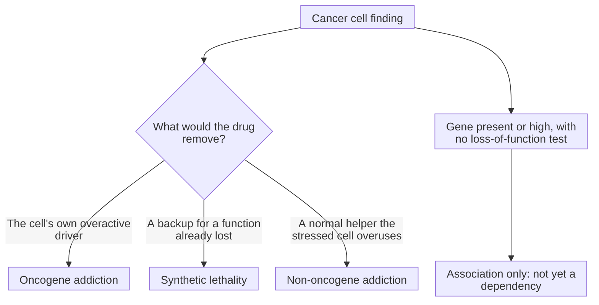

# Cancer dependency: oncogene addiction versus synthetic lethality

A cancer dependency is a gene or function the cancer cell needs to survive; oncogene addiction means needing the cell's own overactive driver, while synthetic lethality means a second loss becomes fatal only because a first function is already gone.

## What they share

Both describe something a cancer cell **needs** more than a normal cell does, so a drug that removes it can hurt the tumor more than healthy tissue. Both are claims about function, shown by taking something away and watching the cell fail. Neither is shown by a gene merely being present, mutated or highly expressed.

## The axis is what the drug takes away

- **Oncogene addiction:** the drug blocks the cancer's own overactive driver, an [oncogene](/wiki/education/concepts/cancer-biology/what-cancer-is/oncogene-and-tumor-suppressor) the cell has come to rely on. The term was popularized by Weinstein in 2002. [Weinstein 2002](https://pubmed.ncbi.nlm.nih.gov/12098689/).
- **[Synthetic lethality](/wiki/education/concepts/therapeutics/how-drugs-work/synthetic-lethality):** the cancer has already **lost** something, usually a tumor suppressor, and the drug blocks a second function that normal cells can do without but the damaged cell cannot.
- **Non-oncogene addiction:** the cancer heavily uses a normal, unmutated gene to cope with the stresses of being a cancer, such as DNA-copying stress or protein overload. [Luo, Solimini and Elledge 2009](https://pubmed.ncbi.nlm.nih.gov/19269363/).

*The same tumor can have several dependencies; the label depends on what the experiment removes.*

## Side by side

| | Oncogene addiction | Synthetic lethality | Association only |
|---|---|---|---|
| What the cancer has | A gained, overactive driver | A lost function | A gene that is present, mutated or high |
| What the drug hits | The driver itself | A second, backup function | Not established |
| Classic example | BCR-ABL in chronic myeloid leukemia, blocked by imatinib; amplified HER2 in breast cancer, blocked by trastuzumab | BRCA1 or BRCA2 loss plus PARP inhibition | High RNA for a target with no test of its removal |
| Evidence needed | Blocking the driver kills or stops the cells | Blocking the second function kills cells lacking the first, but spares matched cells that still have it | A loss-of-function experiment that has not been done |

Imatinib produced complete blood-count responses in 53 of 54 patients with chronic myeloid leukemia treated at 300 mg or more daily, showing the leukemia's reliance on the BCR-ABL kinase. [Druker 2001](https://pubmed.ncbi.nlm.nih.gov/11287972/). In laboratory models, BRCA1- or BRCA2-deficient cells were far more sensitive to PARP inhibitors than matched cells with working BRCA genes, the founding example of synthetic lethality in cancer. [Farmer 2005](https://pubmed.ncbi.nlm.nih.gov/15829967/); [Bryant 2005](https://pubmed.ncbi.nlm.nih.gov/15829966/).

## When each explains a result

- Use **oncogene addiction** when the target is a gained or amplified driver, as for [HER2](/wiki/education/concepts/breast-cancer/receptors-and-subtypes/her2) or a kinase fusion.
- Use **synthetic lethality** when the target is a backup for something the tumor has lost, as for [homologous recombination](/wiki/education/concepts/cancer-biology/genome-instability-and-repair/homologous-recombination-and-hrd) deficiency and PARP inhibitors.
- Use **non-oncogene addiction** when the target is normal but overused, as for proteasome inhibitors in multiple myeloma.
- Say **association** when all you have is a mutation, a stain or an RNA level.

## Common confusions

- **A mutation versus a dependency:** many mutations are passengers the cancer does not need.
- **High expression versus need:** a cell can make a lot of a protein it can live without.
- **Model dependence versus patient benefit:** a dependency in a cell line still needs clinical evidence.
- **Synthetic lethality versus combination therapy:** the classic use pairs a tumor's own loss with one drug; two drugs can also create a synthetic-lethal pair, as PARP plus ATR inhibition is designed to, but most combinations are not chosen that way.

## Try it

A fictional tumor has lost both copies of a repair gene, and its cells die when a second repair enzyme is blocked. Matched cells with the repair gene restored survive the same treatment. Which kind of dependency is this, and which control made the claim convincing?

Show answer

Synthetic lethality: the tumor has lost one function, and blocking a second, backup function kills only the cells lacking the first. The matched cells with the gene restored are the key control, because they show the killing depends on the original loss rather than general toxicity.

## Explain it back

Oncogene addiction targets something the cancer has ______; synthetic lethality targets a backup for something the cancer has ______.

**One possible answer:** gained; lost.

## Takeaway

**A dependency is shown by removing something and watching the cancer cell fail; oncogene addiction removes its overactive driver, synthetic lethality removes the backup for what it has already lost.**

## Related concepts

- [Oncogenes and tumor suppressors](/wiki/education/concepts/cancer-biology/what-cancer-is/oncogene-and-tumor-suppressor)
- [Synthetic lethality](/wiki/education/concepts/therapeutics/how-drugs-work/synthetic-lethality)
- [Drug target and mechanism](/wiki/education/concepts/therapeutics/how-drugs-work/drug-target-and-mechanism)
- [Ubiquitin and the proteasome](/wiki/education/concepts/cancer-biology/cell-death-and-survival/ubiquitin-and-proteasome), the non-oncogene addiction example

## Sources and scope

Source check: November 7, 2026. Concept comparison with fictional practice; expert and learner review pending.

- [Weinstein (2002), *Addiction to oncogenes*](https://pubmed.ncbi.nlm.nih.gov/12098689/): the oncogene addiction concept.
- [Luo, Solimini and Elledge (2009)](https://pubmed.ncbi.nlm.nih.gov/19269363/): oncogene and non-oncogene addiction as a therapeutic framework.
- [Druker et al. (2001)](https://pubmed.ncbi.nlm.nih.gov/11287972/): imatinib in chronic myeloid leukemia and the essential role of BCR-ABL.
- [Farmer et al. (2005)](https://pubmed.ncbi.nlm.nih.gov/15829967/) and [Bryant et al. (2005)](https://pubmed.ncbi.nlm.nih.gov/15829966/): BRCA-deficient cells and PARP inhibition.
- [Slamon et al. (2001)](https://pubmed.ncbi.nlm.nih.gov/11248153/): trastuzumab in HER2-overexpressing metastatic breast cancer.

<!-- BEGIN GENERATED USED IN -->
## Used in

- [Compare related ideas](/wiki/education/comparisons/index)
- [Test the direction of a stress defense](/wiki/education/guides/from-variant-to-drug/10-test-the-direction-of-a-stress-defense)
- [From a variant to a drug claim](/wiki/education/guides/from-variant-to-drug/index)
<!-- END GENERATED USED IN -->
