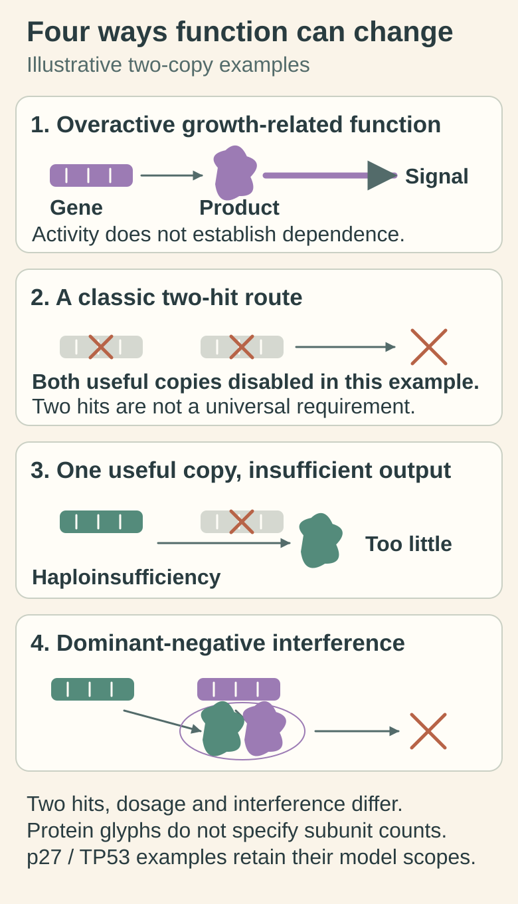

# Oncogenes and tumor suppressors: two routes to lost control

## In one sentence

Oncogenes promote cancer when growth-related functions become overactive, while tumor suppressors normally restrain cancer-promoting processes.

## The intuition

A stuck accelerator and failed brakes can both let a car move when it should stop. This is a useful first picture of cancer-driving genes. It is not a literal wiring diagram: cells have many controls, repair systems and feedback loops, and a gene's role can depend on context.

## How it works

A **proto-oncogene** normally participates in processes such as growth or survival. An activating change can turn it into an oncogene. This can happen through a sequence change, extra gene copies or rearrangement that changes how its product works or how much is made. More copies alone do not demonstrate activation.

A **tumor-suppressor gene** normally helps control growth, maintain genomic integrity or remove damaged cells. Loss of its useful function can support cancer. Many classic tumor suppressors fit a **two-hit model**: both useful gene copies become disabled. The two hits need not be two identical sequence changes. Knudson's original retinoblastoma analysis supported two events, with an inherited first event in some cases and two acquired events in others. It was not a universal law for every cancer gene.

Two important exceptions make the biology easier to read:

- **Haploinsufficiency:** one remaining functional copy supplies insufficient protective activity. In a specific carcinogen/radiation-challenged mouse study, reducing the gene dosage of the cell-cycle regulator p27 increased tumor susceptibility even though the retained copy was neither mutated nor silenced. That experiment does not give a general human risk estimate.
- **Dominant-negative action:** an altered protein interferes with the useful protein made by the other copy. Experiments with particular *TP53* variants in myeloid-leukemia models demonstrated this mechanism. It does not mean every *TP53* variant behaves alike in every tissue.

The roles describe mechanisms, not a gene-name shortcut. A particular [deoxyribonucleic acid (DNA) variant](/wiki/education/concepts/biology-basics/genetics/mutation-types) may be activating, disabling or uncertain. A regional deletion does not prove that every retained gene copy has lost function.

A **driver** contributes to cancer development or maintenance. A **passenger** travels with the cancer without an established driving role. Even a driver need not be an easy drug target: other routes may support survival, the target may be inaccessible, or blocking it may harm normal cells.

*Follow the functional consequence rather than count altered gene names. Two-hit loss, insufficient dosage and partner interference are different mechanisms; one retained useful copy is not universally sufficient. Protein glyphs are schematic, and the p27 and TP53 examples retain their model-specific scope in the text.*

[Open the light diagram](./images/gene-function-copies-and-partners-v1-light.svg) · [Open the dark diagram](./images/gene-function-copies-and-partners-v1-dark.svg)

## Why it matters in cancer

An inhibitor can sometimes reduce an overactive function. Restoring a missing safeguard is a different engineering problem. Another approach is to target a vulnerability created by that loss. These are reasons to investigate a mechanism; they do not establish a treatment indication. Measured pathway activity, tumor dependence and patient benefit require different evidence.

Breast cancer shows each strategy with real genes:

- **Blocking an oncogene.** About 30% of breast cancers in a 1987 series had extra copies of the HER2 (ERBB2) gene, an oncogene [Slamon 1987](https://pubmed.ncbi.nlm.nih.gov/3798106/); the antibody trastuzumab, which blocks HER2, lengthened survival in HER2-overexpressing metastatic disease [Slamon 2001](https://pubmed.ncbi.nlm.nih.gov/11248153/). See [HER2](/wiki/education/concepts/breast-cancer/receptors-and-subtypes/her2).
- **A lost tumor suppressor.** TP53 was mutated in 80% of basal-like breast cancers, a group that overlaps heavily with triple-negative disease, in The Cancer Genome Atlas [TCGA 2012](https://pubmed.ncbi.nlm.nih.gov/23000897/). No approved drug restores its function.
- **Exploiting a loss.** BRCA1 follows the two-hit pattern: an inherited faulty copy, then loss of the other in the tumor. That loss makes cells vulnerable to PARP inhibitors, the classic [synthetic-lethal](/wiki/education/concepts/cancer-biology/what-cancer-is/oncogene-addiction-vs-synthetic-lethality) strategy.

## Worked example

A fictional tumor has an activated growth receptor and a disabled repair safeguard. The receptor finding suggests testing its signaling and dependence. The repair finding suggests testing current repair function and relevant vulnerabilities. “Both are mutated” hides the crucial difference: one may do too much, while the other may do too little.

## Try it

In the dosage and interference panels, a useful copy remains. What differs? **Answer:** Haploinsufficiency means its protective output is insufficient in that context; dominant-negative action means an altered product interferes with useful protein activity. Neither sketch classifies every human variant or establishes tumor dependence.

A fictional altered receptor produces a stronger signaling readout. Does this show that the cancer needs it to survive? What experiment would add evidence?

**Answer:** Stronger signaling establishes activity under the tested conditions, not survival dependence. A [controlled perturbation](/wiki/education/concepts/evidence-and-statistics/study-design/perturbation-and-controls) can reduce that function and measure an appropriate survival or growth endpoint, with controls for off-target effects and exposure. Even a convincing result remains specific to the tested model; clinical benefit requires clinical evidence.

## Common confusions

- A gene frequently altered in cancer is not necessarily a driver in this sample.
- High [ribonucleic acid (RNA)](/wiki/education/concepts/biology-basics/molecules/rna-and-mrna) abundance is not proof of activation or dependence.
- Losing one inherited version is not automatically loss of both useful copies.
- A surface delivery target need not be a growth driver; some medicines use it as an address.

## How it is measured

Sequence and copy analysis describe candidate changes. RNA, protein and controlled perturbations test consequences. Clinical variant interpretation combines those findings with disease-specific evidence. No single generic “oncogene score” replaces that assessment, and gene function does not by itself establish [clinical actionability](/wiki/education/concepts/evidence-and-statistics/biomarkers/actionability).

## Explain it back

Explain the difference between an overactive function, a missing safeguard and a demonstrated survival dependence.

## Takeaway

Ask what this particular change does, then test whether that function matters for the intended intervention.

## Related concepts

- [Mutation types](/wiki/education/concepts/biology-basics/genetics/mutation-types)
- [Different cancer-cell populations](/wiki/education/concepts/cancer-biology/what-cancer-is/tumor-heterogeneity)

## Sources and scope

Source check: October 10, 2026. Gene roles and bounded experimental exceptions; expert and learner review remain pending.

- [NCI cancer genetics](https://www.cancer.gov/about-cancer/understanding/what-is-cancer): proto-oncogene, tumor-suppressor and repair roles.
- [Knudson (1971), retinoblastoma statistical study](https://pubmed.ncbi.nlm.nih.gov/5279523/): historical two-event hypothesis; complete abstract checked.
- [Fero et al. (1998), mouse p27 haploinsufficiency experiment](https://pubmed.ncbi.nlm.nih.gov/9823898/): complete abstract checked, not full methods.
- [Boettcher et al. (2019), dominant-negative TP53 effects](https://pubmed.ncbi.nlm.nih.gov/31395785/): selected full primary results in myeloid cell and mouse models; not a blanket breast-cancer variant rule.
- [Slamon et al. (1987)](https://pubmed.ncbi.nlm.nih.gov/3798106/) and [Slamon et al. (2001)](https://pubmed.ncbi.nlm.nih.gov/11248153/): HER2 amplification in breast cancer and trastuzumab.
- [TCGA Network (2012)](https://pubmed.ncbi.nlm.nih.gov/23000897/): TP53 mutations in 80% of basal-like breast cancers.

<!-- BEGIN GENERATED USED IN -->
## Used in

- [Authenticate and attribute the finding](/wiki/education/guides/from-variant-to-drug/01-authenticate-and-attribute-the-finding)
<!-- END GENERATED USED IN -->
