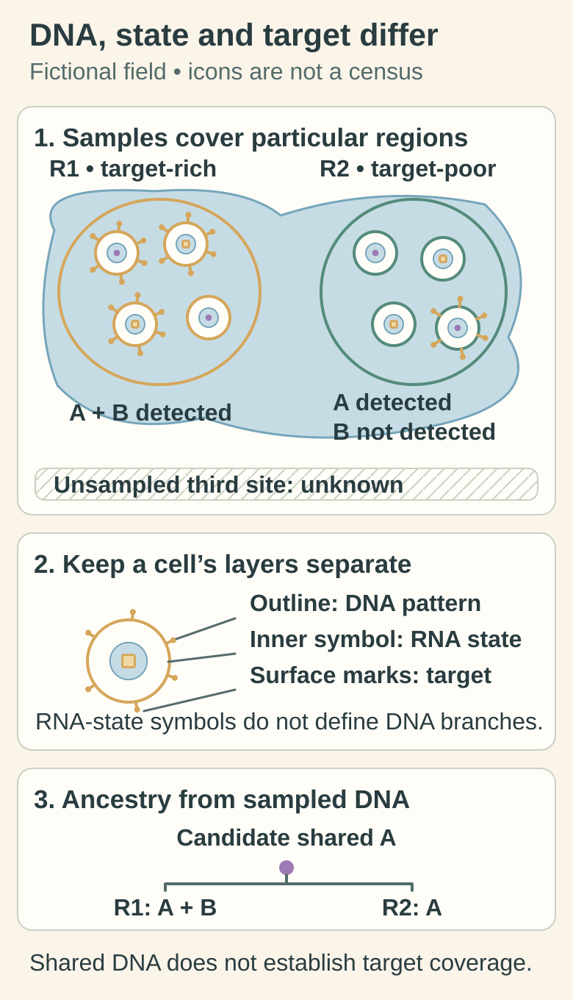

# Tumor heterogeneity: one cancer, several populations

## In one sentence

Tumor heterogeneity means cancer cells can differ in their DNA, molecular state or behavior within and between sampled regions.

## The intuition

A forest contains related trees that do not all have the same branches. Sampling one branch tells us something real, but not everything about the forest. A tumor also contains related populations. The analogy ends when we consider cell states: cells can change their behavior without acquiring a new [deoxyribonucleic acid (DNA)](/wiki/education/concepts/biology-basics/molecules/dna) branch.

## How it works

A **clone** is a population descended from a common ancestral cell, often inferred through shared acquired DNA changes. A **subclone** is a descendant branch with additional changes. A **clonal variant** is estimated to occur in all cancer cells within the analyzed population; this is a claim about that population, with measurement uncertainty.

A **truncal variant** is inferred to lie on the ancestral trunk before the sampled branches separated. Finding a shared change across adequately tested branches can support that inference. A **subclonal variant** occurs in a subset of the cancer cells being considered. Which alterations are shared or branch-restricted depends on sampling, detection limits and the ancestry model. “Clonal in this biopsy” and “truncal across these sampled branches” answer different questions.

A high [variant allele fraction (VAF)](/wiki/education/concepts/measurement/sequencing-basics/variant-allele-fraction-and-cancer-cell-fraction) in one biopsy does not reconstruct the tree. VAF is the fraction of usable reads, or assay-defined molecules, supporting the variant at a tested location. Cancer-cell fraction estimates the share of cancer cells carrying a change under stated assumptions. Copy number and normal-cell admixture can affect the inference. Unseen branches remain unseen.

Genetic differences are only one kind of heterogeneity. Cells with similar DNA can use different [ribonucleic acid (RNA)](/wiki/education/concepts/biology-basics/molecules/rna-and-mrna) programs, make different proteins or respond differently to their surroundings. [Cell state and lineage](/wiki/education/concepts/biology-basics/cells/cell-lineage-and-differentiation) are different axes. A computational RNA cluster is not automatically a genetic clone. In glioblastoma experiments, related descendants could occupy several expression states; this does not supply a universal state map for other cancers.

Differences can occur across one tumor, between lesions or over time. [Clonal evolution](/wiki/education/concepts/cancer-biology/what-cancer-is/clonal-evolution) can change a branch's representation. A resistant population detected after therapy may have existed below detection, acquired new changes or changed state. Two snapshots do not always distinguish these explanations.

*Outline, inner symbol and surface marks depict different biological layers. Shared DNA evidence can support a sampled ancestry hypothesis while cells differ in state and surface target. The third site remains unresolved; icons are illustrative, not cell fractions or a response estimate.*

[Open the light diagram](./images/heterogeneity-sampled-layers-v1-light.svg) · [Open the dark diagram](./images/heterogeneity-sampled-layers-v1-dark.svg)

## Why it matters in cancer

A treatment aimed at one feature may leave cells that lack it. A biopsy can miss a relevant branch, and culture can favor populations that grow well in the model. Profiling still provides evidence: state its sampled scope and uncertainty. Even inferred trunk membership does not guarantee that an RNA, surface protein or presented peptide exists in every cell, or establish therapeutic coverage.

## Worked example

Imagine a fictional specimen with 60 cells carrying a surface target and 40 lacking it. A perfectly target-specific treatment could still leave the second group. If a small biopsy sampled only the target-rich region, its result would be accurate for that piece but incomplete for the whole tumor. These invented counts illustrate sampling, not a clinical response estimate.

## Try it

Two adequately tested fictional regions share variant A; only one has variant B. A third site was not sampled. Does this prove A is in every cancer cell everywhere, and that an A-directed treatment will work?

**Answer:** The pattern supports A as a candidate shared ancestral change and B as a branch-associated change within the sampled evidence. Detection limits and the inferred tree still matter. The unsampled site is unresolved. RNA, protein, immune presentation and treatment-effect questions each need additional evidence.

## Common confusions

- A high average signal does not mean every cancer cell expresses the target.
- Similar RNA states do not establish shared mutation ancestry.
- A clonal call in one biopsy does not prove presence in unseen lesions.
- A higher VAF can reflect copy number or sample purity rather than a larger clone.
- Not detecting a branch is not proof it never existed.

## How it is measured

Multi-region sequencing, modeled variant fractions, single-cell assays and spatial measurements probe different differences. Keep specimen, region, time, method, detection limits and uncertainty beside the claim. Shared and private mutations can support a sampled ancestry model; they do not make the unsampled tumor completely observable.

## Explain it back

Explain why a local cancer-cell fraction, an inferred ancestral trunk and a reversible RNA state are three different descriptions.

## Takeaway

Describe both the biological difference and the sampling reach of the evidence.

## Related concepts

- [Variant and cancer-cell fractions](/wiki/education/concepts/measurement/sequencing-basics/variant-allele-fraction-and-cancer-cell-fraction)
- [Why bulk RNA mixes populations](/wiki/education/concepts/measurement/transcriptomics/bulk-rna-seq)

## Sources and scope

Source check: October 10, 2026. Fictional counts are teaching examples; expert and learner review remain pending.

- [NCI tumor-heterogeneity definition](https://www.cancer.gov/publications/dictionaries/cancer-terms/def/tumor-heterogeneity).
- [Gerlinger et al. (2012), primary multi-region renal-cancer study](https://pubmed.ncbi.nlm.nih.gov/22397650/): sampled branching in four metastatic renal cancers; selected primary methods/results checked, not a universal missed-variant frequency.
- [Neftel et al. (2019), glioblastoma genetics and state experiments](https://pubmed.ncbi.nlm.nih.gov/31327527/): selected primary results and lineage-labeling methods; model-specific evidence for state plasticity.

<!-- BEGIN GENERATED USED IN -->
## Used in

- [The journey through a solid tumor](/wiki/education/cellular-therapies/08-solid-tumor-barriers)
- [Aiming a drug at a surface target](/wiki/education/guides/aiming-a-drug-at-a-surface-target/index)
- [Authenticate and attribute the finding](/wiki/education/guides/from-variant-to-drug/01-authenticate-and-attribute-the-finding)
- [Read tumor and normal data before choosing targets](/wiki/education/guides/personalized-cancer-vaccine/02-reading-tumor-and-normal-data)
- [Understand what a tumor model can predict](/wiki/education/guides/predicting-response-before-treating/index)
- [Read each label as an answer to a question](/wiki/education/guides/start-here/01-read-the-labels)
- [Start here: read the biology, then the evidence](/wiki/education/guides/start-here/index)
- [Choose a tumor model for the question](/wiki/education/modeling-tumor-response/index)
- [Use RNA to test the message and its source](/wiki/education/molecular-profiling/02-rna-the-activity-layer)
- [Add the geography of cells and signals](/wiki/education/molecular-profiling/04-spatial-biology)
- [Test a mechanism in a living model](/wiki/education/molecular-profiling/05-functional-drug-response)
- [Build an integrated claim without skipping the clinical question](/wiki/education/molecular-profiling/07-from-data-to-care-plan)
- [Read single-cell data after treatment](/wiki/education/molecular-profiling/08-profile-residual-tumor)
- [See what is inside a tissue sample](/wiki/education/multi-omics-foundations/01-epithelial-and-breast-tissue)
- [Separate cell identity from cell state](/wiki/education/multi-omics-foundations/02-cell-identity-and-state)
- [Separate DNA copies from cancer-cell fractions](/wiki/education/multi-omics-foundations/04-copies-alleles-and-clones)
- [Choose the comparison before interpreting the signal](/wiki/education/multi-omics-foundations/07-comparisons-and-evidence)
- [What does multi-omics tell us about a tumor?](/wiki/education/reading-a-tumor/omics-and-multi-omics)
- [Compare formats with evidence and normal-tissue risk](/wiki/education/targeted-therapy-modalities/06-comparisons)
<!-- END GENERATED USED IN -->
