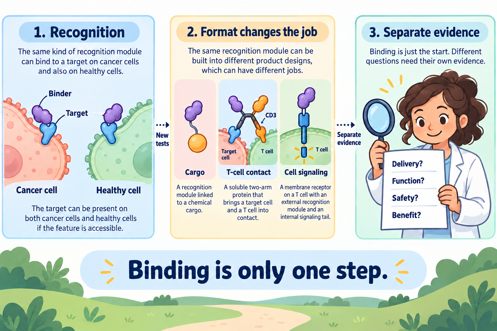

# A binder as a targeting module

## In one sentence

A binder is a recognition module that attaches to a particular molecular feature, while the rest of a therapeutic design determines what can happen after that contact.

## The intuition

Think of a binder as a parcel's address-reading device. It can recognize a destination, but it does not tell you what the parcel contains or whether it arrives intact. The analogy stops at recognition: molecules meet through shape and chemistry, and the same destination can occur on cancer and healthy cells.

*Recognition is one step: the complete product needs separate evidence for delivery, useful function, safety and patient benefit. The engager's distinct T-cell arm recognizes CD3; the diagrams are schematic.*

## How it works

A binder recognizes an [epitope](/wiki/education/concepts/immunology/antigen-presentation/antigen-and-epitope), the particular molecular feature it contacts. Antibody-derived binders include [single-chain variable fragments and single-domain nanobodies](/wiki/education/concepts/engineering-and-manufacturing/binders/scfv-and-vhh-nanobodies). [Other engineered protein scaffolds](https://www.nature.com/articles/s41586-023-06415-8) can also supply recognition. A binder need not be a whole antibody.

The module can be connected to different actions. An [antibody-drug conjugate](/wiki/education/concepts/therapeutics/antibody-based/antibody-drug-conjugate) links recognition to chemical cargo. A [T-cell engager](/wiki/education/concepts/therapeutics/antibody-based/t-cell-engager) brings together a target cell and a T cell. A [chimeric antigen receptor (CAR)](/wiki/education/concepts/therapeutics/cell-therapies/car-anatomy) connects an external recognition region to signaling inside a living cell. An early engineered-receptor experiment demonstrated this connection in a specified cell model; it did not establish a universal cancer treatment. [Eshhar et al.](https://pubmed.ncbi.nlm.nih.gov/8421711/).

A delivery binder can instead recognize the cell meant to receive instructions. That cell might be an immune cell. [Delivery targeting and cancer targeting](/wiki/education/concepts/engineering-and-manufacturing/delivery-vehicles/delivery-targeting-vs-cancer-targeting) can therefore describe different addresses. A [mouse cardiac-injury study](https://pubmed.ncbi.nlm.nih.gov/34990237/) used a delivery binder aimed at T cells and a receptor aimed at activated fibroblasts; it did not establish cancer treatment in people.

Each action adds requirements. Cargo delivery may require entry, processing and access to the payload's action site. Immune redirection requires productive contact and functioning cells. Blocking a receptor requires a relevant effect on signaling. Attaching a binder does not establish these later steps. [FDA's cytotoxic conjugate guidance](https://www.fda.gov/media/155997/download) separates the conjugate and its constituent parts.

## Why it matters in cancer

A target's gene or RNA signal does not prove that the epitope is exposed on living tumor cells. A highly specific binder can also recognize its intended target on healthy tissue. This is [on-target, off-tumor injury](/wiki/education/concepts/therapeutics/toxicities-and-supportive-care/on-target-off-tumor-toxicity), rather than a mistaken molecular address.

The [binder profile](/wiki/education/concepts/engineering-and-manufacturing/binders/affinity-epitope-and-developability) describes useful properties of the recognition element. [Format constraints](/wiki/education/concepts/engineering-and-manufacturing/binders/format-constraints-on-binders) explain why those properties must be retested after assembly.

## How it is measured

| Assay card | What to record |
|---|---|
| Method and input | Purified-target binding and relevant live-cell assays; identify the actual binder or finished construct |
| Consumption | Protein and cell aliquots are consumed; patient-derived tests may use finite tissue |
| Output and units | Binding curves or cell-associated fluorescence, followed by separate delivery or function readouts |
| Thresholds and controls | Prespecified assay criteria, target-negative cells and unrelated-target controls; no universal therapeutic cutoff |
| Failures and limits | Tags, altered protein folding or surface-only signal can mislead; binding does not measure uptake, exposure or clinical benefit |
| Validation tier | Research interaction evidence unless the method and use have further validation; product safety needs broader evidence |

## Common confusions

- **Target-associated is not tumor-exclusive.** Healthy-cell expression remains relevant.
- **Recognition is not activation.** The connected mechanism needs its own test.
- **A portable sequence is not proven portability.** A new format changes the experimental question.

## Try it

A fictional binder recognizes purified protein R and binds living R-positive cancer cells. The team attaches it to a CAR. Can it now claim a safe, working cell therapy?

**Answer:** It has evidence for recognition in the tested settings. It still needs evidence for receptor expression, target-dependent activation, unwanted activity, healthy-tissue recognition and the complete product's clinical behavior. Even successful killing in a dish answers only a model-specific question.

## Explain it back

“The binder establishes ___; the connected format must establish ___.”

**One answer:** which feature can be recognized; what follows recognition and under which conditions.

## Takeaway

**Binding is one step in a therapeutic mechanism, with later steps requiring separate evidence.**

## Related concepts

- [Drug target and mechanism](/wiki/education/concepts/therapeutics/how-drugs-work/drug-target-and-mechanism)
- [Binder discovery](/wiki/education/concepts/engineering-and-manufacturing/binders/binder-discovery)

## Sources and scope

Source check: October 10, 2026. General mechanisms and a fictional exercise; expert and learner review remain pending.

- [NCI: monoclonal antibodies](https://www.cancer.gov/about-cancer/treatment/types/immunotherapy/monoclonal-antibodies) — recognition and different immune actions.
- [Eshhar et al., 1993](https://pubmed.ncbi.nlm.nih.gov/8421711/) — antibody-type recognition linked to cellular activation in an experimental receptor model.
- [Watson et al., 2023](https://www.nature.com/articles/s41586-023-06415-8) — engineered protein binders with experimental characterization.
- [Rurik et al., 2022](https://pubmed.ncbi.nlm.nih.gov/34990237/) — delivery and receptor targeting in a mouse cardiac-injury model.
- [FDA, 2024: clinical pharmacology of antibody-drug conjugates](https://www.fda.gov/media/155997/download) — cytotoxic conjugate components, processing and exposure; not all cargo formats.

<!-- BEGIN GENERATED USED IN -->
## Used in

- [How engineered immune cells can attack a solid tumor](/wiki/education/guides/engineered-cell-therapy/index)
- [Separate the address from the killing mechanism](/wiki/education/targeted-therapy-modalities/01-mechanism)
<!-- END GENERATED USED IN -->
