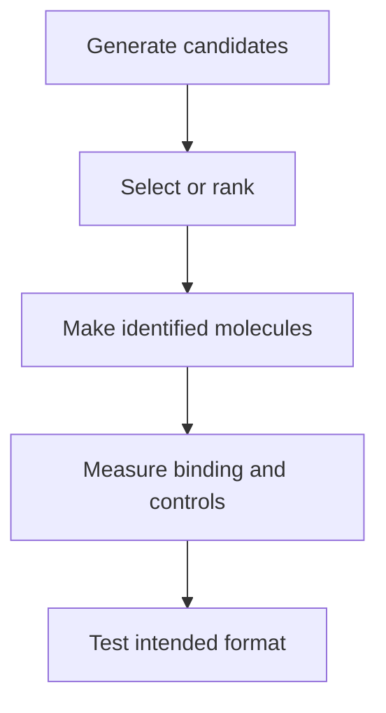

# How binders are discovered

## In one sentence

Binder discovery generates and screens candidate recognition molecules, then tests whether selected candidates bind the intended target under defined experimental conditions.

## The intuition

Imagine searching for a key for a complicated lock. You can start with existing keys, search a large collection, or design new shapes. A promising shape still has to turn in the real lock. Molecules are less rigid than keys, and a laboratory target may differ from its form on a living cell.

## How it works

Discovery methods connect a candidate's identity to a measurable interaction. The output is a set of testable molecules, not a clinical prediction.

**Hybridoma discovery** combines antibody-producing cells with myeloma cells, which can grow continuously in culture. Cloned hybrid cells can secrete antibodies for screening. The fusion does not select the desired specificity by itself: researchers test what each clone produces. [Köhler and Milstein's primary experiments](https://pubmed.ncbi.nlm.nih.gov/825377/) establish this fusion-and-screening logic.

**Phage display** puts a candidate binding protein on a bacteriophage, a virus that infects bacteria, while carrying the corresponding genetic instructions. Researchers expose a library to the target and recover retained phage. Repeated selection enriches candidates under those conditions. The [original antibody-display study](https://pubmed.ncbi.nlm.nih.gov/2247164/) demonstrated the link between displayed binding and recoverable coding genes.

**Yeast display** places candidates on yeast cells. Fluorescent target labeling and a separate display measurement can support sorting and quantitative binding comparisons. The yeast carries the candidate's gene, allowing recovery after selection. [Boder and Wittrup](https://pubmed.ncbi.nlm.nih.gov/9181578/) demonstrated antibody-fragment engineering using this approach. Display abundance and binding should be distinguished; a bright cell is not automatically a better isolated binder.

**Artificial intelligence (AI) design** proposes or ranks protein structures and sequences computationally. Researchers must make the proposed proteins and test them. In the [RFdiffusion primary study](https://www.nature.com/articles/s41586-023-06415-8), designed proteins were expressed, purified and experimentally screened for binding. A subset received more detailed binding measurements. Computational scores and predicted structures were not clinical-outcome tests.

These approaches can work together. A computational candidate can seed a display library; a discovered antibody can undergo further engineering. The method name supplies no universal success rate, timeline or winning strategy.

*Selection finds candidates; follow-up experiments determine what the candidates actually do.*

## Why it matters in cancer

Selection against purified protein can miss the native [epitope](/wiki/education/concepts/immunology/antigen-presentation/antigen-and-epitope) on cells. A protein tag or an altered target preparation can become the apparent binding partner. Binding to a cancer-associated protein also does not establish absence of binding to healthy tissue.

Discovery should therefore lead to a [binder profile](/wiki/education/concepts/engineering-and-manufacturing/binders/affinity-epitope-and-developability) and testing in the [intended format](/wiki/education/concepts/engineering-and-manufacturing/binders/format-constraints-on-binders), rather than jumping from a hit to a treatment claim.

## How it is measured

| Assay card | What to record |
|---|---|
| Input and consumption | Candidate clones or expressed proteins, defined target preparations and cell controls; aliquots are consumed, and patient tissue may be finite |
| Output and units | Selected sequences, binding curves and assay-specific fluorescence; a computational rank is a different output |
| Thresholds | Define a hit relative to assay controls; no universal “therapeutic binder” threshold |
| Follow-up | Retest the identified molecule outside its selection system; use target-negative, unrelated-protein and tag controls as appropriate |
| Failure modes | Display level, enrichment bias, tag binding, aggregation and target preparation can distort selection |
| Validation tier | Discovery and preclinical interaction evidence; neither a selected sequence nor a measured binding constant predicts clinical response |

## Common confusions

- **Enriched does not mean fully specific.** It means favored by the selection conditions.
- **A designed sequence is not a measured binder.** Prediction needs an experiment.
- **A discovery hit is not a finished therapy.** Assembly and product testing add new questions.

## Try it

A fictional lab ranks 60 AI-designed candidates. Eight can be purified. Two bind the tagged target, but both also bind the tag alone. How many intended-target binders have been established?

**Answer:** None yet. Two molecules show a tag-associated interaction. A different target preparation and suitable controls are needed before claiming intended-target recognition. The 60 rankings are predictions, not 60 binding results.

## Explain it back

“Discovery gives me ___; follow-up binding tests establish ___.”

**One answer:** identified candidates; an interaction under the tested conditions.

## Takeaway

**Keep candidate generation, selection, measured binding and finished-product testing as distinct stages.**

## Related concepts

- [Enzymes and binding](/wiki/education/concepts/biology-basics/molecules/enzymes-and-binding)
- [Antibody-derived binder formats](/wiki/education/concepts/engineering-and-manufacturing/binders/scfv-and-vhh-nanobodies)

## Sources and scope

Source check: October 10, 2026. The studies establish particular discovery methods, not interchangeable performance or patient benefit. The practice numbers are fictional. Expert and learner review remain pending.

- [Köhler and Milstein, 1976](https://pubmed.ncbi.nlm.nih.gov/825377/) — antibody-producing cell hybrids and clone screening.
- [McCafferty et al., 1990](https://pubmed.ncbi.nlm.nih.gov/2247164/) — antibody variable domains on phage.
- [Boder and Wittrup, 1997](https://pubmed.ncbi.nlm.nih.gov/9181578/) — yeast display and quantitative binding analysis.
- [Watson et al., 2023](https://www.nature.com/articles/s41586-023-06415-8) — computational protein design followed by experimental characterization.

<!-- BEGIN GENERATED USED IN -->
## Used in

- [How engineered immune cells can attack a solid tumor](/wiki/education/guides/engineered-cell-therapy/index)
- [Separate the address from the killing mechanism](/wiki/education/targeted-therapy-modalities/01-mechanism)
<!-- END GENERATED USED IN -->
