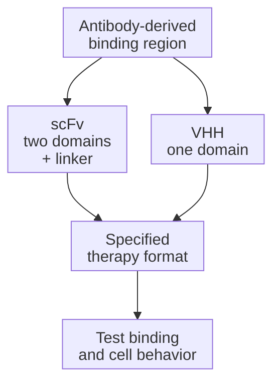

# Single-chain variable fragments and single-domain nanobodies

## In one sentence

Single-chain variable fragments and single-domain nanobodies are compact antibody-derived binding formats that use different structures to recognize a molecular target.

## The intuition

Researchers can reuse the gripping part of an antibody without carrying the whole antibody. There is more than one way to build that grip. The size and number of parts describe a format; they do not decide how well the finished therapy will recognize cancer or spare healthy tissue. The “grip” analogy also has a limit: a binder engages a molecular surface, rather than choosing a cell by whether it looks malignant.

## How it works

A conventional [antibody](/wiki/education/concepts/immunology/antibodies-and-b-cells/antibody-structure) uses paired heavy- and light-chain variable domains to form a binding site. **Variable** means the sequence differs across antibodies and helps determine recognition. A **single-chain variable fragment (scFv)** joins these two domains with a peptide linker into one protein chain. “Single-chain” does not mean one variable domain.

The [early engineered scFv study](https://pubmed.ncbi.nlm.nih.gov/3045807/) showed that linked domains could recover specific binding after folding. That does not mean every domain order or linker works equally well. Expression, folding, aggregation and target binding must be tested for the actual sequence and format.

Camelids also make naturally occurring heavy-chain antibodies without light chains. **VHH (variable domain of a heavy-chain-only antibody)** names the binding domain of such an antibody. An isolated VHH can serve as a single-domain binder, often called a **nanobody**. The [original heavy-chain antibody study](https://pubmed.ncbi.nlm.nih.gov/8502296/) established the underlying architecture. Not every engineered single-domain antibody is a camelid-derived VHH.

Both formats can supply the binding region of a [chimeric antigen receptor (CAR)](/wiki/education/concepts/therapeutics/cell-therapies/car-anatomy) or appear in other molecular therapies. Neither isolated format contains the full antibody constant region that normally helps recruit immune machinery. Those functions require other components in the finished design. A CAR also needs its membrane and signaling regions; the binder alone is not the receptor.

Format affects geometry and engineering options. A VHH has one domain, while an scFv has a paired-domain interface and linker. Either may be joined to additional binding units. An isolated single binding domain has one recognition site; joining several domains can change the number and geometry of contacts. **Affinity** describes an individual interaction; **avidity** describes the combined strength of multiple interactions. Compare matched formats rather than assuming that a multivalent molecule has improved intrinsic affinity. A small binding module on a cell does not make that whole living cell penetrate tissue like a small soluble protein.

Binding strength, the recognized [epitope](/wiki/education/concepts/immunology/antigen-presentation/antigen-and-epitope) or molecular feature, surface expression and spontaneous clustering can influence receptor behavior. **Tonic signaling** means ongoing signaling without the intended antigen encounter. One primary CAR study linked antigen-independent clustering of particular scFvs to tonic signaling and [exhaustion](/wiki/education/concepts/immunology/t-cells/t-cell-states). [That study](https://pubmed.ncbi.nlm.nih.gov/25939063/) shows why the finished receptor must be tested, rather than judging a binder only by isolated affinity.

*Two architectures can supply a targeting module; the finished format determines the next tests.*

## Why it matters in cancer

Binder format can influence manufacturability, receptor expression and recognition. It does not create tumor specificity when the intended antigen is also present on healthy cells. More compact or stronger binding is not automatically safer or more effective.

## How it is measured

Measure binding to the actual target feature, including relevant healthy-tissue targets and unwanted interactions. Purified-molecule affinity measurements do not reproduce every membrane geometry. For a CAR, test surface expression, baseline signaling, responses across target abundance and controlled [target-cell killing](/wiki/education/concepts/measurement/immune-monitoring/functional-cytotoxicity-assays). Keep receptor format and cell preparation fixed when attributing differences to the binder.

## Worked example and practice

Two fictional CARs use different binders for surface protein X. Both bind X in a purified-protein assay. Only one expresses well on T cells; the other shows activation without target cells.

**Try it:** Did the binding assay establish equivalent therapeutic performance?

**Answer:** No. It tested one interaction. Surface expression, target-dependent signaling, unwanted activation, tumor killing and healthy-tissue recognition require separate evidence.

## Common confusions

- scFv has two variable domains despite being one chain.
- VHH is not shorthand for a complete heavy-chain antibody.
- A binder, a whole CAR and a CAR-bearing cell are different objects.
- Smaller size and higher affinity do not determine whole-product performance.

## Explain it back

“The format tells me ___; it does not prove ___.” One answer: “how the binding domains are arranged; safe and useful recognition by the finished therapy.”

## Takeaway

**Binder format describes architecture; specificity and useful behavior belong to the tested finished molecule or cell.**

## Related concepts

- [Antibody structure](/wiki/education/concepts/immunology/antibodies-and-b-cells/antibody-structure)
- [CAR anatomy](/wiki/education/concepts/therapeutics/cell-therapies/car-anatomy)

## Sources and scope

Source check: October 10, 2026; expert and learner review pending. This is foundational teaching, not a treatment recommendation. Worked examples are fictional.

- [Huston et al., 1988](https://pubmed.ncbi.nlm.nih.gov/3045807/) — engineered linked heavy- and light-chain variable domains.
- [Hamers-Casterman et al., 1993](https://pubmed.ncbi.nlm.nih.gov/8502296/) — naturally occurring camelid heavy-chain antibodies.
- [Long et al., 2015](https://pubmed.ncbi.nlm.nih.gov/25939063/) — clustering, tonic signaling and exhaustion in specified CAR constructs.
- [Ways and Parham, 1983](https://pubmed.ncbi.nlm.nih.gov/6197968/) — single-site affinity and bivalent avidity in defined antibody–cell binding experiments.

<!-- BEGIN GENERATED USED IN -->
## Used in

- [Building an engineered T cell](/wiki/education/cellular-therapies/05-engineered-t-cell-building-blocks)
- [How engineered immune cells can attack a solid tumor](/wiki/education/guides/engineered-cell-therapy/index)
<!-- END GENERATED USED IN -->
