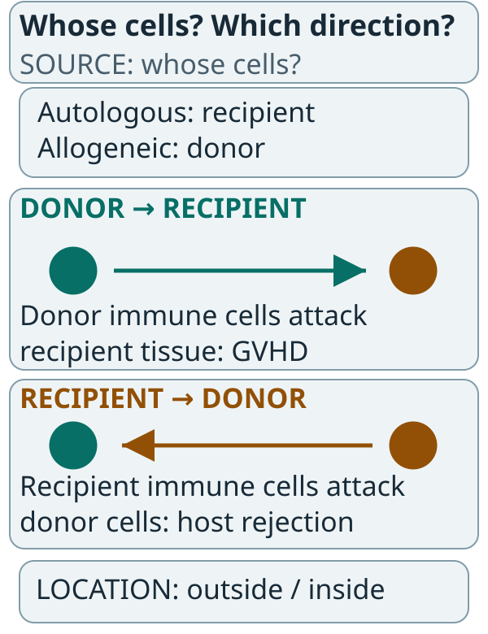

# Autologous versus allogeneic cell therapy

## In one sentence

Autologous cell therapy uses the recipient's own cells, while allogeneic cell therapy uses cells from another person.

## The intuition

One workshop starts with your own material; another starts with material from a donor. That tells us the source. It does not tell us what the finished product recognizes, how well it works or how quickly it reaches the clinic.

The analogy breaks at immune compatibility. Living cells can recognize other cells as foreign and can themselves be rejected. They are not interchangeable building supplies.

## How it works

An autologous workflow commonly collects a person's cells by [leukapheresis](/wiki/education/concepts/engineering-and-manufacturing/cell-manufacturing/leukapheresis), processes them and returns a manufactured product to that same person. Starting material can vary with disease, prior treatment and cell composition. The process still requires identity, safety and functional testing.

An allogeneic workflow uses donor-derived cells. Depending on the platform, the source may be blood, cord blood or a donor-derived cell bank. Some processes can manufacture multiple doses in advance. A banked product still needs release, distribution and recipient eligibility.

Two immune directions matter. **Graft-versus-host disease** means donor immune cells attack the recipient's tissues. **Host rejection** means the recipient's immune system attacks donor cells. Those are different events.

*Follow the arrow from the attacking immune cells to the cells or tissues they recognize. Source and engineering location answer different questions.*

In the two recognition panels, teal marks donor cells and amber marks recipient cells. The arrows describe possible immune directions, not rates or inevitable events. The source panel asks whose cells do the work; the location panel asks where they are changed. Neither axis supplies a universal safety ranking.

Conventional donor T cells can recognize foreign [human leukocyte antigen (HLA)](/wiki/education/concepts/immunology/antigen-presentation/hla). Specific engineering addresses each direction, and a trial document will name it. To limit graft-versus-host disease, the donor cells' own T-cell receptor gene is disrupted. UCART19, the first allogeneic CD19 product given to people, was made from non-HLA-matched donor cells with the T-cell receptor alpha chain and the CD52 gene both edited ([Qasim et al., 2017](https://pubmed.ncbi.nlm.nih.gov/28123068/)). To limit rejection, other designs disrupt HLA class-I genes alongside the receptor gene ([Chen et al., 2024](https://pubmed.ncbi.nlm.nih.gov/38231412/), a preclinical study of HLA-A/B and TRAC disruption).

**Allogeneic products also tend to need heavier lymphodepletion,** because the recipient's own immune system would otherwise clear the donor cells. In the UCART19 trials, patients received fludarabine and cyclophosphamide with or without alemtuzumab, an antibody against CD52 — which is why the CD52 gene is edited out of the product, so the antibody depletes host lymphocytes and spares the infused cells ([Qasim et al., 2017](https://pubmed.ncbi.nlm.nih.gov/28123068/)). A pharmacology analysis of those trials found the alemtuzumab-containing regimen sustained UCART19 expansion and persistence ([Dupouy et al., 2022](https://pubmed.ncbi.nlm.nih.gov/36970059/)). The resulting risks depend on the actual cells and engineering; “allogeneic” does not establish safety.

## Compare source with engineering location

| Question | Autologous | Allogeneic |
| --- | --- | --- |
| Whose cells perform the work? | Recipient-derived | Donor-derived |
| What varies at the starting-material gate? | Each patient's collection | Donor or cell-bank characteristics |
| Can doses be prepared ahead? | Depends on the workflow and banking | Often a development goal, not guaranteed inventory |
| Is immune compatibility settled by the name? | No; other immune/product risks remain | No; donor attack and host rejection need evaluation |

[Ex vivo versus in vivo engineering](/wiki/education/concepts/engineering-and-manufacturing/cell-manufacturing/ex-vivo-vs-in-vivo-engineering) asks where cells are changed. An available delivery vial can engineer the patient's own cells inside the body. “Off the shelf” can describe the carrier, without making the resulting cells donor-derived.

## Why it matters in cancer

Source affects logistics and immunology. It does not determine cancer specificity. A patient-derived [chimeric antigen receptor (CAR)](/wiki/education/concepts/therapeutics/cell-therapies/car-anatomy) cell can recognize an unsafe target. A donor-derived cell can fail to enter a solid tumor.

Autologous cells also remain vulnerable to poor starting quality, manufacturing failure and treatment-related toxicity. Allogeneic availability can shorten one waiting step while leaving compatibility, preparation and monitoring questions.

## How it is measured

Source is a documented relationship, not a numerical assay result. Records connect donor, recipient and lot through [chain of identity and custody](/wiki/education/concepts/engineering-and-manufacturing/cell-manufacturing/chain-of-identity-and-custody).

Other measurements include viable cell dose, relevant cell fractions, donor identity/eligibility evidence and product-specific residual unwanted-cell counts. HLA typing can inform matching or biology, but does not replace complete traceability or prove the intended genetic modification. No universal “acceptable donor-cell percentage” covers all products.

## Worked example and practice

A fictional ready-made particle vial enters a patient's T cells and supplies CAR instructions. No donor cells are administered.

**Try it:** Are the engineered cells allogeneic because the vial was already manufactured?

**Answer:** No. The cells are patient-derived. Engineering location, product availability and cell source are three separate descriptions.

## Common confusions

- Autologous does not mean a bespoke cancer target.
- Allogeneic does not mean instantly available or universally compatible.
- Graft-versus-host disease and host rejection run in opposite directions.
- An off-the-shelf carrier and an off-the-shelf cell product are different products.

## Explain it back

“Source tells me ___, while the receptor and protocol tell me ___.” One answer: “whose cells; what they recognize and how their activity and risks are evaluated.”

## Related concepts

- [Cell therapy as a living drug](/wiki/education/concepts/therapeutics/cell-therapies/cell-therapy-as-a-living-drug)
- [Vein-to-vein time](/wiki/education/concepts/engineering-and-manufacturing/cell-manufacturing/vein-to-vein-time)

## Sources and scope

Source check: November 7, 2026 (named edits and lymphodepletion); October 9, 2026 (rest); expert and learner review pending. These are source categories, not a ranking of products. The worked example is fictional.

- [NCI dictionary: autologous](https://www.cancer.gov/publications/dictionaries/cancer-terms/def/autologous).
- [NCI dictionary: allogeneic](https://www.cancer.gov/publications/dictionaries/cancer-terms/def/allogeneic).
- [FDA final CAR T-cell guidance, January 2024](https://www.fda.gov/media/156896/download) — source-specific manufacturing and clinical considerations.
- [Qasim et al., 2017, *Sci Transl Med*](https://pubmed.ncbi.nlm.nih.gov/28123068/) — UCART19 made by lentiviral transduction of non-HLA-matched donor cells with TALEN editing of the T-cell receptor alpha chain and CD52 loci, given after lymphodepleting chemotherapy and anti-CD52 serotherapy; checked November 7, 2026.
- [Benjamin et al., 2020, *Lancet*](https://pubmed.ncbi.nlm.nih.gov/33308471/) — two phase 1 studies of genome-edited donor-derived anti-CD19 CAR T cells in 7 children and 14 adults, with fludarabine and cyclophosphamide with or without alemtuzumab; checked November 7, 2026.
- [Dupouy et al., 2022, *Cancer Res Commun*](https://pubmed.ncbi.nlm.nih.gov/36970059/) — the alemtuzumab-based regimen sustained UCART19 expansion and persistence; checked November 7, 2026.
- [Chen et al., 2024, *Cancer Immunol Immunother*](https://pubmed.ncbi.nlm.nih.gov/38231412/) — preclinical allogeneic CAR-T cells with HLA-A/B and TRAC disruption; checked November 7, 2026.
- [NCI stem-cell transplantation](https://www.cancer.gov/about-cancer/treatment/types/stem-cell-transplant) — graft-versus-host disease; transplant risks should not be numerically transferred to every engineered cell product.

Visual relationship check: October 13, 2026. The new illustration was checked against the relevant FDA CAR T-cell guidance sections; invented arithmetic is teaching data. Existing paper citations retain their stated scope. Expert and learner review remain pending.

<!-- BEGIN GENERATED USED IN -->
## Used in

- [Compare related ideas](/wiki/education/comparisons/index)
- [Cell therapies as living drugs](/wiki/education/guides/engineered-cell-therapy/01-cell-therapy-primer)
- [How to engineer T cells inside the body](/wiki/education/guides/engineered-cell-therapy/04-in-vivo-delivery)
- [How engineered immune cells can attack a solid tumor](/wiki/education/guides/engineered-cell-therapy/index)
<!-- END GENERATED USED IN -->
