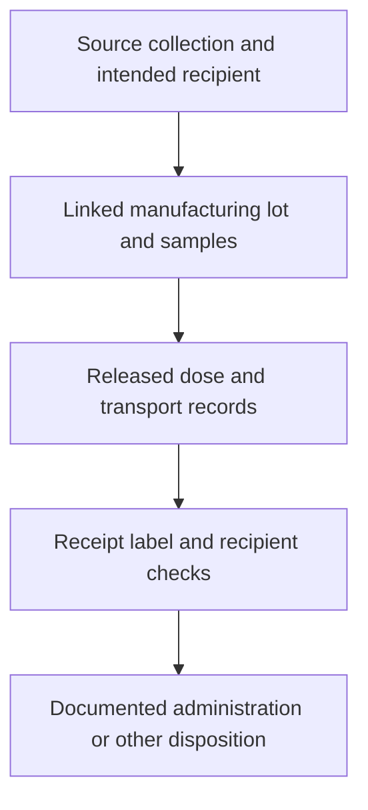

# Chain of identity and custody

## In one sentence

Chain of identity links a product to its source and intended recipient, while chain of custody records who controlled it through each handoff.

## The intuition

A tracked parcel has both an address and a travel history. The address answers where it belongs; the history answers who handled it. A perfect travel log for a wrongly addressed parcel solves the wrong problem.

For cell therapy, the “parcel” may divide into samples and doses, change through manufacture and move between facilities. A sticker alone cannot carry that whole history. Records must preserve the relationships as well as the containers.

## How it works

At collection, identifiers connect the source person, collection event and material. For an [autologous product](/wiki/education/concepts/engineering-and-manufacturing/cell-manufacturing/autologous-vs-allogeneic-cell-therapy), the intended recipient is also the source person. For a donor-derived product, the donor and recipient relationships differ.

As material is sampled, processed or divided, new container or batch identifiers must remain linked to the earlier ones. Multiple collections may feed one therapy; one manufactured lot may provide multiple doses. The record needs those relationships rather than assuming one bag always equals one person.

**Chain of identity (COI)** preserves that association. **Chain of custody (COC)** documents guardianship and handoffs: who released material, who received it, when and under what recorded conditions. Checks compare physical labels with the authorized records.

*Identity follows the biological relationships; custody follows the handling.*

The records also connect applicable sequence or engineering versions to the lot. For a personalized RNA vaccine, a correctly delivered vial must still match the intended construct and recipient. That product is not a cell collection, but the traceability problem is closely related.

## Why it matters in cancer

Patient-specific products cannot be treated as interchangeable stock. A wrong-recipient or wrong-version error can remain invisible to tests that merely confirm the product is viable or biologically active.

A custody record supports investigation of a temperature excursion or delayed handoff. It does not itself establish that the material remained suitable. [Cryopreservation](/wiki/education/concepts/engineering-and-manufacturing/cell-manufacturing/cryopreservation), stability evidence and [batch release](/wiki/education/concepts/engineering-and-manufacturing/cmc-and-quality/gmp-and-batch-release) answer those quality questions.

## How it is measured

Traceability is primarily a record system, not a laboratory concentration. Auditable entries include collection, container, sample, lot and recipient identifiers; handoff timestamps; and disposition.

Temperature records use degrees Celsius, elapsed holding times use defined units, and quantities may use milliliters or cell counts. Those measurements supplement identity checks. A temperature logger cannot establish whose cells are in a bag.

Standardized codes can help different systems communicate. Their correct use still needs verification, controlled records and a way to investigate mismatches. A barcode is a means of carrying an identifier, not evidence that every upstream entry was correct.

## Worked example and practice

A fictional cell lot passes viability and functional tests. At clinic receipt, the lot's linked recipient differs from the scheduled patient's identity.

**Try it:** Do the passing assays resolve the discrepancy?

**Answer:** No. Biological quality and correct identity are separate gates. The discrepancy needs the authorized investigation and disposition; guessing from the appointment calendar cannot restore the missing link.

## Common confusions

- Identity asks “whose material and for whom?”; custody asks “who controlled it and when?”
- A courier tracking number is not complete clinical-product traceability.
- Passing potency does not establish correct recipient or sequence.
- Recording a temperature excursion does not make the excursion acceptable.

## Explain it back

“The identity chain links ___; the custody chain documents ___.” One answer: “source, product and intended recipient; handling and handoffs.”

## Related concepts

- [Leukapheresis](/wiki/education/concepts/engineering-and-manufacturing/cell-manufacturing/leukapheresis)
- [Manufacturing comparability](/wiki/education/concepts/engineering-and-manufacturing/cmc-and-quality/manufacturing-comparability)

## Sources and scope

Source check: October 9, 2026; expert and learner review pending. The scenario is fictional. This is traceability education, not a local operating procedure.

- [ICCBBA ISBT 128 chain-of-identity standard, version 1.1.0](https://iccbba.org/wp-content/uploads/2025/08/1a7593_0aa7a5f7202c4b43be4cc11bcd2048ef.pdf) — identity, custody and end-to-end associations.
- [ICCBBA implementation guide IG-050](https://iccbba.org/wp-content/uploads/2025/08/1a7593_badfaf3c48d443f78006340096a671e0.pdf) — communicating identifiers across the supply chain; this edition has a stated scenario scope.
- [FDA final chimeric antigen receptor (CAR) T-cell guidance, January 2024](https://www.fda.gov/media/156896/download) — documented tracking, label and recipient checks.
- [FDA 2024 CMC town-hall transcript](https://www.fda.gov/media/180664/download) — starting-material control, transport and traceability.

<!-- BEGIN GENERATED USED IN -->
## Used in

- [How to engineer T cells inside the body](/wiki/education/cellular-therapies/06-in-vivo-delivery)
- [How a personalized vaccine is manufactured](/wiki/education/designing-a-vaccine/05-how-vaccines-are-manufactured)
- [How engineered immune cells can attack a solid tumor](/wiki/education/guides/engineered-cell-therapy/index)
<!-- END GENERATED USED IN -->
