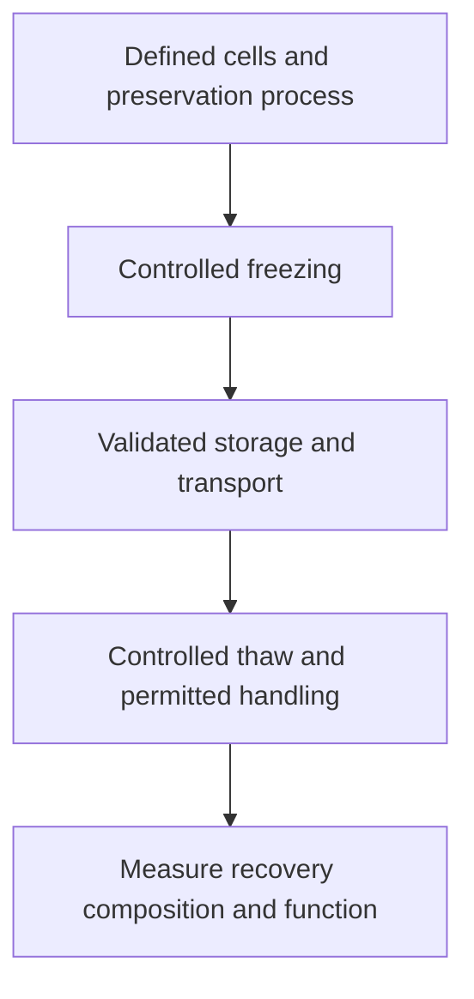
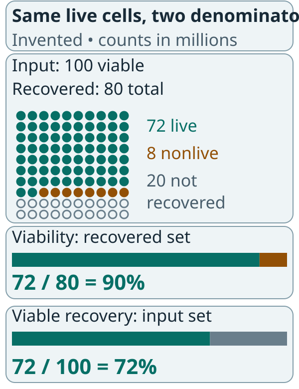

# Cryopreservation of living cells

## In one sentence

Cryopreservation uses a controlled preservation process and very low temperatures to retain cells for later recovery and use.

## The intuition

Think of putting a living population into a carefully managed pause. The aim is to recover useful cells later, rather than simply keep a bag cold.

The pause analogy has a limit: freezing and thawing can kill cells, change the recovered mixture or alter function. The population does not necessarily return unchanged. Recovery must be measured.

## How it works

As water freezes, ice formation and changing solute concentrations can injure cells. Cooling rate and water movement influence whether damaging ice forms inside cells. Preservation methods control those stresses for the particular material.

A **cryoprotectant** helps limit freezing injury. Dimethyl sulfoxide (DMSO) is used in some cell-product formulations, but its concentration, exposure and clinical risks are product-specific. A familiar ingredient does not validate a new freezing method.

The preservation process includes the formulation, container, freezing, storage, transport and thawing conditions. [Chain of identity and custody](/wiki/education/concepts/engineering-and-manufacturing/cell-manufacturing/chain-of-identity-and-custody) maintains the link to the collected cells and intended product throughout.

*The endpoint is a suitable recovered population, not just a frozen container.*

A starting collection and a finished cell therapy are different preservation stages. Data for one cannot automatically validate the other. Neither can a preserved research sample automatically become accepted treatment-manufacturing material.

## Why it matters in cancer

Preservation can separate collection, manufacture and treatment dates. It can support transport and provide time for testing. It also introduces another source of cell loss and variability.

In a primary National Institutes of Health (NIH) study, Panch and colleagues measured characteristics of cryopreserved starting material and autologous [chimeric antigen receptor (CAR)](/wiki/education/concepts/therapeutics/cell-therapies/car-anatomy) T-cell products. It illustrates why post-thaw recovery and cell attributes need testing in the actual workflow, rather than assuming every frozen product behaves alike.

Cell preservation differs from freezing RNA-vaccine vials. RNA stability and particle behavior are different quality questions. “Keep frozen” is not a common handling protocol for all living cells and nucleic-acid products.

## How it is measured

**Viability** is the fraction of measured cells classified as living by the specified assay. **Viable recovery** compares recovered living cells with a clearly defined pre-freeze living-cell count.

Reports also need cell composition and relevant [potency assays](/wiki/education/concepts/engineering-and-manufacturing/cmc-and-quality/potency-assays). Temperature is recorded in degrees Celsius; storage duration and post-thaw holding time need stated units. There is no universal shelf life, allowable excursion or post-thaw interval for every cell product.

The sample timing matters. A primary study by Wang and colleagues found that functional measurements changed with post-thaw recovery conditions for its particular CAR T-cell preparation. That is an assay-design observation, not permission to add an unvalidated resting step to clinical handling.

## Worked example and practice

A fictional sample starts with 100 million viable cells. After thaw, 80 million total cells are recovered and 90% test viable.

*The same 72 million live cells can be 90% of what was recovered and 72% of what went in.*

Each dot stands for one million cells in this invented counting example. Teal dots are recovered live cells; amber dots are recovered nonlive cells; outlined dots represent input cells not recovered in the count. They do not identify the mechanism of loss. The two bars change the denominator while keeping 72 million recovered live cells as the numerator. Neither bar measures potency.

**Try it:** Is viable recovery 90%?

**Answer:** No. There are 72 million recovered viable cells, giving 72% viable recovery relative to the stated input. The 90% value is viability among recovered cells. Neither number proves useful tumor recognition.

## Common confusions

- High viability can coexist with substantial loss of the starting population.
- Freezing for molecular analysis is not validated preservation of living cells.
- A successful freeze does not prove unchanged function or cell composition.
- A freezer temperature alone does not establish shelf life or clinical suitability.

## Explain it back

“A preserved sample is useful only if ___.” One answer: “its identity, recovery, composition and relevant function remain suitable for the intended use.”

## Related concepts

- [Ex vivo cell expansion](/wiki/education/concepts/engineering-and-manufacturing/cell-manufacturing/ex-vivo-cell-expansion)
- [Good manufacturing practice and batch release](/wiki/education/concepts/engineering-and-manufacturing/cmc-and-quality/gmp-and-batch-release)

## Sources and scope

Source check: October 9, 2026; expert and learner review pending. This is not a freezing, thawing or infusion recipe. Practice counts are fictional.

- [Mazur, 1963](https://pubmed.ncbi.nlm.nih.gov/14085017/) — water movement, cooling rate and intracellular freezing.
- [Panch et al., 2019](https://pubmed.ncbi.nlm.nih.gov/31178392/) — primary study of autologous CAR T-cell cryopreservation.
- [Wang et al., 2019](https://pubmed.ncbi.nlm.nih.gov/30910382/) — product-specific post-thaw functional-assay conditions.
- [FDA final CAR T-cell guidance, January 2024](https://www.fda.gov/media/156896/download) — preservation, shipping, stability and in-use handling.

Visual relationship check: October 13, 2026. The new illustration was checked against the relevant FDA CAR T-cell guidance sections; invented arithmetic is teaching data. Existing paper citations retain their stated scope. Expert and learner review remain pending.

<!-- BEGIN GENERATED USED IN -->
## Used in

- [How to engineer T cells inside the body](/wiki/education/cellular-therapies/06-in-vivo-delivery)
- [How engineered immune cells can attack a solid tumor](/wiki/education/guides/engineered-cell-therapy/index)
<!-- END GENERATED USED IN -->
