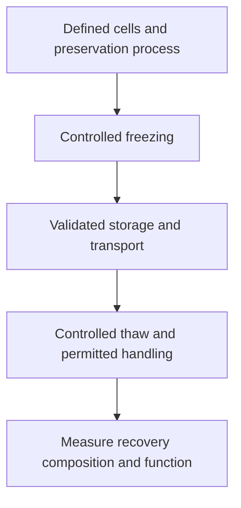
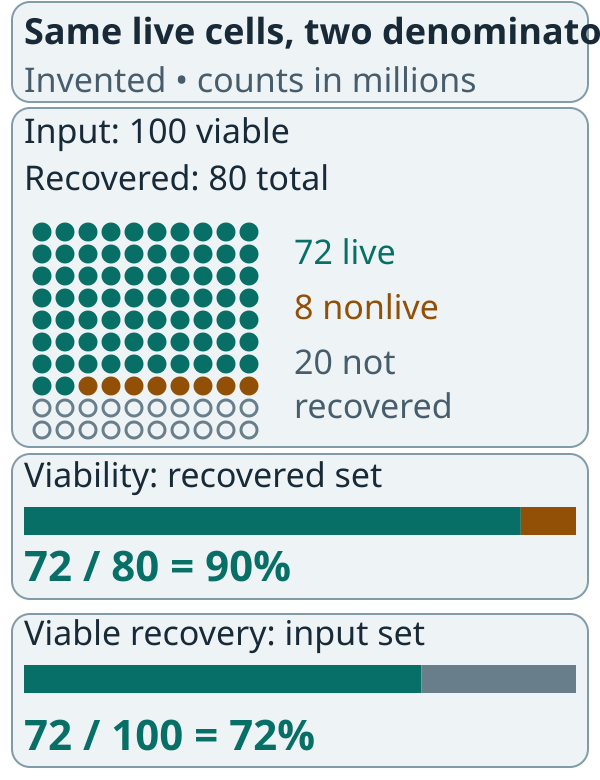

# Cryopreservation of living cells

## In one sentence

Cryopreservation uses a controlled preservation process and very low temperatures to retain cells for later recovery and use.

## The intuition

Think of putting a living population into a carefully managed pause. The aim is to recover useful cells later, rather than simply keep a bag cold.

The pause analogy has a limit: freezing and thawing can kill cells, change the recovered mixture or alter function. The population does not necessarily return unchanged. Recovery must be measured.

## How it works

As water freezes, ice formation and changing solute concentrations can injure cells. Cooling rate and water movement influence whether damaging ice forms inside cells. Preservation methods control those stresses for the particular material.

A **cryoprotectant** helps limit freezing injury. Dimethyl sulfoxide (DMSO) is the usual one for cell products, typically at a few percent of the final formulation: the YESCARTA (axicabtagene ciloleucel) label describes a formulation containing 5% DMSO and 2.5% human albumin ([DailyMed label, section 11](https://dailymed.nlm.nih.gov/dailymed/drugInfo.cfm?setid=9b70606e-b99c-4272-a0f1-b5523cce0c59)), while the KYMRIAH (tisagenlecleucel) label gives 7.5% (v/v) DMSO ([DailyMed label, section 11](https://dailymed.nlm.nih.gov/dailymed/drugInfo.cfm?setid=aad3ba54-dfd3-4cb3-9e2b-c5ef89559189)) — so even two approved autologous T-cell products do not share one number. The cryoprotectant is infused with the thawed cells, so it is also a clinical exposure: that label attributes possible hypersensitivity reactions to DMSO or residual gentamicin. Concentration, exposure and risk remain product-specific, and a familiar ingredient does not validate a new freezing method.

**Storage is cold enough to stop molecular motion, not merely to keep the cells frozen.** Approved autologous [chimeric antigen receptor (CAR)](/wiki/education/concepts/therapeutics/cell-therapies/car-anatomy) T-cell products are held at or below about −120 °C, which in practice means a mechanical freezer or the vapor phase of liquid nitrogen rather than an ordinary −20 °C or −80 °C freezer. The YESCARTA label directs storage at ≤ −120 °C and ships the product in a liquid-nitrogen dry shipper at ≤ −150 °C, allowing one transfer to −80 °C (± 10 °C) for up to 90 days, with no return to colder storage afterwards ([DailyMed label, section 16](https://dailymed.nlm.nih.gov/dailymed/drugInfo.cfm?setid=9b70606e-b99c-4272-a0f1-b5523cce0c59)). The KYMRIAH label directs storage in a temperature-monitored system at or below −120 °C, for example in the vapor phase of liquid nitrogen ([DailyMed label, section 16](https://dailymed.nlm.nih.gov/dailymed/drugInfo.cfm?setid=aad3ba54-dfd3-4cb3-9e2b-c5ef89559189)). Read each product's own label: these two differ in their permitted excursions, and in DMSO content.

The preservation process includes the formulation, container, freezing, storage, transport and thawing conditions. [Chain of identity and custody](/wiki/education/concepts/engineering-and-manufacturing/cell-manufacturing/chain-of-identity-and-custody) maintains the link to the collected cells and intended product throughout.

*The endpoint is a suitable recovered population, not just a frozen container.*

A starting collection and a finished cell therapy are different preservation stages. Data for one cannot automatically validate the other. Neither can a preserved research sample automatically become accepted treatment-manufacturing material.

## Why it matters in cancer

Preservation can separate collection, manufacture and treatment dates. It can support transport and provide time for testing. It also introduces another source of cell loss and variability.

In a primary National Institutes of Health (NIH) study, Panch and colleagues measured characteristics of cryopreserved starting material and autologous CAR T-cell products. It illustrates why post-thaw recovery and cell attributes need testing in the actual workflow, rather than assuming every frozen product behaves alike.

Cell preservation differs from freezing RNA-vaccine vials. RNA stability and particle behavior are different quality questions. “Keep frozen” is not a common handling protocol for all living cells and nucleic-acid products.

## How it is measured

**Viability** is the fraction of measured cells classified as living by the specified assay. **Viable recovery** compares recovered living cells with a clearly defined pre-freeze living-cell count.

Reports also need cell composition and relevant [potency assays](/wiki/education/concepts/engineering-and-manufacturing/cmc-and-quality/potency-assays). Temperature is recorded in degrees Celsius; storage duration and post-thaw holding time need stated units. There is no universal shelf life, allowable excursion or post-thaw interval for every cell product.

The sample timing matters. A primary study by Wang and colleagues found that functional measurements changed with post-thaw recovery conditions for its particular CAR T-cell preparation. That is an assay-design observation, not permission to add an unvalidated resting step to clinical handling.

## Worked example and practice

A fictional sample starts with 100 million viable cells. After thaw, 80 million total cells are recovered and 90% test viable.

*The same 72 million live cells can be 90% of what was recovered and 72% of what went in.*

Each dot stands for one million cells in this invented counting example. Teal dots are recovered live cells; amber dots are recovered nonlive cells; outlined dots represent input cells not recovered in the count. They do not identify the mechanism of loss. The two bars change the denominator while keeping 72 million recovered live cells as the numerator. Neither bar measures potency.

**Try it:** Is viable recovery 90%?

**Answer:** No. There are 72 million recovered viable cells, giving 72% viable recovery relative to the stated input. The 90% value is viability among recovered cells. Neither number proves useful tumor recognition.

## Common confusions

- High viability can coexist with substantial loss of the starting population.
- Freezing for molecular analysis is not validated preservation of living cells.
- A successful freeze does not prove unchanged function or cell composition.
- A freezer temperature alone does not establish shelf life or clinical suitability.

## Explain it back

“A preserved sample is useful only if ___.” One answer: “its identity, recovery, composition and relevant function remain suitable for the intended use.”

## Related concepts

- [Ex vivo cell expansion](/wiki/education/concepts/engineering-and-manufacturing/cell-manufacturing/ex-vivo-cell-expansion)
- [Good manufacturing practice](/wiki/education/concepts/engineering-and-manufacturing/cmc-and-quality/gmp-and-batch-release) and [batch release](/wiki/education/concepts/engineering-and-manufacturing/cmc-and-quality/batch-release)

## Sources and scope

Source check: November 8, 2026 (storage temperatures and the two labels' DMSO contents); November 7, 2026 (DMSO exposure); October 9, 2026 (rest); expert and learner review pending. This is not a freezing, thawing or infusion recipe. Practice counts are fictional.

- [Mazur, 1963](https://pubmed.ncbi.nlm.nih.gov/14085017/) — water movement, cooling rate and intracellular freezing.
- [Panch et al., 2019](https://pubmed.ncbi.nlm.nih.gov/31178392/) — 158 autologous CAR T-cell products from six single-center trials: cryopreserving the starting mononuclear cells lowered their viability but did not change final fold expansion, transduction efficiency, CD3% or CD4:CD8 ratio, and persistence and clinical responses did not differ between fresh and cryopreserved final products (abstract checked November 7, 2026).
- [YESCARTA prescribing information](https://dailymed.nlm.nih.gov/dailymed/drugInfo.cfm?setid=9b70606e-b99c-4272-a0f1-b5523cce0c59) — 5% DMSO and 2.5% albumin in the formulation; hypersensitivity reactions attributed in part to DMSO (checked November 7, 2026); section 16 storage at ≤ −120 °C, shipping at ≤ −150 °C and the single permitted −80 °C excursion (section text checked November 8, 2026).
- [KYMRIAH prescribing information](https://dailymed.nlm.nih.gov/dailymed/drugInfo.cfm?setid=aad3ba54-dfd3-4cb3-9e2b-c5ef89559189) — section 16 storage in a temperature-monitored system at or below −120 °C, and 7.5% (v/v) DMSO in section 11 (section text checked November 8, 2026).
- [Wang et al., 2019](https://pubmed.ncbi.nlm.nih.gov/30910382/) — product-specific post-thaw functional-assay conditions.
- [FDA final CAR T-cell guidance, January 2024](https://www.fda.gov/media/156896/download) — preservation, shipping, stability and in-use handling.

Visual relationship check: October 13, 2026. The new illustration was checked against the relevant FDA CAR T-cell guidance sections; invented arithmetic is teaching data. Existing paper citations retain their stated scope. Expert and learner review remain pending.

<!-- BEGIN GENERATED USED IN -->
## Used in

- [How to engineer T cells inside the body](/wiki/education/guides/engineered-cell-therapy/04-in-vivo-delivery)
<!-- END GENERATED USED IN -->
