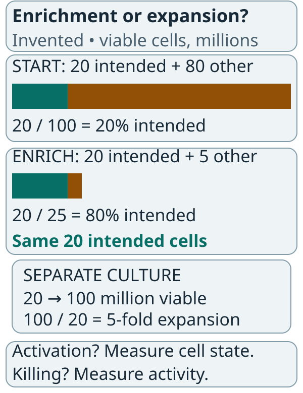
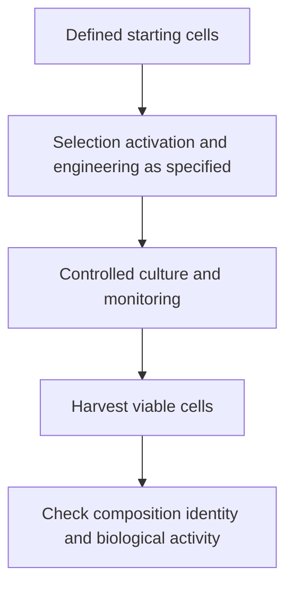

# Ex vivo cell expansion

## In one sentence

Ex vivo cell expansion grows a cell population outside the body under controlled conditions, changing its number and potentially its composition and state.

## The intuition

Think of a greenhouse that helps selected plants multiply. The growing conditions also favor some plants over others. A larger harvest can therefore be a different mixture from the starting material.

The analogy stops at function: counting plants cannot tell us whether immune cells retain useful recognition and killing. Expansion is a biological process, not photocopying.

## How it works

A manufacturer begins with collected cells, which may undergo selection or activation. **Selection** enriches a population; **activation** provides signals that stimulate its behavior. Neither necessarily increases the total cell number.

*Enrichment can raise a fraction while the intended-cell count stays fixed. Expansion increases a defined population count.*

The first two bars share one scale: each full width represents 100 million viable cells. Teal is the intended population and amber is other cells. The enriched population has fewer other cells, not more intended cells. The lower example is a separate culture, measured on the same viable-cell basis at start and end. No culture duration or growth rate is implied. Activation state and target-cell killing are not supplied by these counts.

Cells then divide in culture with controlled medium, nutrients and signals. [Cytokines](/wiki/education/concepts/immunology/immune-regulation/cytokine-and-chemokine) can support growth or change cell state. Density, gas exchange, temperature and time all influence the culture.

Expansion can occur before or after genetic engineering, depending on the process. Some cells divide faster or survive better than others. The final population may have different cell subsets, receptor-positive fractions or levels of activation from the input.

*Increasing the count is one manufacturing result; preserving useful properties is another.*

[Good manufacturing practice (GMP) and batch release](/wiki/education/concepts/engineering-and-manufacturing/cmc-and-quality/gmp-and-batch-release) connect the culture to a defined process. A large bag does not bypass those checks.

## Why it matters in cancer

A cell product needs an adequate dose of the intended cells. Expansion can help obtain it, but longer culture can also change differentiation and function.

A primary study by Ghassemi and colleagues compared culture durations for a CD19-directed [chimeric antigen receptor (CAR)](/wiki/education/concepts/therapeutics/cell-therapies/car-anatomy) product in laboratory experiments and a leukemia mouse model. Shorter culture changed the cells' state and antileukemic activity. That supports evaluating duration, rather than prescribing one culture length for all cell types or solid tumors.

Expansion outside the body is also different from a [living drug](/wiki/education/concepts/therapeutics/cell-therapies/cell-therapy-as-a-living-drug) expanding after infusion. A factory growth curve does not predict exactly how cells will survive, move or divide in a patient.

## How it is measured

Useful outputs include viable cell count, cells per milliliter, viable-cell percentage, relevant subset fractions and culture duration in days. **Fold expansion** is an end count divided by a starting count using the same defined population and viability convention.

Counts should identify whether they include all cells, viable T cells or receptor-positive viable T cells. Changing that denominator midway can create apparent growth. Diluting into more liquid changes concentration without creating cells.

[Potency assays](/wiki/education/concepts/engineering-and-manufacturing/cmc-and-quality/potency-assays) ask about relevant biological activity. A cell count or receptor-positive fraction alone cannot answer the whole functional question.

## Worked example and practice

A fictional culture starts with 20 million viable cells and ends with 100 million viable cells, measured on the same basis.

**Try it:** What is the fold expansion, and what does it fail to prove?

**Answer:** Five-fold. It does not prove that each cell is receptor-positive, tumor-reactive or equally functional. If the final count included dead cells, even that five-fold viable expansion would not be established.

## Common confusions

- Enrichment changes fractions; expansion changes population size.
- More cells need not mean a better therapeutic product.
- Cell concentration and total cell count are different quantities.
- Ex vivo growth and in vivo persistence require different measurements.

## Explain it back

“Expansion increases ___, while quality testing asks ___.” One answer: “a defined cell population's number; whether the final cells retain the required identity, composition and activity.”

## Related concepts

- [Cryopreservation](/wiki/education/concepts/engineering-and-manufacturing/cell-manufacturing/cryopreservation)
- [Manufacturing comparability](/wiki/education/concepts/engineering-and-manufacturing/cmc-and-quality/manufacturing-comparability)

## Sources and scope

Source check: October 9, 2026; expert and learner review pending. This is process education, not a culture recipe. Practice numbers are fictional.

- [NCI T-cell transfer therapy](https://www.cancer.gov/about-cancer/treatment/types/immunotherapy/t-cell-transfer-therapy) — growing selected cells for treatment.
- [Ghassemi et al., 2018](https://pubmed.ncbi.nlm.nih.gov/30030295/) — culture-duration experiments and leukemia mouse-model comparisons, not universal clinical equivalence.
- [FDA final CAR T-cell guidance, January 2024](https://www.fda.gov/media/156896/download) — in-process monitoring, composition, harvest and testing.

Visual relationship check: October 13, 2026. The new illustration was checked against the relevant FDA CAR T-cell guidance sections; invented arithmetic is teaching data. Existing paper citations retain their stated scope. Expert and learner review remain pending.

<!-- BEGIN GENERATED USED IN -->
## Used in

- [How to engineer T cells inside the body](/wiki/education/cellular-therapies/06-in-vivo-delivery)
- [How engineered immune cells can attack a solid tumor](/wiki/education/guides/engineered-cell-therapy/index)
<!-- END GENERATED USED IN -->
