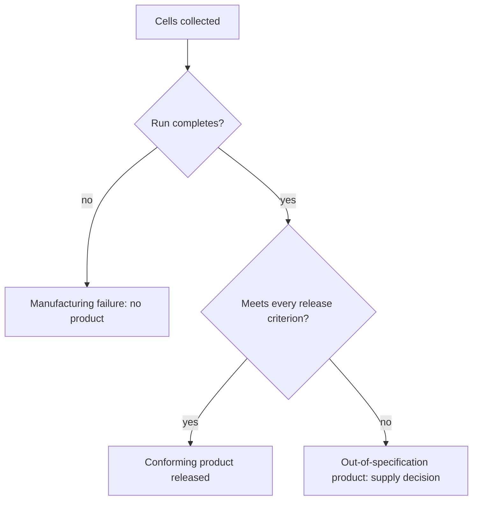

# Manufacturing failure and out-of-specification product

## In one sentence

A manufacturing failure is a patient-specific cell product that is never successfully made; an out-of-specification product is one that was made but misses at least one release criterion.

## The intuition

A tailor can fail in two ways. The cloth can be ruined, so no suit exists. Or a suit can be finished with a sleeve a centimeter short of the specification written on the order, and someone must then decide whether to deliver it.

The analogy stops at the decision. A suit can be re-cut; a patient's cells are a finite starting material, the patient is waiting, and the person deciding is weighing a flawed product against no product at all.

## How it works

An [autologous](/wiki/education/concepts/engineering-and-manufacturing/cell-manufacturing/autologous-vs-allogeneic-cell-therapy) product is made once, from one person's cells, and each lot is its own batch. The starting material varies with the patient's disease and prior treatment, so the same process can give different results from different people. Three distinct outcomes follow, and reports use different words for them.

| Outcome | What happened | Where it shows up |
|---|---|---|
| Manufacturing termination or failure | The run stopped; no product exists | A manufacturing success rate below 100% |
| Shipment not made or cancelled | A product exists but was not sent, or was no longer needed | A shipment success rate separate from manufacturing |
| Out-of-specification (OOS) product | A product exists and misses at least one release criterion | A separate OOS rate, plus a case-by-case supply decision |

[Release testing](/wiki/education/concepts/engineering-and-manufacturing/cell-manufacturing/release-testing-for-cell-products) defines which attributes are checked, and [batch release](/wiki/education/concepts/engineering-and-manufacturing/cmc-and-quality/batch-release) defines the disposition decision. An OOS result is not one failure mode: in a reported program the usual reasons were low cell viability and a cell dose below — or, in one disease group, above — the specified range.

An OOS product is not automatically discarded. Because the alternative may be no treatment, programs can supply it under a defined pathway with its own consent and reporting, and some have studied those patients prospectively.

*The two failure routes are different events and are counted separately.*

## Why it matters in cancer

A patient who never receives a product is still part of the treatment pathway. Reading results only among infused people removes the failures from the denominator and makes the pathway look more reliable than it is — the same denominator problem that [vein-to-vein time](/wiki/education/concepts/engineering-and-manufacturing/cell-manufacturing/vein-to-vein-time) raises for the calendar.

Failure rates are program properties, not fixed properties of a modality. In commercial tisagenlecleucel manufacturing for patients in Japan between August 2019 and July 2023, the manufacturing success rate rose from 85.6% in year one to 95.3% in year four, the termination rate fell from 6.8% to 0.9%, and the OOS rate fell from 7.6% to 3.7% ([Iwamoto et al., 2025](https://pubmed.ncbi.nlm.nih.gov/40066375/)). Those are one product, one region and one four-year window; they show the direction and the order of magnitude, and they cannot be read as another product's rate.

An OOS product that is infused is also an evidence problem. Its outcomes belong to a differently specified product, so they should not be pooled with conforming lots without saying so.

## How it is measured

Ask for a denominator and a definition: how many people were collected, how many runs completed, how many products shipped, how many met every criterion, and how many people were infused. A "manufacturing success rate" can be calculated per order, per collection or per run, and the three differ. An OOS rate needs the reasons attached, because a viability miss and a dose miss raise different clinical questions.

## Worked example and practice

**Fictional teaching numbers.** A program collects cells from 100 people. Six runs terminate. Of the 94 products made, 4 miss a release criterion; 3 of those 4 are supplied under the program's OOS pathway and 1 is not. Eight more people deteriorate and are never infused.

- Manufacturing success rate: 94/100 = 94%.
- OOS rate among products made: 4/94 ≈ 4.3%.
- People infused: 94 − 1 (OOS not supplied) − 8 (never infused) = 85, so 85/100 = 85% of people collected.

**Try it:** A sponsor reports "94% manufacturing success." What has it not told you?

One possible answer

How many collected people were actually treated (85 of 100 here), how many products were out of specification, which criteria they missed, and whether OOS lots were infused and pooled into the efficacy result.

## Common confusions

- A manufacturing failure and an out-of-specification product are different events: one has no product, the other has a product that misses a criterion.
- An OOS product is not necessarily unusable, and an infused OOS lot is not the same product as a conforming lot.
- A high manufacturing success rate does not mean a high proportion of collected patients were treated.
- These rates belong to a named product, process version and period, not to cell therapy in general.

## Explain it back

"A failure rate needs ___ and ___." One answer: "a stated denominator — orders, collections or runs; and the reasons products missed their criteria."

## Takeaway

**Count the people who never reached a conforming product, and keep out-of-specification lots labelled.**

## Related concepts

- [Release testing for cell products](/wiki/education/concepts/engineering-and-manufacturing/cell-manufacturing/release-testing-for-cell-products)
- [Vein-to-vein time](/wiki/education/concepts/engineering-and-manufacturing/cell-manufacturing/vein-to-vein-time)
- [Batch release](/wiki/education/concepts/engineering-and-manufacturing/cmc-and-quality/batch-release)
- [Manufacturing comparability](/wiki/education/concepts/engineering-and-manufacturing/cmc-and-quality/manufacturing-comparability)

## Sources and scope

Source check: November 7, 2026; expert and learner review pending. The worked counts are invented teaching numbers and promise no program's performance. The cited rates describe one product in one region over one period.

- [Iwamoto et al., 2025, *Regenerative Therapy*](https://pubmed.ncbi.nlm.nih.gov/40066375/) — commercial tisagenlecleucel orders in Japan, August 2019 to July 2023: manufacturing success rate 85.6% to 95.3%, termination 6.8% to 0.9%, out-of-specification 7.6% to 3.7%.
- [Kato et al., 2025, *Cytotherapy*](https://pubmed.ncbi.nlm.nih.gov/40377509/) — a phase 3b study of patients treated with out-of-specification tisagenlecleucel; the definition of OOS and the recorded reasons (low viability, low or high dose) come from this report.
- [FDA: chimeric antigen receptor (CAR) T-cell product-development guidance, January 2024](https://www.fda.gov/media/156896/download) — release testing and lot disposition expectations.

<!-- BEGIN GENERATED USED IN -->
## Used in

Browse the [concept index](/wiki/education/concepts/index) for related learning paths.
<!-- END GENERATED USED IN -->
