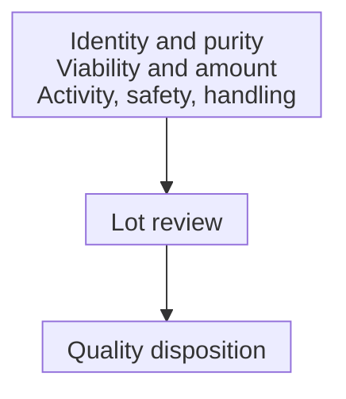
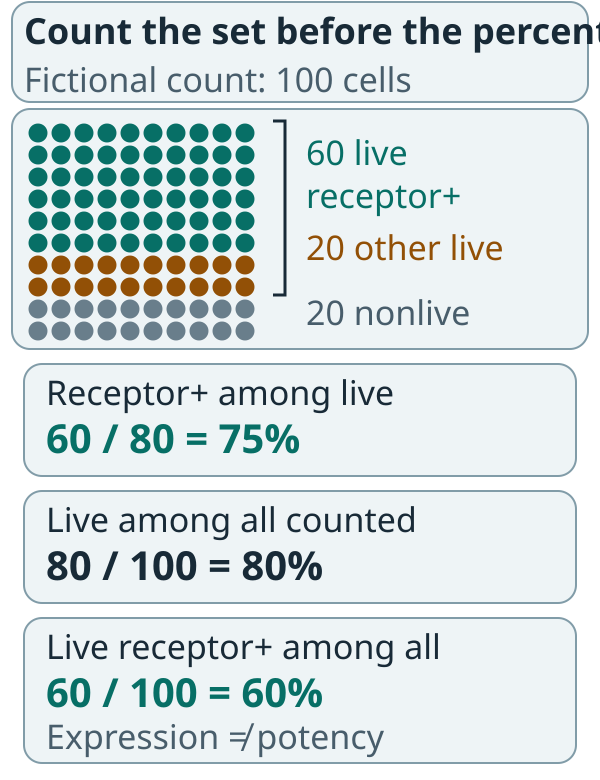

# Release testing for cell products: separate quality questions

## In one sentence

Release testing for cell products assesses specified attributes of a particular cell-product lot before its quality disposition.

## The intuition

A team can have the correct jerseys, enough people and an apparently healthy roster without demonstrating the skill needed for its task. Those checks are useful, but they ask different questions.

For a cell product, the analogy separates identity, quantity, viability and function. It does not imply that cells behave like a coordinated team in a patient. Laboratory quality and clinical performance have different evidence.

## How it works

Begin with the specified product and lot. [Chain of identity and custody](/wiki/education/concepts/engineering-and-manufacturing/cell-manufacturing/chain-of-identity-and-custody) connects source, processing, recipient and handoffs. A biological identity test alone cannot establish that a container belongs to the intended person.

**Identity** asks whether the intended cells or construct are present. **Purity** concerns unwanted cells or materials. **Viability** concerns the live fraction under a defined method. These measurements can overlap in an assay, but they are not interchangeable.

[Potency](/wiki/education/concepts/engineering-and-manufacturing/cmc-and-quality/potency-assays) assesses biological activity relevant to the intended action. Receptor expression can contribute evidence; its relation to function needs support. The United States Food and Drug Administration (FDA) potency guidance does not supply universal acceptance criteria for all cell products.

Microbiological safety checks address relevant contamination risks, such as bacteria, mycoplasma or endotoxin. These are different targets, not alternative names for sterility. Living final products require suitable manufacturing controls; terminal sterilization that destroys the cells cannot be treated as an ordinary solution. The applicable test set depends on product, process and development stage.

Handling is part of the evidence. Cryopreservation, thawing and the interval before administration may change relevant attributes. Results should be interpreted at their actual sampling point, with supporting stability and handling data. A pre-freeze result is not automatically a post-thaw result.

*Complementary checks support the lot review. No individual test establishes the whole release package or clinical benefit.*

## Why it matters in cancer

An engineered immune-cell product may contain live cells that express a receptor but lack adequate relevant activity. Conversely, a strong activity result cannot erase a contamination or identity problem. Cell [release](/wiki/education/concepts/engineering-and-manufacturing/cmc-and-quality/batch-release) requires the applicable package, rather than selecting the most reassuring result.

## How it is measured

| Attribute | Illustrative output | Important boundary |
|---|---|---|
| Cellular identity or composition | Defined populations by flow cytometry | State the gating and denominator |
| Viability and amount | Live fraction and a specified cell count | Live cells are not necessarily functional cells |
| Activity | Product-relevant assay or justified assay matrix | Assay conditions do not reproduce a whole patient |
| Safety | Results for named contaminants | One target does not cover every hazard |
| Stability | Attributes after specified storage or handling | Conditions and time point limit the inference |

These examples are not a product's acceptance specification. [A COA](/wiki/education/concepts/engineering-and-manufacturing/cmc-and-quality/certificate-of-analysis) reports selected lot results; it is not every supporting study.

## Worked example and practice

In a fictional laboratory teaching sample, 100 counted cells include 80 live cells. Of those 80 live cells, 60 express the intended receptor. The live fraction is 80%; receptor positivity among live cells is 75%. The 60 live receptor-positive cells are 60% of all counted cells. These are different denominators, not three conflicting results.

*All three percentages are correct because they count different sets.*

Each dot is one counted cell in an invented sample. The teal block contains 60 live receptor-positive cells; amber contains 20 other live cells; gray contains 20 nonlive cells. The live bracket contains the first two blocks. Receptor status of the nonlive cells is not specified. These counts describe expression and viability under stated gates; they provide neither a potency result nor authorization to release the lot.

**Try it:** Does this establish potency or a complete release decision?

One possible answer

No. The fictional counts describe viability and receptor expression under stated gates. They supply no functional, contamination, handling or final-disposition evidence. None of the percentages is a clinical release cutoff.

## Common confusions

- Viability, purity and potency are different attributes.
- A sample's count is not automatically the administered dose.
- A valid test result is not the complete quality disposition.
- Quality release, patient eligibility and treatment benefit remain separate gates.

## Explain it back

“Identity, viability and potency answer ___; the denominator tells me ___.” One answer: “different questions; which population a reported percentage counts.”

## Takeaway

**Read each cell-product result in its own assay and lot context.**

## Related concepts

- [Flow cytometry](/wiki/education/concepts/measurement/immune-monitoring/flow-cytometry)
- [Autologous versus allogeneic cell therapy](/wiki/education/concepts/engineering-and-manufacturing/cell-manufacturing/autologous-vs-allogeneic-cell-therapy)

## Sources and scope

Source check: October 10, 2026. General cell-product quality education, with chimeric antigen receptor (CAR) T-cell examples; not a release specification. Actual expert and learner review remains pending.

- [FDA: CAR T-cell product-development guidance, January 2024](https://www.fda.gov/media/156896/download), analytical testing, microbiological controls and in-use stability sections.
- [FDA: potency tests for cellular and gene therapy products, January 2011](https://www.fda.gov/media/79856/download), product-specific potency testing and acceptance-criteria limits.
- [FDA: gene-therapy CMC information for investigational applications, January 2020](https://www.fda.gov/media/113760/download), product control and stability sections.

Visual relationship check: October 13, 2026. The new illustration was checked against the relevant FDA CAR T-cell guidance sections; invented arithmetic is teaching data. Existing paper citations retain their stated scope. Expert and learner review remain pending.

<!-- BEGIN GENERATED USED IN -->
## Used in

Browse the [concept index](/wiki/education/concepts/index) for related learning paths.
<!-- END GENERATED USED IN -->
