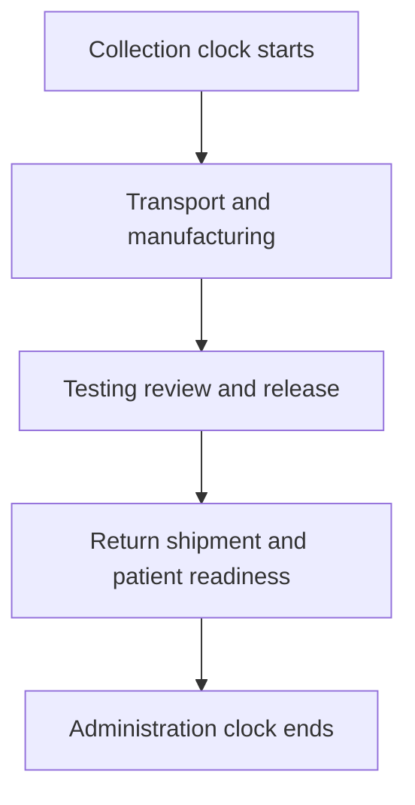
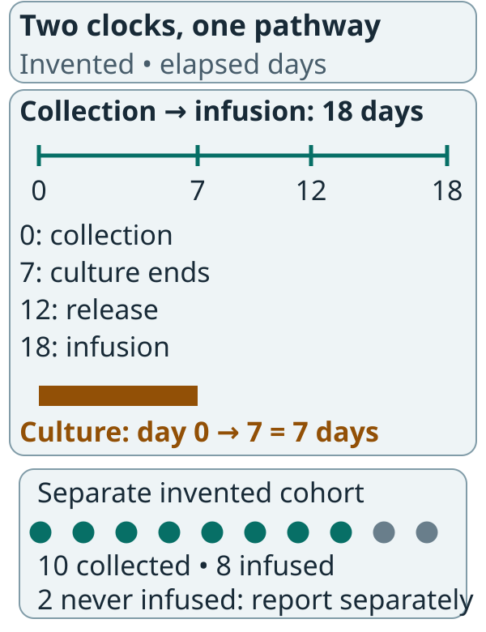

# Vein-to-vein time

## In one sentence

Vein-to-vein time is the elapsed interval from collecting a person's cells to administering the manufactured cell product back to that person.

## The intuition

A parcel's travel time includes more than the minutes spent packing it. It can wait for a slot, move between sites and pause before delivery. Cell therapy has a similar calendar, but the recipient can become medically unready while the product is being made.

The parcel analogy misses living biology. Starting cells and the finished product can lose quality, and a patient may need a different clinical plan. A faster factory is only one part of a shorter treatment interval.

## How it works

In a typical [autologous workflow](/wiki/education/concepts/engineering-and-manufacturing/cell-manufacturing/autologous-vs-allogeneic-cell-therapy), the clock starts at [leukapheresis](/wiki/education/concepts/engineering-and-manufacturing/cell-manufacturing/leukapheresis) or another specified cell collection. Collection and shipping lead to manufacturing, product testing, release, return transport and scheduled administration.

Some activities overlap. Others wait for a preceding result or a clinical decision. A failed lot, repeat collection or reassessment can add time. [Ex vivo expansion](/wiki/education/concepts/engineering-and-manufacturing/cell-manufacturing/ex-vivo-cell-expansion) describes one process step, not this entire interval.

*Record the start and end events before comparing the number of days.*

A sponsor may instead report order-to-infusion, enrollment-to-infusion or receipt-to-release time. Those can be useful metrics, but they are not the same clock. Definitions and handling of repeat collections belong beside the estimate.

An [in vivo delivery product](/wiki/education/concepts/engineering-and-manufacturing/cell-manufacturing/ex-vivo-vs-in-vivo-engineering) does not have this same patient-specific cell collection-to-return interval. Carrier production, release, access and clinical preparation still take time. Calling the interval “zero” can hide the remaining work.

## Why it matters in cancer

Patients may need disease control while waiting. A treatment given during the interval is often called **bridging therapy**. Whether it is needed, appropriate or allowed depends on the patient and protocol.

A delay can affect both feasibility and interpretation. People who reach infusion may differ from those who deteriorate, withdraw or have manufacturing failure. Reading only infused patients can miss that part of the treatment pathway.

A stocked donor-derived product may shorten patient-specific manufacturing wait. It does not guarantee an available lot, immediate scheduling or eligibility. Compare measured intervals in actual programs, rather than assigning universal days to a cell category.

## How it is measured

The basic unit is elapsed calendar days, with exact start and end dates. A report should give its definition, cohort, central estimate and spread. A median does not promise that the next patient will receive treatment by that date.

Also ask how many people started the pathway, how many received product and why others did not. A vein-to-vein summary among infused patients cannot assign an infusion time to people who never received cells. Report those outcomes separately.

## Worked example and practice

In a fictional workflow, cells are collected on day 0. Culture ends on day 7, release occurs on day 12 and infusion occurs on day 18.

*The 7-day culture interval sits inside an 18-day collection-to-infusion interval. People never infused need a separate outcome.*

The upper axis uses elapsed days, with proportional event positions at 0, 7, 12 and 18. For this invented example only, culture starts at collection and ends on day 7; other workflows can start culture later. The lower dots depict a separate invented cohort. Infused-only timing cannot assign an infusion duration to the two people never infused. Report the follow-up window and reasons separately; these counts and dates promise no turnaround time.

**Try it:** Is vein-to-vein time seven days?

**Answer:** No. It is 18 elapsed days for this example. Seven days describes the stated culture interval. The other steps remain part of the treatment calendar.

## Common confusions

- Culture time is not vein-to-vein time.
- Enrollment-to-infusion and collection-to-infusion have different starting events.
- A fast median can conceal long waits and people never infused.
- Off-the-shelf availability does not eliminate all clinical preparation.

## Explain it back

“A timeline claim needs ___, ___ and ___.” One answer: “a defined clock, an identified population and the outcomes of people who did not reach infusion.”

## Related concepts

- [Chain of identity and custody](/wiki/education/concepts/engineering-and-manufacturing/cell-manufacturing/chain-of-identity-and-custody)
- [Cryopreservation](/wiki/education/concepts/engineering-and-manufacturing/cell-manufacturing/cryopreservation)

## Sources and scope

Source check: October 9, 2026; expert and learner review pending. The timeline is fictional and provides no scheduling promise.

- [NCI T-cell transfer therapy](https://www.cancer.gov/about-cancer/treatment/types/immunotherapy/t-cell-transfer-therapy) — collection, manufacture and treatment preparation.
- [FDA final chimeric antigen receptor (CAR) T-cell guidance, January 2024](https://www.fda.gov/media/156896/download) — manufacturing logistics, failures and clinical-study considerations.
- [Ghassemi et al., 2018](https://pubmed.ncbi.nlm.nih.gov/30030295/) — shortened culture as one process change; it does not establish a universal end-to-end interval.

Visual relationship check: October 13, 2026. The new illustration was checked against the relevant FDA CAR T-cell guidance sections; invented arithmetic is teaching data. Existing paper citations retain their stated scope. Expert and learner review remain pending.

<!-- BEGIN GENERATED USED IN -->
## Used in

- [How to engineer T cells inside the body](/wiki/education/cellular-therapies/06-in-vivo-delivery)
- [How engineered immune cells can attack a solid tumor](/wiki/education/guides/engineered-cell-therapy/index)
<!-- END GENERATED USED IN -->
