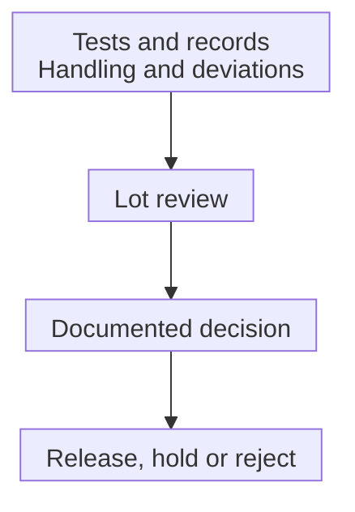

# Batch release: a decision about one lot

## In one sentence

Batch release is the documented quality decision about whether a particular product lot meets the requirements for its intended use.

## The intuition

A departure board can show several completed checks while a flight is still awaiting clearance. The checks are evidence; clearance is a decision made using the whole relevant record.

For a manufactured medical product, the “flight” is a specific lot. The analogy does not identify who may authorize release or which checks apply. Those come from the product's controlled procedures and regulatory setting.

## How it works

A **lot**, or batch, is identified material made under a defined manufacturing record. Release concerns that lot, not the general reputation of its manufacturer. A **specification** connects named tests and methods to acceptance criteria.

Release review brings together the required results and relevant manufacturing records. The [certificate of analysis](/wiki/education/concepts/engineering-and-manufacturing/cmc-and-quality/certificate-of-analysis) may summarize test results. It does not replace evaluation of deviations, the correct product version or the evidence supporting storage and use.

The responsible quality function records the lot's disposition under the applicable system. Disposition may be release, hold pending review, or rejection under the applicable process. A lot can remain pending while a required result or investigation is unresolved. A missing result is not automatically a failure, and it is not a passing result either. Under applicable United States finished-drug rules, [production-record review is part of release](https://www.ecfr.gov/current/title-21/section-211.192).

An **out-of-specification result** falls outside a defined acceptance criterion. It raises a question about the sample, method, calculation or product. The United States Food and Drug Administration (FDA) pharmaceutical laboratory guidance rejects selecting passing retests while disregarding an unexplained initial failure. That guidance focuses on its specified laboratory-testing scope; biological assays need suitable product-specific procedures rather than a copied retest recipe.

*Inputs support a documented lot decision. The map does not say that a test automatically releases material or that every unresolved lot will later pass.*

## Why it matters in cancer

A correct [ribonucleic acid (RNA)](/wiki/education/concepts/biology-basics/molecules/rna-and-mrna) sequence, viable cells or receptor expression can be useful quality evidence. None is a complete release decision. [Cell products](/wiki/education/concepts/engineering-and-manufacturing/cell-manufacturing/release-testing-for-cell-products) also need procedures suited to their changing biology and handling constraints.

Quality release does not establish [regulatory authorization](/wiki/education/concepts/access-and-regulation/trials-and-access/ind-vs-bla), eligibility or benefit for an individual. Those later questions cannot be answered by adding a “released” stamp to a report.

## How it is assessed

| Evidence | What it contributes |
|---|---|
| Lot and version identifiers | Which material is being reviewed |
| Results with methods and criteria | Whether specified tests were valid and acceptable |
| Manufacturing and deviation records | Whether process departures are understood |
| Stability and handling information | Whether the evidence covers intended conditions |
| Authorized disposition record | The actual decision under the relevant system |

The applicable package varies with product and development stage.

## Worked example and practice

A fictional lot has acceptable identity and impurity results. A required activity assay is still pending. A spreadsheet labels the lot “all tests passed” because it includes only completed tests. The label has lost the missingness information.

**Try it:** What can you conclude from the supplied record?

One possible answer

Some tests passed, but the stated required activity result is not supplied. The record does not establish completed release. This is a reasoning exercise, not instructions for administering material.

## Common confusions

- A report, a test result and a release decision are different artifacts.
- Repeated testing is not permission to erase unexplained results.
- “Released” does not mean the product remains suitable after every later handling event.
- Batch release and government lot-release requirements are not interchangeable terms for every product category.

## Explain it back

“A test result supports ___; release also requires ___.” One answer: “the attribute assessed by that test; the applicable documented quality review.”

## Takeaway

**Keep testing, lot disposition and clinical benefit separate.**

## Related concepts

- [Product dossier: CMC](/wiki/education/concepts/engineering-and-manufacturing/cmc-and-quality/chemistry-manufacturing-and-controls)
- [Chain of identity and custody](/wiki/education/concepts/engineering-and-manufacturing/cell-manufacturing/chain-of-identity-and-custody)

## Sources and scope

Source check: October 10, 2026. A general quality-decision model; actual requirements are product-, phase- and jurisdiction-specific. Actual expert and learner review remains pending.

- [21 CFR 211.192: production-record review](https://www.ecfr.gov/current/title-21/section-211.192), within its applicable regulatory scope.
- [FDA: quality systems approach to pharmaceutical CGMP](https://www.fda.gov/media/71023/download).
- [FDA: investigating out-of-specification pharmaceutical test results, May 2022](https://www.fda.gov/media/158416/download), including its biological-assay scope limitation.

<!-- BEGIN GENERATED USED IN -->
## Used in

- [How a personalized vaccine is manufactured](/wiki/education/designing-a-vaccine/05-how-vaccines-are-manufactured)
<!-- END GENERATED USED IN -->
