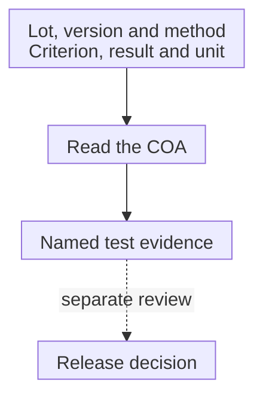

# Certificate of analysis: reading a lot report

## In one sentence

A certificate of analysis is a lot-specific report that identifies material and summarizes specified test results against stated acceptance criteria.

## The intuition

Think of a report card with the student's name, the subjects assessed and the results. It helps you read those assessments. It cannot establish performance in an untested subject or guarantee what happens next year.

A **certificate of analysis (COA)** similarly needs an identifiable lot and understandable tests. The analogy stops at a school grade: product tests have methods, units, sampling and acceptance criteria that a single “pass” can hide.

## How it works

First ask which material the report describes. A raw-material COA and a final-product COA are not interchangeable. A product name without the right lot and version leaves the evidence disconnected from the material in hand.

Next read the method, result and acceptance criterion together. A number may mean concentration, a percentage under a defined denominator or activity relative to a reference. The unit is part of the result. “Within specification” is interpretable only when the specification and the reporting method are understood.

The report also needs its issuing context: who produced or tested the material, when it was assessed and which record it corresponds to. The United States Food and Drug Administration (FDA) Q7 guidance describes these report elements for active pharmaceutical ingredients and intermediates. That scope is not a universal final-cell-product reporting template.

Finally distinguish reporting from [release](/wiki/education/concepts/engineering-and-manufacturing/cmc-and-quality/batch-release). A COA can carry release-related information, but the existence of a document does not independently prove the entire quality review. Supporting raw data, manufacturing records and investigations may sit elsewhere.

*The report ties evidence to material. The dotted step requires a separate quality review; the drawing does not imply that every COA authorizes use.*

## Why it matters in cancer

Personalized [ribonucleic acid (RNA)](/wiki/education/concepts/biology-basics/molecules/rna-and-mrna) and cell products can have similar names while differing in sequence, source or processing. The [chain of identity and custody](/wiki/education/concepts/engineering-and-manufacturing/cell-manufacturing/chain-of-identity-and-custody) connects these records to the intended source and recipient.

A statement about cell viability does not establish [potency](/wiki/education/concepts/engineering-and-manufacturing/cmc-and-quality/potency-assays). A supplied document also does not establish a clinical effect, eligibility or lawful access. Each requires its own evidence.

## How to read the fields

| Field | Reading question |
|---|---|
| Material and lot | Does this identify the actual material? |
| Test and method | What attribute was assessed, and how? |
| Result and unit | What does the reported value count? |
| Acceptance criterion | Which stated requirement is being compared? |
| Dates and issuing context | Which testing and reporting event is this? |
| Pending or missing information | What remains outside the supplied report? |

This table is a reader aid, not a required COA format for every product.

## Worked example and practice

A fictional supplier sends a raw-material COA with acceptable impurity results. A separate final cell product has the same project label. The supplier report supports those raw-material tests; it does not supply the cell product's identity, activity or final disposition.

**Try it:** Is the matching project label enough to apply the report to the final cells?

One possible answer

No. The materials occupy different parts of the manufacturing chain. Their relationship needs records, and final-product claims need the corresponding evidence. A shared label cannot turn a raw-material result into a final-cell result.

## Common confusions

- A COA is not a guarantee of treatment benefit or a substitute for the product dossier.
- “Not reported” does not mean zero, failed or passed.
- A result's unit and denominator matter as much as its numerical value.
- A later storage excursion is not resolved by an earlier acceptable laboratory result.

## Explain it back

“This COA reports ___ for ___; it cannot establish ___.” One answer: “the named tests; the identified material and lot; unreported attributes or the complete release review.”

## Takeaway

**Tie each result to its material, method, unit and criterion.**

## Related concepts

- [Chemistry, manufacturing and controls](/wiki/education/concepts/engineering-and-manufacturing/cmc-and-quality/chemistry-manufacturing-and-controls)
- [Release testing for cell products](/wiki/education/concepts/engineering-and-manufacturing/cell-manufacturing/release-testing-for-cell-products)

## Sources and scope

Source check: October 10, 2026. Document-reading education; report requirements vary with material and product. Actual expert and learner review remains pending.

- [FDA: Q7 good manufacturing practice for active pharmaceutical ingredients, September 2016](https://www.fda.gov/files/drugs/published/Q7-Good-Manufacturing-Practice-Guidance-for-Active-Pharmaceutical-Ingredients-Guidance-for-Industry.pdf), section 11.4, scoped to intermediates and active ingredients.
- [FDA: chimeric antigen receptor (CAR) T-cell product-development guidance, January 2024](https://www.fda.gov/media/156896/download), supplier-material COAs and product-specific reporting examples.

<!-- BEGIN GENERATED USED IN -->
## Used in

- [How a personalized vaccine is manufactured](/wiki/education/designing-a-vaccine/05-how-vaccines-are-manufactured)
<!-- END GENERATED USED IN -->
