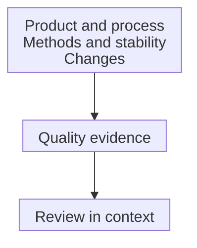

# Chemistry, manufacturing and controls: the product evidence

## In one sentence

Chemistry, manufacturing and controls describes a drug or biological product, how it is made and the evidence used to control its quality.

## The intuition

Think of a product dossier as a map with supporting evidence. It tells a reviewer what the product is, how it is made and how its important features are checked. A map labeled “complete” is less useful than one whose claims can be traced to actual measurements.

The analogy stops at the paperwork. **Chemistry, manufacturing and controls (CMC)** depends on studies and operating experience, not polished descriptions alone. For living-cell products, “chemistry” does not restrict the dossier to chemical measurements.

## How it works

Start by defining the product. A sequence, cell population or formulation needs a specified version and composition. The manufactured active material and the final administered formulation may have different descriptions and controls. A product name alone leaves these relationships unclear.

Next describe the manufacturing process and its materials. Identify steps or attributes whose variation could affect quality. A **critical quality attribute** is an important product characteristic to keep within justified limits. A processing setting and the resulting product attribute are related, but are not the same measurement.

The evidence then connects methods to claims. A **specification** identifies tests, their procedures and acceptance criteria. A criterion is meaningful only with a suitable method and an explanation of what the result represents. [Potency](/wiki/education/concepts/engineering-and-manufacturing/cmc-and-quality/potency-assays) and identity answer different questions.

Stability asks whether relevant quality persists under specified storage, transport and use conditions. A result at manufacture does not establish every later condition. Changes require assessment of whether earlier evidence still applies. These elements are described in [the United States Food and Drug Administration (FDA) gene-therapy CMC guidance](https://www.fda.gov/media/113760/download).

*The dossier connects product, process and evidence. Review in context is not an automatic authorization or a clinical-benefit claim.*

## Why it matters in cancer

A personalized construct may change while using a shared manufacturing platform. Reusing a process can be useful, but the relationship between the new product and earlier evidence still needs support. Likewise, changing a cell-processing step can affect features beyond the final cell count.

Evidence develops with the program. FDA's May 2026 guidance describes product- and stage-dependent CMC flexibility for cell and gene therapies moving toward a biologics license application. Flexibility is not a universal exemption from quality requirements. An investigational submission and a marketing application are different review settings.

## How it is assessed

| Dossier question | Example evidence | Tempting overread |
|---|---|---|
| What is the product? | Composition and identity | A name fixes every attribute |
| How is it made? | Process description and controls | A diagram proves reproducibility |
| What does it do in a test? | Relevant activity assay | Laboratory activity proves benefit |
| What happens over time? | Stability under stated conditions | One time point covers every journey |

These are learning questions, not an application template.

## Worked example and practice

A fictional vaccine dossier describes version A and its storage studies. Version B changes the formulation. The old studies show something about A; the shared sequence does not establish B's delivery or stability.

**Try it:** Can the old dossier simply be relabeled B?

One possible answer

No. The changed formulation needs to be identified and its effect assessed. A [comparability assessment](/wiki/education/concepts/engineering-and-manufacturing/cmc-and-quality/manufacturing-comparability) may connect relevant evidence, but the example supplies no such conclusion.

## Common confusions

- CMC is the product-quality evidence, not a synonym for a facility's GMP framework.
- A [certificate of analysis](/wiki/education/concepts/engineering-and-manufacturing/cmc-and-quality/certificate-of-analysis) summarizes a lot's named tests; it is not the entire dossier.
- Product characterization can be broader than routine [release testing](/wiki/education/concepts/engineering-and-manufacturing/cmc-and-quality/batch-release).
- Quality, regulatory authorization and clinical efficacy remain separate questions.

## Explain it back

“CMC connects ___; its requirements depend on ___.” One answer: “the product, process and quality evidence; the product and development stage.”

## Takeaway

**Read the product, process and quality evidence together.**

## Related concepts

- [Good manufacturing practice](/wiki/education/concepts/engineering-and-manufacturing/cmc-and-quality/gmp-and-batch-release)
- [Cell-product release testing](/wiki/education/concepts/engineering-and-manufacturing/cell-manufacturing/release-testing-for-cell-products)

## Sources and scope

Source check: October 10, 2026. General dossier concepts, illustrated by United States cell/gene-therapy guidance. Actual expert and learner review remains pending.

- [FDA: gene-therapy CMC information for investigational applications, January 2020](https://www.fda.gov/media/113760/download), product description, specifications and stability sections.
- [FDA: CMC flexibilities for cell/gene-therapy biologics license applications, May 2026](https://www.fda.gov/media/192321/download).

<!-- BEGIN GENERATED USED IN -->
## Used in

- [How a personalized vaccine is manufactured](/wiki/education/designing-a-vaccine/05-how-vaccines-are-manufactured)
<!-- END GENERATED USED IN -->
