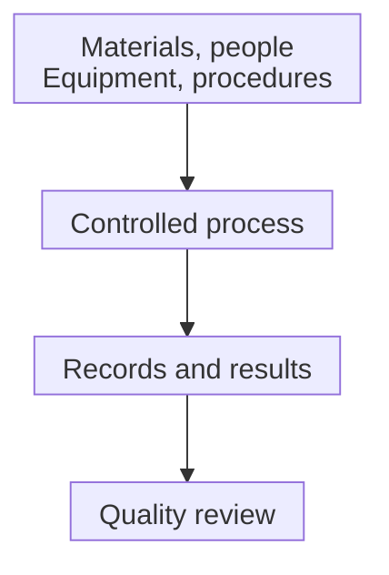

# Good manufacturing practice: building quality into the process

## In one sentence

Good manufacturing practice is a system of controls that builds consistent product quality into manufacturing.

## The intuition

Imagine a bakery that checks its ingredients, cleans its equipment, trains staff and records each batch. Tasting one loaf cannot reveal every mix-up or handling problem. The process has to protect the loaves that nobody samples.

The analogy has limits. Medical products need controls designed for their particular risks, not a generic cleanliness score. A careful factory also cannot establish that a treatment benefits a patient.

## How it works

**Good manufacturing practice (GMP)** combines people, procedures, materials, equipment and records into a working quality system. The “current” in current good manufacturing practice means the controls must remain suitable as methods and knowledge develop. [The United States Food and Drug Administration (FDA) explains this framework](https://www.fda.gov/drugs/pharmaceutical-quality-resources/facts-about-current-good-manufacturing-practice-cgmp).

Manufacturing staff follow controlled instructions and record what actually happened. An **in-process control** checks a relevant step while manufacture is underway. A final sample answers a narrower question about tested material; it cannot reconstruct an unrecorded process.

The **quality unit** reviews procedures, evidence and departures from the intended process. These departures are called deviations. Investigating a deviation asks what happened, which material may be affected and how to prevent recurrence. A missing record and a failed laboratory test are different findings, but both deserve an explanation.

Changes also need control. Replacing a supplier or changing a processing step may alter the product. [Manufacturing comparability](/wiki/education/concepts/engineering-and-manufacturing/cmc-and-quality/manufacturing-comparability) asks whether relevant quality remains comparable. It does not assume that a familiar product name means unchanged biology.

*Quality depends on a controlled process and its records. The map shows review relationships, not a guarantee that every lot passes.*

## Why it matters in cancer

Personalized sequences and living cells can vary between products. That makes process control important; it does not make every product interchangeable. [Chemistry, manufacturing and controls (CMC)](/wiki/education/concepts/engineering-and-manufacturing/cmc-and-quality/chemistry-manufacturing-and-controls) describes the supporting product evidence. [Batch release](/wiki/education/concepts/engineering-and-manufacturing/cmc-and-quality/batch-release) is the disposition of a particular lot.

Requirements depend on jurisdiction, product and development stage. FDA's Phase 1 guidance describes an exemption from certain detailed regulations alongside continuing statutory manufacturing-quality duties. “Investigational” therefore does not mean “quality controls optional.” This page explains the framework, rather than certifying a facility or applying a rule to an individual product.

## How it is assessed

| Question | Relevant evidence |
|---|---|
| Was the intended process followed? | Batch records and in-process observations |
| Were methods and equipment suitable? | Qualification, maintenance and assay evidence |
| Was a departure understood? | Investigation and its documented disposition |
| Was a change evaluated? | Change-control and comparability evidence |

No single measurement or badge establishes the whole system.

## Worked example and practice

A fictional lot's final sample meets its listed tests. The batch record shows an unexplained material substitution. The sample results remain useful, but do not establish that the substitution was harmless or appropriately controlled.

**Try it:** Does a passing final test close the process question?

One possible answer

No. Test evidence and process evidence have different scopes. The substitution needs a documented assessment; the example supplies no final release decision.

## Common confusions

- A clean room is one part of a manufacturing system, not proof of compliance by itself.
- GMP, a product dossier and a lot's release decision answer different questions.
- Manufacturing quality supports reliable clinical investigation; it does not establish clinical efficacy.

## Explain it back

“GMP helps control ___; a passing sample does not establish ___.” One answer: “how the product is made; the entire manufacturing history or treatment benefit.”

## Takeaway

**Build quality into the process, then review the lot and its evidence.**

## Related concepts

- [Certificate of analysis](/wiki/education/concepts/engineering-and-manufacturing/cmc-and-quality/certificate-of-analysis)
- [Potency assays](/wiki/education/concepts/engineering-and-manufacturing/cmc-and-quality/potency-assays)

## Sources and scope

Source check: October 10, 2026. General manufacturing education; requirements are product-, phase- and jurisdiction-specific. Actual expert and learner review remains pending.

- [FDA: facts about current good manufacturing practice](https://www.fda.gov/drugs/pharmaceutical-quality-resources/facts-about-current-good-manufacturing-practice-cgmp).
- [FDA: quality systems approach to pharmaceutical CGMP](https://www.fda.gov/media/71023/download), especially the quality-unit discussion.
- [FDA: current good manufacturing practice for Phase 1 investigational drugs](https://www.fda.gov/regulatory-information/search-fda-guidance-documents/current-good-manufacturing-practice-phase-1-investigational-drugs).

<!-- BEGIN GENERATED USED IN -->
## Used in

- [How to engineer T cells inside the body](/wiki/education/cellular-therapies/06-in-vivo-delivery)
- [How a personalized vaccine is manufactured](/wiki/education/designing-a-vaccine/05-how-vaccines-are-manufactured)
- [How engineered immune cells can attack a solid tumor](/wiki/education/guides/engineered-cell-therapy/index)
- [How a personalized cancer vaccine is designed](/wiki/education/guides/personalized-cancer-vaccine/index)
<!-- END GENERATED USED IN -->
