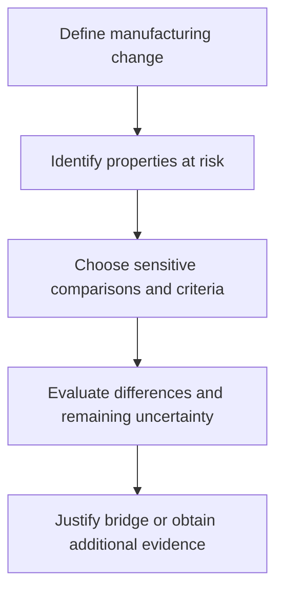

# Manufacturing comparability

## In one sentence

Manufacturing comparability asks whether a process change leaves a biological product sufficiently similar for earlier quality, safety and efficacy evidence to remain relevant.

## The intuition

Imagine moving a recipe to a new kitchen. Keeping the recipe name does not prove the result is unchanged. New equipment, ingredients or storage can alter the product.

Biological products make this harder: living cells and complex formulations vary even before a change. Comparability therefore asks about meaningful differences, rather than demanding that every measurement be numerically identical.

## How it works

A change may affect a manufacturing site, material, equipment, scale, culture conditions, formulation or preservation step. First describe what changed and what product properties it might alter.

Those important properties are often called **critical quality attributes**. They may include identity, cell composition, impurity levels or relevant biological activity. The right set depends on the product and mechanism.

The comparison then uses methods capable of detecting the anticipated effects. [Potency assays](/wiki/education/concepts/engineering-and-manufacturing/cmc-and-quality/potency-assays), broader characterization and stability testing may all contribute. Passing routine release specifications alone can miss changes those specifications were not designed to detect.

For patient-derived cell products, differences between starting samples can obscure the process effect. Where suitable, the same starting material can be divided and processed by the old and new methods. This reduces one source of variation; it does not erase all uncertainty or replace an adequate study design.

*The bridge is an evidence argument, not a claim that the process name stayed the same.*

If unresolved differences could affect safety or efficacy, additional nonclinical or clinical evidence may be needed. The scope depends on the change, product, development stage and applicable regulatory assessment.

## Why it matters in cancer

Changing cytokines to improve [ex vivo cell expansion](/wiki/education/concepts/engineering-and-manufacturing/cell-manufacturing/ex-vivo-cell-expansion) can also change cell subsets or activation. Changing an RNA particle can affect delivery. Adding [cryopreservation](/wiki/education/concepts/engineering-and-manufacturing/cell-manufacturing/cryopreservation) can alter recovery and function. Better yield is not enough to show the earlier clinical evidence still applies.

Comparability concerns a changed version of a product. It is different from declaring two unrelated therapies equivalent or comparing response rates across separate trials.

Personalization also needs careful language. A platform may intentionally vary antigen sequences between patients under defined controls. That does not give every new sequence or process edit an automatic bridge to every earlier result.

## How it is measured

Readouts and units follow the affected properties: viable cell count, cell fractions, functional activity, RNA integrity or particle size in nanometers, for example. No single “comparability score” settles all of them.

A sound report names the before/after process versions, lot and donor/sample numbers, assay conditions, predefined acceptance criteria and results. It also explains why observed differences are not expected to harm product performance, or what remains unknown.

An assay change can itself create an apparent product difference. Method transfer and reference materials help separate measurement changes from biological changes. A nonsignificant statistical test alone does not establish similarity; an insensitive comparison may miss an important difference.

## Worked example and practice

A fictional team changes the culture medium. Final cell counts remain similar, but the fraction of a relevant T-cell subset changes substantially.

**Try it:** Do matching counts establish comparability?

**Answer:** No. Count is one attribute. The team must assess the subset difference, function and other properties plausibly affected by the change, then justify whether earlier evidence remains relevant.

## Common confusions

- Comparable does not mean identical in every measurement.
- Meeting release limits alone does not prove comparability.
- Higher potency or yield can introduce new safety questions.
- A process bridge is not head-to-head clinical equivalence between therapies.

## Explain it back

“A manufacturing change needs a bridge because ___.” One answer: “earlier evidence tested an earlier product, and the change may affect properties that matter.”

## Related concepts

- [Good manufacturing practice and batch release](/wiki/education/concepts/engineering-and-manufacturing/cmc-and-quality/gmp-and-batch-release)
- [Chain of identity and custody](/wiki/education/concepts/engineering-and-manufacturing/cell-manufacturing/chain-of-identity-and-custody)

## Sources and scope

Source check: October 9, 2026; expert and learner review pending. The medium-change example is fictional. This explains the evidence question, not an automatic regulatory approval route.

- [FDA/ICH Q5E final guidance, June 2005](https://www.fda.gov/media/71489/download) — general biological-product comparability principles.
- [FDA final chimeric antigen receptor (CAR) T-cell guidance, January 2024](https://www.fda.gov/media/156896/download) — CAR-specific analytical comparisons, starting-material variability and release-test limits.
- [FDA manufacturing-changes/comparability draft, July 2023](https://www.fda.gov/regulatory-information/search-fda-guidance-documents/manufacturing-changes-and-comparability-human-cellular-and-gene-therapy-products) — cellular/gene-therapy change management; still labeled draft, not for implementation, when checked.

<!-- BEGIN GENERATED USED IN -->
## Used in

- [How to engineer T cells inside the body](/wiki/education/cellular-therapies/06-in-vivo-delivery)
- [How a personalized vaccine is manufactured](/wiki/education/designing-a-vaccine/05-how-vaccines-are-manufactured)
- [How engineered immune cells can attack a solid tumor](/wiki/education/guides/engineered-cell-therapy/index)
- [How a personalized cancer vaccine is designed](/wiki/education/guides/personalized-cancer-vaccine/index)
<!-- END GENERATED USED IN -->
