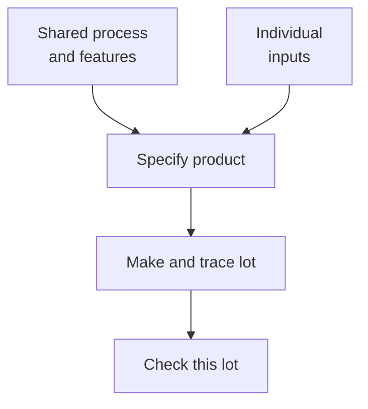

# Platform and personalized components

## In one sentence

Platform components are the features or processes reused across a program, while personalized components are the inputs or specifications selected for an individual recipient.

## The intuition

Think of a print shop using one controlled printing process for different books. Equipment and checks may be shared, while each book has its own text and identity. The analogy has limits: a biological product's sequence or starting cells can change its behavior and manufacturing properties. Reusing the shop does not make every book, or every product, equivalent.

## What they share

Both belong to a specified product and manufacturing workflow. Both need clear versions, traceable materials and appropriate quality controls. “Platform” here is a teaching description of reuse, not a claim of a formal regulatory designation or authorization.

## The axis that differs

Ask one question: **Is this feature deliberately reused across recipients, or selected for this recipient?** The answer depends on the program. Personalization may concern an antigen sequence, a receptor sequence, the person's own cells, or some combination. It need not mean every reagent or manufacturing step is redesigned.

*Shared infrastructure and individual specifications meet in a real lot that requires its own checks.*

| Question | Platform side | Personalized side |
|---|---|---|
| What can be held common? | A controlled process, equipment, formulation approach or construct features | Only features the program explicitly fixes |
| What can change? | Process versions and their documented controls | Target sequences, selected materials or recipient-linked starting cells |
| What must be identified? | The process and shared-component versions used | The intended individual specification and actual lot |
| What can evidence support? | Reuse of defined methods within their demonstrated scope | Correct identity and measured attributes of that individual's product |
| What does reuse not prove? | Automatic equivalence after a change | Antigen presentation, immune response or clinical benefit |

## How this works in cancer products

An individualized messenger RNA (**mRNA**) vaccine may reuse parts of the RNA architecture and a formulation approach while changing the encoded [neoantigen](/wiki/education/concepts/immunology/antigen-presentation/neoantigen) message. In the [Rojas et al. pancreatic-cancer phase 1 study](https://www.nature.com/articles/s41586-023-06063-y), individual vaccine sequences were made using a defined RNA–lipoplex design. That is an example of shared design features with individual messages, not proof that all RNA vaccines share a recipe or outcome.

Sequence choices can affect physical and biological properties. A primary [peptide-conjugate vaccine study](https://www.nature.com/articles/s41587-019-0390-x) specifically addressed the manufacturing challenges of varying antigen sequences in preclinical models. Its solution is one studied approach, not a universal rule for personalized vaccines.

Personalized starting material is another axis. An autologous [chimeric antigen receptor (CAR) T-cell product](/wiki/education/concepts/therapeutics/cell-therapies/car-anatomy) uses the recipient's own cells even when its receptor design is reused. The [FDA CAR T-cell guidance](https://www.fda.gov/media/156896/download) identifies variability in starting cells and recommends maintaining identity through manufacture and administration. Individual cells and an individually selected receptor are different kinds of personalization.

## When each is useful

Reuse can support consistent handling, shared process learning and repeatable testing. Individual specification is useful when the intended target message or starting material must match the recipient. They commonly work together. Neither category wins on efficacy by itself.

A [comparability assessment](/wiki/education/concepts/engineering-and-manufacturing/cmc-and-quality/manufacturing-comparability) asks what a defined change does to product quality. [Good manufacturing practice and release testing](/wiki/education/concepts/engineering-and-manufacturing/cmc-and-quality/gmp-and-batch-release) concern controlled manufacture and lot acceptance. They cannot substitute for evidence that the encoded targets are naturally presented or that treatment benefits people.

## How the distinction is checked

| Review card | What to record |
|---|---|
| Input and consumption | Design records, material identities and sampled lot aliquots; product testing can consume finite material |
| Output | Sequence/version matches, batch records and assay-specific quality or potency measurements |
| Thresholds | Prespecified, product-appropriate specifications; no universal “personalized product” cutoff |
| Failures | Swapped identity, undocumented changes or assuming one lot's result applies to another |
| Validation tier | Identity and manufacturing evidence; functional and clinical claims remain separate |

The FDA's [1999 vaccine manufacturing guidance](https://www.fda.gov/media/73614/download) distinguishes identity, purity, potency and stability. It illustrates these quality categories; it is not a complete current rulebook for every individualized modality.

## Common confusions

- Shared methods do not make recipient-specific sequences interchangeable.
- “Personalized” does not say which component changed.
- Passing release criteria does not establish antigen selection accuracy or clinical benefit.

## Try it

A fictional program uses the same RNA features and formulation process for recipients A and B, but different antigen messages. Lot A passes identity and quality checks. Can Lot B be accepted from that result alone?

**Answer:** No. Lot B must match B's specification and satisfy its own applicable checks. Shared process evidence can inform those checks; it cannot establish B's identity or results.

## Explain it back

“The shared part is ___; the individual part is ___; each actual lot still needs ___.”

**One answer:** the defined process; the recipient's specified message or materials; traceability and appropriate testing.

## Takeaway

**Describe what is reused, what is individualized and what has been checked in the actual product.**

## Related concepts

- [Multi-epitope constructs](/wiki/education/concepts/engineering-and-manufacturing/nucleic-acid-design/multi-epitope-constructs)
- [Contract development and manufacturing organizations](/wiki/education/concepts/engineering-and-manufacturing/cmc-and-quality/cdmo-role)

## Sources and scope

Source check: October 10, 2026. A component comparison, not a therapy comparison or regulatory determination. The exercise is fictional; expert and learner review remain pending.

- [Rojas et al., 2023](https://www.nature.com/articles/s41586-023-06063-y) — individualized RNA messages within one defined vaccine design and study.
- [Lynn et al., 2020](https://www.nature.com/articles/s41587-019-0390-x) — sequence-related peptide manufacturing constraints in a specified preclinical vaccine platform.
- [FDA, 2024: CAR T-cell product development](https://www.fda.gov/media/156896/download) — starting-material variation and chain of identity.
- [FDA, 1999: vaccine chemistry, manufacturing and controls](https://www.fda.gov/media/73614/download) — quality categories and lot records; dated guidance with a defined scope.
