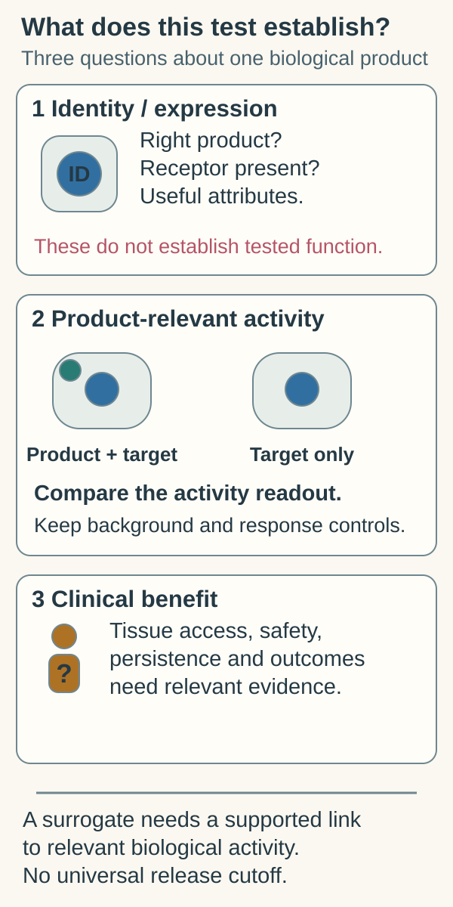

# Potency assays

## In one sentence

A potency assay measures a product's biological activity relevant to its intended therapeutic action under defined test conditions.

## The intuition

A flashlight can have the right label and intact casing, yet fail to produce useful light. Testing whether it lights up asks about function. A potency assay plays that role for a biological product.

The analogy stops before clinical benefit. A flashlight faces a simple task. A cancer treatment must reach the right tissue and work within a complex patient. A controlled laboratory task cannot reproduce that whole journey.

## How it works

Start with the proposed mechanism. A cell product may need to recognize a target and perform an immune action. An RNA product may need to deliver instructions that cells translate. The assay asks whether a specified activity remains present in the tested material.

A direct biological assay measures an activity, such as target-cell killing under controlled conditions. A surrogate assay measures a related attribute. Receptor expression or protein quantity can contribute useful evidence, but their relationship to relevant function needs support.

Some products use several complementary tests, often called an **assay matrix**. This can address different parts of a complex mechanism. It does not mean adding many unrelated measurements automatically proves potency.

Assay controls distinguish real biological activity from background, target-independent effects or an invalid test run. Test conditions and reference material make results interpretable between lots. An assay unable to distinguish active from degraded product offers weak protection against loss of function.

*Identity and expression help characterize a product; product-relevant activity and clinical benefit require different evidence.*

For the existing background-death comparison, see [functional cytotoxicity assays](/wiki/education/concepts/measurement/immune-monitoring/functional-cytotoxicity-assays).

**Figure check:** Would receptor expression alone settle the activity question? **Answer:** No. A supported surrogate relationship or a relevant functional test is needed; neither establishes patient benefit.

## Why it matters in cancer

A [chimeric antigen receptor (CAR)](/wiki/education/concepts/therapeutics/cell-therapies/car-anatomy) product can contain living receptor-positive cells without establishing adequate target-specific activity. A vaccine can have the intended RNA sequence without establishing adequate expression of its encoded construct.

Even measured expression does not prove peptide presentation by [human leukocyte antigen (HLA)](/wiki/education/concepts/immunology/antigen-presentation/hla), T-cell recognition or patient benefit. Those are later biological and clinical questions. A relevant release assay reduces a quality risk; it cannot answer every efficacy question.

Handling also affects interpretation. A test on fresh material cannot automatically represent the final product after [cryopreservation](/wiki/education/concepts/engineering-and-manufacturing/cell-manufacturing/cryopreservation), transport or a long permitted holding period.

## How it is measured

| Assay-card field | What to ask |
| --- | --- |
| Measures | Which biological activity does this product need? |
| How | What challenge, controls and readout test that activity? |
| Input | What sample represents the lot, and in what handling state? |
| Output and units | Activity units, relative potency, percent target-cell killing or another defined readout |
| Threshold | Product-specific criterion and evidence supporting it |
| Failure modes | Unstable targets, insensitive controls, variable timing or sample effects |
| What it cannot tell you | Complete safety, tumor access or clinical efficacy |
| Validation | Performance established for the assay's intended development/release use |

For a killing assay, state target identity, effector-to-target ratio and observation time. “60% killing” without those conditions is not comparable between laboratories. For relative potency, identify the reference and model used. No universal passing cutoff applies to every product.

Qualification or validation evaluates the method's performance. It is different from demonstrating that a drug improves a clinical endpoint.

## Worked example and practice

A fictional cell lot has high viability and receptor expression. Its target-specific killing result falls below the predefined product criterion.

**Try it:** Can the two passing tests cancel the functional failure?

**Answer:** No. Investigate the assay and lot under the controlled process. Correct identity and living cells do not establish adequate tested activity. This example supplies no instruction to administer the lot.

## Common confusions

- Identity asks what the product is; potency asks about relevant activity.
- A validated surrogate needs supporting functional relationships.
- Sterility and potency answer different questions.
- A passing potency result is not a clinical response rate.

## Explain it back

“Potency establishes ___ under ___, while clinical benefit requires ___.” One answer: “a specified activity; defined test conditions; evidence in the relevant patients and setting.”

## Related concepts

- [Manufacturing comparability](/wiki/education/concepts/engineering-and-manufacturing/cmc-and-quality/manufacturing-comparability)
- [Good manufacturing practice and batch release](/wiki/education/concepts/engineering-and-manufacturing/cmc-and-quality/gmp-and-batch-release)

## Sources and scope

Source check: October 9, 2026; expert and learner review pending. Units are illustrative, not a universal release specification. The practice lot is fictional.

- [FDA potency-tests final guidance, January 2011](https://www.fda.gov/media/79856/download) — direct assays, surrogate evidence and assay matrices.
- [FDA final CAR T-cell guidance, January 2024](https://www.fda.gov/media/156896/download) — product-specific functional characterization and testing.
- [FDA potency-assurance draft guidance, December 2023](https://www.fda.gov/regulatory-information/search-fda-guidance-documents/potency-assurance-cellular-and-gene-therapy-products) — broader process and testing strategy; still labeled draft, not for implementation, when checked.

<!-- BEGIN GENERATED USED IN -->
## Used in

- [How to engineer T cells inside the body](/wiki/education/cellular-therapies/06-in-vivo-delivery)
- [Reading cell-therapy evidence](/wiki/education/cellular-therapies/09-reading-cell-therapy-evidence)
- [How a personalized vaccine is manufactured](/wiki/education/designing-a-vaccine/05-how-vaccines-are-manufactured)
- [How engineered immune cells can attack a solid tumor](/wiki/education/guides/engineered-cell-therapy/index)
- [How a personalized cancer vaccine is designed](/wiki/education/guides/personalized-cancer-vaccine/index)
<!-- END GENERATED USED IN -->
