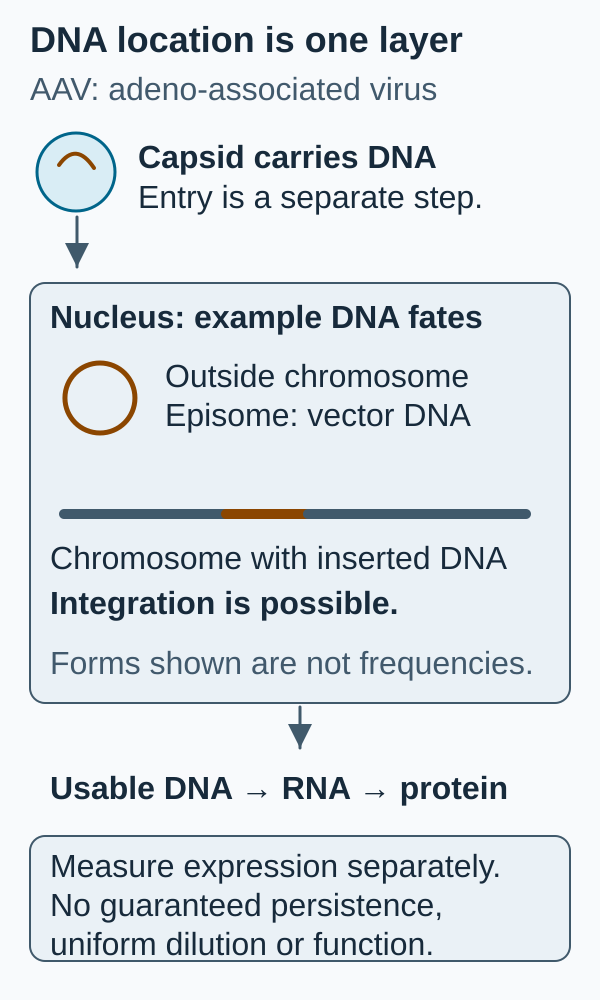

# AAV (adeno-associated virus) vector

## In one sentence

An AAV vector is an engineered adeno-associated virus particle that delivers a DNA expression cassette, which often persists outside chromosomes but still requires product-specific delivery and safety assessment.

## The intuition

Picture a small package carrying a set of instructions. The **capsid**, its protein shell, influences which cells the package can enter. The payload determines what those cells might make. A package's address is not its payload's job, and the analogy cannot predict expression duration or immune reactions.

**Before you start:** [DNA → RNA → protein](/wiki/education/concepts/biology-basics/genetics/central-dogma) explains transcription and translation; [lentiviral vectors](/wiki/education/concepts/engineering-and-manufacturing/delivery-vehicles/lentiviral-vector) provide a contrasting delivery design. AAV is distinct from adenovirus.

## How it works

Recombinant AAV, abbreviated **rAAV**, replaces viral coding material with a designed cassette and regulatory sequences. Capsid design, route and cell biology influence entry and subsequent steps. The DNA must reach the nucleus and become a usable transcription template. RNA production and translation then make protein.

*DNA location and expression are different layers. These example forms do not assign their frequencies, duration or therapeutic effect.*

An **episome** is DNA outside the chromosomes. A study of sampled human muscle found persistent circular vector genomes and tested the expression competence of recovered sequences. This supports that tissue and construct; it is not a guarantee for every cell type. Episomal genomes can be diluted during cell division. Mouse liver-regeneration experiments also showed that extrachromosomal expression and genome persistence differ from a chromosomally integrated control.

“Often episomal” does not mean “never integrates.” Nor does persistent DNA ensure an intact cassette, adequate protein or a surviving functional cell. Capsid-directed immunity can also affect delivery or persistence; a human liver-directed study showed expression loss alongside evidence consistent with an immune response against transduced cells. The response and repeat-administration questions belong to the particular product and setting.

## Why it matters in cancer

An AAV carrier can be part of a cell-engineering or genome-editing workflow. Its name alone does not establish direct T-cell targeting inside a patient. For an editing design, the lasting genomic change can come from the editor rather than long-term persistence of the carrier DNA.

Packaging capacity is limited, so a complex multi-component design cannot simply assume that all its sequences fit or are delivered together. Whether intended and unintended cells receive an intact, functional construct requires direct testing. AAV's usual genetic behavior does not supply a universal safety advantage over another carrier.

## How it is measured

**Measurement card — AAV DNA and expression**

- **Input and consumption:** Vector-lot aliquots; sampled cells or tissue at defined times. Tissue extraction consumes material and represents a limited region.
- **How and output:** Nucleic-acid assays report vector-genome copies per volume or sample denominator. Sequence and DNA-form analyses examine cassette integrity, episomes or integration; RNA and protein assays test expression in identified cells.
- **Thresholds and failures:** Acceptance criteria are construct- and assay-specific. Counting one short sequence does not prove an intact functional genome. Cell mixtures and sampling time can distort apparent persistence.
- **Limits and validation:** Copy counts alone cannot determine chromosomal location or antitumor function. Human muscle or mouse liver results cannot validate a T-cell application. Clinical safety and benefit require the relevant product and population.

## Common confusions

- **Nonintegrating category means zero integration:** It describes usual behavior, not an absolute exclusion.
- **Persistent expression means expression survives every division:** Tissue turnover and genome maintenance matter.
- **Capsid targeting means cancer targeting:** The encoded receptor or editor has a separate task.

## Try it

A fictional proposal takes long-lived expression in human muscle as proof that an AAV-delivered [chimeric antigen receptor (CAR)](/wiki/education/concepts/therapeutics/cell-therapies/car-anatomy) will stay expressed through rapid T-cell expansion. Is the evidence sufficient?

**Answer:** No. The cell type, division history, cassette and delivery differ. Measure genome form and receptor expression over time in the intended T cells, alongside their function; do not assign the muscle result to them.

## Explain it back

“Episomal tells me where DNA is relative to ___, not whether ___.” One answer: “chromosomes; a therapeutic effect has occurred.”

## Takeaway

**Assess AAV entry, DNA fate, expression and function in the intended cells instead of treating episomal persistence as a complete product result.**

## Related concepts

- [Delivery and cancer targeting](/wiki/education/concepts/engineering-and-manufacturing/delivery-vehicles/delivery-targeting-vs-cancer-targeting)
- [Insertional mutagenesis](/wiki/education/concepts/therapeutics/toxicities-and-supportive-care/insertional-mutagenesis)

## Sources and scope

Source check: October 10, 2026; expert and learner review pending. These primary studies concern muscle or liver biology, not demonstrated human solid-tumor CAR-T efficacy.

- [Schnepp et al., 2016](https://pmc.ncbi.nlm.nih.gov/articles/PMC5374867/) — vector forms and recovered-cassette expression in a human muscle study.
- [Nakai et al., 2001](https://pubmed.ncbi.nlm.nih.gov/11435577/) — extrachromosomal genomes and expression after mouse liver regeneration.
- [Manno et al., 2006](https://pubmed.ncbi.nlm.nih.gov/16474400/) — human liver-directed expression and capsid-immune limitations.
- [Wu et al., 2010](https://pubmed.ncbi.nlm.nih.gov/19904234/) — construct size, packaged-genome integrity and expression in specified vectors.
- [FDA, January 2020: long-term follow-up](https://www.fda.gov/media/113768/download) — risk-based, product-specific assessment.

<!-- BEGIN GENERATED USED IN -->
## Used in

- [How to engineer T cells inside the body](/wiki/education/cellular-therapies/06-in-vivo-delivery)
- [How engineered immune cells can attack a solid tumor](/wiki/education/guides/engineered-cell-therapy/index)
<!-- END GENERATED USED IN -->
