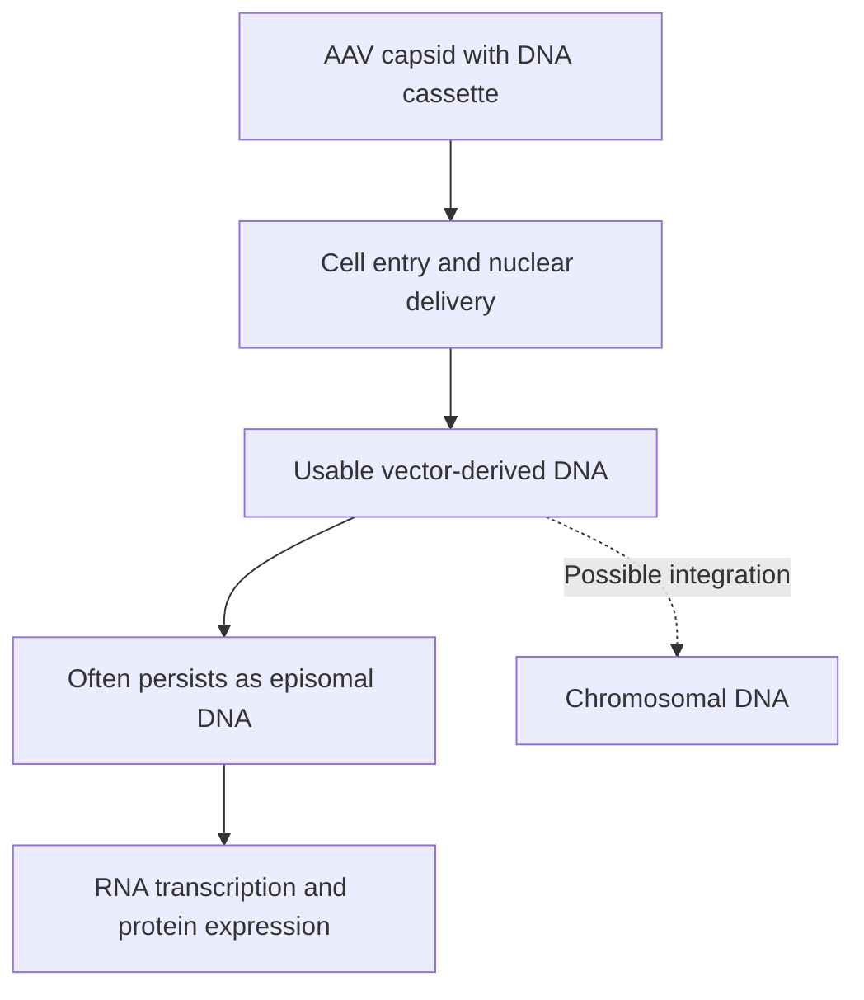

# AAV (adeno-associated virus) vector

## In one sentence

An AAV vector is an engineered adeno-associated virus particle that delivers a DNA expression cassette, which often persists outside chromosomes but still requires product-specific delivery and safety assessment.

## The intuition

An AAV vector is a protein package carrying a DNA instruction cassette. The package helps determine which cells it can enter; the instructions determine what those cells may make. The parcel analogy does not tell you how long the instructions remain, whether immune defenses reject the package or whether the expressed product is safe.

**Before you start:** [DNA → RNA → protein](/wiki/education/concepts/biology-basics/genetics/central-dogma) explains the expression path; [lentiviral vectors](/wiki/education/concepts/engineering-and-manufacturing/delivery-vehicles/lentiviral-vector) provide a comparison with a commonly integrating design.

## How it works

**AAV** means adeno-associated virus. It is a different virus from adenovirus. A recombinant AAV (**rAAV**) vector replaces much of the viral genetic content with a designed DNA cassette. A **capsid** is the surrounding protein shell. An **expression cassette** contains the instructions and regulatory features needed to produce the intended product.

Capsid design, the route of administration and the recipient's biology affect **tropism**, the tendency to enter particular cells or tissues. Entry alone is insufficient: vector-derived DNA must reach the nucleus and become usable for transcription. The cell then makes RNA and, for a protein-encoding cassette, translates it into protein.

*An episome is DNA outside the chromosomes. “Often episomal” is not “never integrates.”*

Primary human-muscle studies found persistent, transcriptionally active episomal vector genomes. That finding cannot be transferred unchanged to rapidly dividing cells. Episomal DNA can be lost or diluted as cells divide, and persistence also depends on the vector and tissue. Low-frequency integration is possible; the label AAV does not establish zero genetic risk.

## Why it matters in cancer

AAV can be considered as a gene-delivery tool, but a demonstration in muscle or liver does not prove selective engineering of T cells or control of cancer. Long expression may be useful for one purpose and undesirable for another. A cassette has finite packaging space, so a large multi-component design requires its own feasibility assessment.

Pre-existing or newly formed immunity to the capsid can affect delivery and repeat administration. The consequences of systemic exposure and the expressed product also need assessment. Persistence outside chromosomes does not make a product automatically safe or easily reversible.

## Try it

A fictional team observes protein expression months after AAV delivery into nondividing muscle cells. It describes the same cassette as guaranteed to persist through rapid T-cell expansion. What is missing?

**Answer:** Evidence in the relevant dividing cells. Persistence, expression, integration and immune effects need to be measured for that design and setting. Muscle expression is not a T-cell delivery validation.

## Common confusions

- **AAV versus adenovirus:** Similar names, different vectors.
- **DNA payload versus mRNA payload:** AAV expression usually requires nuclear DNA and transcription before translation.
- **Episomal versus harmless:** Genetic location answers one question, not the entire safety question.
- **Persistent DNA versus useful expression:** Retained genomes can exist without adequate protein production.

## Related concepts

- [Delivery targeting versus cancer targeting](/wiki/education/concepts/engineering-and-manufacturing/delivery-vehicles/delivery-targeting-vs-cancer-targeting).
- [Transposons](/wiki/education/concepts/engineering-and-manufacturing/delivery-vehicles/transposon) deliberately support genomic insertion in engineered systems.

## Sources and scope

Source check: October 9, 2026; expert and learner review pending. Mechanism and risk questions do not constitute a recommendation for an AAV cancer product.

- [Schnepp et al., 2016: long-lived episomal vector genomes in human muscle](https://pubmed.ncbi.nlm.nih.gov/26650966/).
- [Hagedorn et al., 2017: experimental episomal-maintenance strategies in proliferating cells](https://doi.org/10.1089/hum.2017.025).
- [Manno et al., 2006: human liver gene transfer and limitations from capsid-directed immunity](https://pubmed.ncbi.nlm.nih.gov/16474400/).
- [FDA, 2020: risk-based long-term follow-up after human gene therapy](https://www.fda.gov/regulatory-information/search-fda-guidance-documents/long-term-follow-after-administration-human-gene-therapy-products).

<!-- BEGIN GENERATED USED IN -->
## Used in

- [How to engineer T cells inside the body](/wiki/education/cellular-therapies/06-in-vivo-delivery)
<!-- END GENERATED USED IN -->
