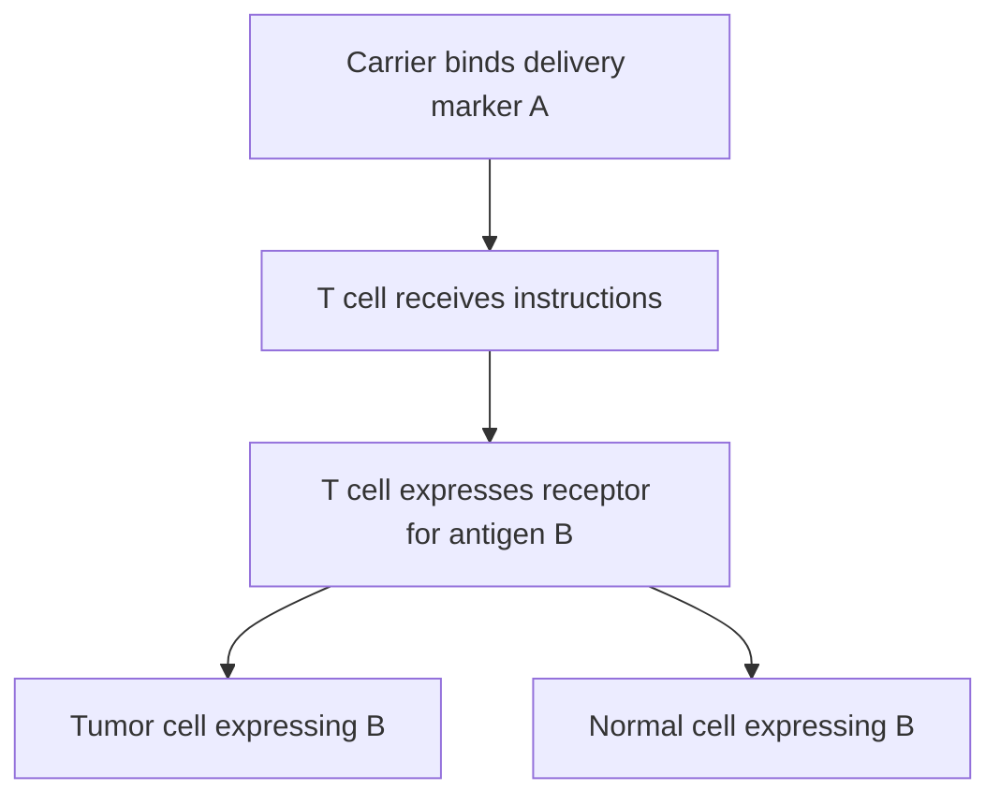

# Delivery targeting versus cancer targeting

## In one sentence

Delivery targeting determines which cells receive an intervention, while cancer targeting determines what the resulting therapeutic molecule or immune cell recognizes or acts on.

## The intuition

A package can be addressed to a T cell and contain instructions for recognizing a different cell. The delivery address and the recognition address perform different jobs. This distinction is especially useful for in vivo cell engineering, where a carrier's binding molecule and the engineered receptor can target completely different proteins.

**Before you start:** [Lipid nanoparticles](/wiki/education/concepts/engineering-and-manufacturing/delivery-vehicles/lipid-nanoparticle) explain one carrier; [chimeric antigen receptor (CAR) anatomy](/wiki/education/concepts/therapeutics/cell-therapies/car-anatomy) explains the protein an engineered cell may make.

## How it works

A delivery system may favor a cell type by recognizing one of its surface molecules. Successful delivery also requires useful cargo release and expression. The carrier's targeting feature is not necessarily the therapeutic receptor's binding part.

After engineering, a CAR T cell recognizes an antigen through the newly expressed CAR. That antigen may be on cancer cells and also on normal tissue. The delivery marker says which cells are meant to become therapeutic cells; the CAR antigen says which cells those therapeutic cells can recognize.

*The two addresses are fictional. The normal-cell branch is part of the recognition question.*

In a vaccine, the desired delivery recipient can be an antigen-presenting cell. That cell makes or acquires antigen and helps prime T cells. The primed T cells then need to recognize relevant fragments on tumor cells. Delivery to an immune cell is not a failure merely because the carrier did not enter the tumor.

## Why it matters in cancer

Claims about “tumor-targeted” treatments can refer to different stages. Ask whether a study measured where the carrier went, which cells expressed the payload, what the resulting receptor recognized or which tumors responded. Each is useful evidence, but none can silently replace the next.

Delivery to unintended cells is different from [on-target, off-tumor toxicity](/wiki/education/concepts/therapeutics/toxicities-and-supportive-care/on-target-off-tumor-toxicity), where the therapeutic receptor recognizes its intended antigen on healthy tissue. Both can matter in the same product. A cancer-associated antigen is not necessarily cancer-exclusive.

## Try it

A fictional carrier binds marker A on T cells. Its RNA encodes a CAR recognizing antigen B. B is present on tumor cells and a healthy epithelial population. A report says that selective T-cell delivery solves all targeting risks.

**Answer:** It addresses only the delivery job. The resulting CAR still needs evidence about B expression, recognition thresholds, tumor-cell activity and healthy-tissue effects. Selective engineering cannot make B cancer-exclusive.

## Common confusions

- **Targeted carrier versus tumor-homing cell:** Engineering a T cell does not prove it reaches tumor tissue.
- **Binding versus useful delivery:** Surface contact can occur without payload expression.
- **Antigen recognition versus benefit:** Killing cells in an assay does not establish clinical tumor control.
- **Two targets versus two required tumor antigens:** The delivery marker can be on the immune cell, not on the cancer.

## Related concepts

- [Targeted LNPs](/wiki/education/concepts/engineering-and-manufacturing/delivery-vehicles/targeted-lnps) explore the first address.
- [Antigen processing](/wiki/education/concepts/immunology/antigen-presentation/antigen-processing-machinery) connects vaccine expression with display.
- [Ex vivo versus in vivo engineering](/wiki/education/concepts/engineering-and-manufacturing/cell-manufacturing/ex-vivo-vs-in-vivo-engineering) separates delivery workflows.

## Sources and scope

Source check: October 9, 2026; expert and learner review pending. The practice example is fictional. The primary studies demonstrate different delivery and therapeutic targets in defined settings.

- [Rurik et al., 2022: CD5-directed RNA delivery and a FAP-directed CAR in a mouse cardiac-injury model](https://pubmed.ncbi.nlm.nih.gov/34990237/) — not a cancer trial.
- [Hunter et al., 2025: targeted delivery for immune-cell engineering in human-cell experiments and animal models](https://pubmed.ncbi.nlm.nih.gov/40536974/).
- [Kranz et al., 2016: RNA delivery to dendritic cells for cancer immunotherapy](https://pubmed.ncbi.nlm.nih.gov/27281205/).

<!-- BEGIN GENERATED USED IN -->
## Used in

- [How to engineer T cells inside the body](/wiki/education/cellular-therapies/06-in-vivo-delivery)
- [How a personalized cancer vaccine is designed](/wiki/education/guides/personalized-cancer-vaccine/index)
<!-- END GENERATED USED IN -->
