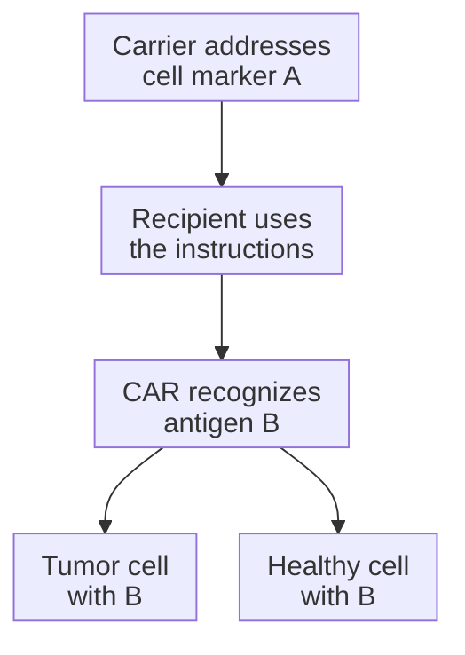

# Delivery targeting versus cancer targeting

## In one sentence

Delivery targeting determines which cells receive an intervention, while cancer targeting determines what the resulting therapeutic molecule or immune cell recognizes or acts on.

## The intuition

Imagine delivering a tool to its operator, then asking what job the operator can do. Those are two addresses. In cell engineering, a carrier may favor T cells while its payload encodes a receptor for a different antigen. The analogy stops at delivery: a cell must use the instructions, reach a target and respond appropriately.

**Before you start:** [Lipid nanoparticles (LNPs)](/wiki/education/concepts/engineering-and-manufacturing/delivery-vehicles/lipid-nanoparticle) introduce one carrier; [CAR anatomy](/wiki/education/concepts/therapeutics/cell-therapies/car-anatomy) explains a chimeric antigen receptor.

## How it works

A carrier can use a cell-binding feature directed at marker **A** on a T cell. Its cargo can encode a CAR directed at antigen **B** on another cell. A and B need not be the same molecule.

*Delivery selectivity does not establish exclusive tumor recognition or killing.*

[Targeted LNPs](/wiki/education/concepts/engineering-and-manufacturing/delivery-vehicles/targeted-lnps) must distribute, enter cells and release usable cargo. Detectable binding or particle uptake may occur without useful expression. Likewise, a CAR that binds B may fail to activate or kill. Binding, expression, signaling and target-cell effects need distinct tests.

The delivery address can also be an antigen-presenting cell in a vaccine. That cell makes antigen for immune priming; the eventual immune response must recognize the relevant display on tumor cells. Vaccine-carrier targeting is not necessarily direct tumor delivery.

### Compare two targeting jobs in the A/B example

| Question | Delivery targeting | Cancer targeting by the resulting receptor |
|---|---|---|
| What is addressed? | Recipient cell marker A, through the carrier | Antigen B, through the expressed CAR |
| What evidence fits? | Usable expression in identified intended and unintended recipient cells; binding or uptake alone is insufficient | Antigen-dependent recognition and function in tumor and relevant healthy-cell tests, with suitable controls |
| What remains unproved? | Tumor entry, cancer-only action or all-body delivery exclusivity | Safe cancer-only killing or patient benefit from the observed test activity |

## Why it matters in cancer

There are at least three separate targeting questions:

| Question | Measurement needed | Remaining boundary |
| --- | --- | --- |
| Which cells receive usable cargo? | Expression in identified recipient populations, including unintended ones | Tissue-level signal can mix many cell types |
| What does the resulting receptor recognize? | Binding and activation with the relevant antigen and controls | Cancer-associated antigens can also occur in healthy tissue |
| Where do engineered cells act? | Location and function in relevant tumor and healthy compartments | Blood expression does not establish tumor entry or killing |

Selective engineering does not remove [on-target, off-tumor risk](/wiki/education/concepts/therapeutics/toxicities-and-supportive-care/on-target-off-tumor-toxicity): the receptor may recognize its intended antigen on a healthy cell. Conversely, finding little unintended-cell expression in a sampled experiment does not establish its absence everywhere.

## How it is measured

**Measurement card — two targeting jobs**

- **Input and consumption:** Defined carrier or cell-product samples; identified cell populations and relevant target/healthy-cell controls. Sorting and functional tests use finite cells; tissue sampling has limits.
- **How and output:** [Flow cytometry](/wiki/education/concepts/measurement/immune-monitoring/flow-cytometry) can report receptor-positive fractions within live, identified subsets. Functional assays report activation or target-cell death under stated conditions, with matched antigen-positive and antigen-negative controls.
- **Thresholds and failures:** Cell identification, background controls, sampling time and antigen measurement must be defined. A percentage among all expressing cells differs from a percentage of all T cells that express the receptor.
- **Limits and validation:** No universal expression percentage certifies safe targeting. Cell-culture function and animal distribution support their tested conditions; neither alone establishes human antitumor benefit.

## Worked example

A fictional carrier addresses A and encodes a CAR for B. In a sampled preparation, 60 of 200 live T cells express the receptor; 5 of 100 live non-T cells do too. These are 30% and 5% within their respective sampled populations. Report both rather than calling delivery exclusive.

A controlled culture test then finds activity against B-positive tumor cells and B-positive healthy cells, with little activity against matched B-negative controls. This supports B-dependent activity in that experiment and exposes a safety concern. It does not prove selective cancer killing or forecast patient benefit.

## Common confusions

- **Carrier binding equals useful cargo release:** Several steps intervene.
- **T-cell delivery equals T-cell tumor homing:** Engineering and movement are different jobs.
- **Cancer target equals cancer-only antigen:** Healthy-cell expression needs assessment.

## Try it

A fictional summary says, “The carrier selectively engineers T cells, so the B-directed CAR cannot damage healthy tissue.” What measurement is missing?

**Answer:** The resulting receptor's recognition and function against relevant healthy tissues, alongside tumor cells. Delivery specificity cannot settle whether healthy cells display B or are affected by the engineered cells.

## Explain it back

“A is the ___ address; B is the ___ address.” One answer: “carrier's cell-entry; resulting receptor's recognition.”

## Takeaway

**A delivery result answers who receives instructions; receptor and functional tests answer what the resulting cells can do.**

## Related concepts

- [Functional cytotoxicity assays](/wiki/education/concepts/measurement/immune-monitoring/functional-cytotoxicity-assays)
- [Ex vivo and in vivo engineering](/wiki/education/concepts/engineering-and-manufacturing/cell-manufacturing/ex-vivo-vs-in-vivo-engineering)

## Sources and scope

Source check: October 10, 2026; expert and learner review pending. Named experiments show particular delivery and recognition designs, not universal targeting or clinical efficacy.

- [Rurik et al., 2022](https://pubmed.ncbi.nlm.nih.gov/34990237/) — CD5-directed delivery and FAP-directed recognition in a mouse cardiac-injury model.
- [Hunter et al., 2025](https://pubmed.ncbi.nlm.nih.gov/40536974/) — targeted T-cell RNA engineering in human-cell experiments and animals.
- [Kranz et al., 2016](https://pubmed.ncbi.nlm.nih.gov/27281205/) — vaccine RNA delivery to antigen-presenting cells in defined experiments.
- [FDA, January 2024: CAR T-cell product development](https://www.fda.gov/media/156896/download) — antigen-dependent function and healthy-cell recognition assessment for ex vivo CAR products.

<!-- BEGIN GENERATED USED IN -->
## Used in

- [How to engineer T cells inside the body](/wiki/education/cellular-therapies/06-in-vivo-delivery)
- [Reading cell-therapy evidence](/wiki/education/cellular-therapies/09-reading-cell-therapy-evidence)
- [Compare related ideas](/wiki/education/comparisons/index)
- [How engineered immune cells can attack a solid tumor](/wiki/education/guides/engineered-cell-therapy/index)
- [How a personalized cancer vaccine is designed](/wiki/education/guides/personalized-cancer-vaccine/index)
<!-- END GENERATED USED IN -->
