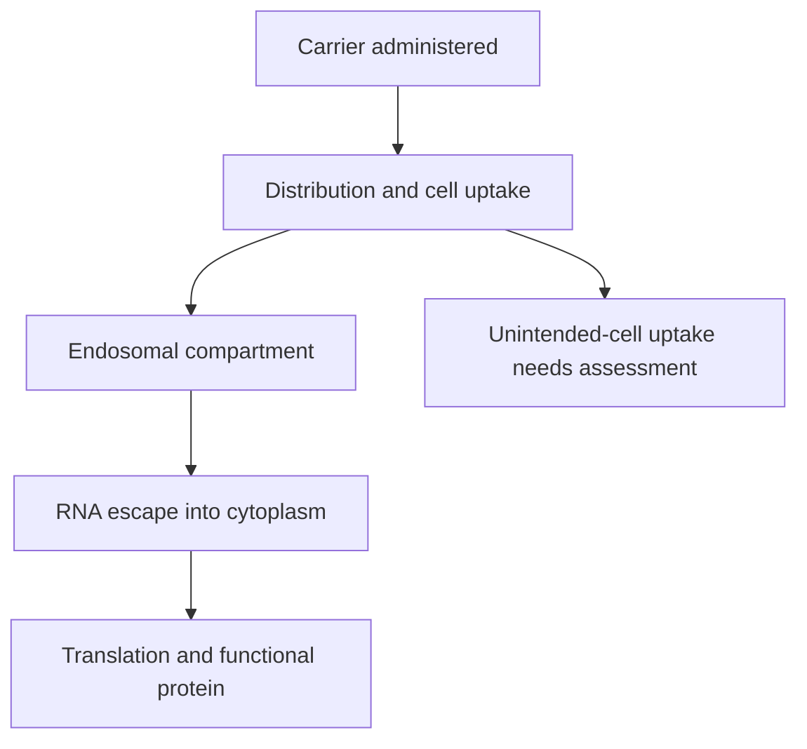

# LNP (lipid nanoparticle)

## In one sentence

A lipid nanoparticle is a formulated lipid carrier that can protect RNA and help deliver it into cells.

## The intuition

A delivery package needs the right destination and a way to release its contents. A lipid nanoparticle (LNP) must do more than enter a cell. The RNA needs access to the cytoplasm, where translation occurs. The package analogy does not predict which cells receive it.

## How it works

RNA-delivery LNPs often combine an ionizable lipid with helper lipids, cholesterol and a polyethylene glycol-linked lipid. Composition and particle properties affect stability, distribution, uptake and inflammatory effects.

After uptake, RNA can remain trapped in membrane-bound endosomes. Endosomal escape is therefore a separate delivery requirement. Detecting particles in tissue does not establish useful cytoplasmic RNA delivery or protein expression.

The payload, formulation, dose and administration route jointly affect behavior. An intramuscular vaccine formulation cannot simply be assigned the distribution of an intravenous formulation. Targeting a carrier to a T-cell marker is also different from designing the encoded receptor to recognize a cancer antigen.

*Cell uptake and useful cytoplasmic delivery are different requirements.*

## Why it matters in cancer

LNPs can carry antigen instructions or instructions for engineering cells. Neither use proves that a particular product has reached the right cell population safely or produced clinical benefit.

## Worked example

A fictional targeted particle accumulates near T cells. The next experiments identify which cells received the message, whether RNA escaped the endosome, and whether the intended protein works. A location image alone establishes none of those downstream claims.

## Common confusions

- An LNP and an RNA-lipoplex are distinct formulation architectures.
- Transient RNA does not imply every downstream effect stops immediately.
- The same RNA sequence in another carrier can be a meaningfully different product.

## Related concepts

- [mRNA construct anatomy](/wiki/education/concepts/engineering-and-manufacturing/nucleic-acid-design/mrna-construct-anatomy)
- [DNA, RNA and protein](/wiki/education/concepts/biology-basics/genetics/central-dogma)
- [Chimeric antigen receptor (CAR) anatomy](/wiki/education/concepts/therapeutics/cell-therapies/car-anatomy)

## Sources and scope

Source check: October 8, 2026. This is a mechanism explanation, not a treatment recommendation. Expert and learner review remain pending.

- [Lipid nanoparticle composition and delivery](https://www.nature.com/articles/s41578-021-00358-0).
- [Primary targeted mRNA cell-engineering experiments](https://pubmed.ncbi.nlm.nih.gov/40536974/).

<!-- BEGIN GENERATED USED IN -->
## Used in

- [How to engineer T cells inside the body](/wiki/education/cellular-therapies/06-in-vivo-delivery)
- [How a personalized vaccine is manufactured](/wiki/education/designing-a-vaccine/05-how-vaccines-are-manufactured)
- [How engineered immune cells can attack a solid tumor](/wiki/education/guides/engineered-cell-therapy/index)
- [Turn selected targets into an mRNA message](/wiki/education/guides/personalized-cancer-vaccine/06-writing-the-message)
- [How a personalized cancer vaccine is designed](/wiki/education/guides/personalized-cancer-vaccine/index)
<!-- END GENERATED USED IN -->
