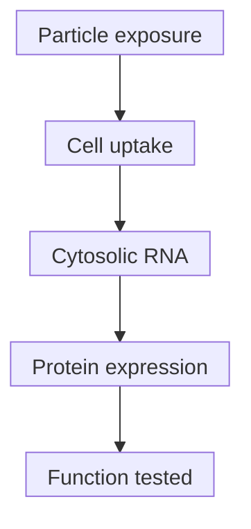
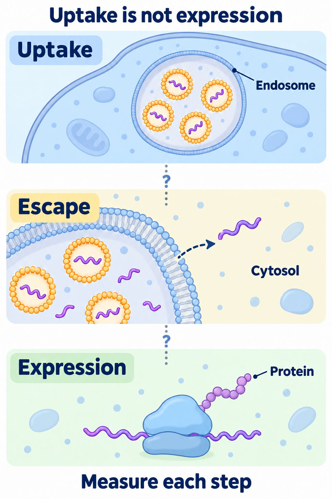

# LNP (lipid nanoparticle)

## In one sentence

A lipid nanoparticle is a formulated lipid carrier that can protect RNA and help deliver it into cells.

## The intuition

A delivery package needs a destination and a way to release its contents. A **lipid nanoparticle (LNP)** must do more than enter a cell: its [ribonucleic acid (RNA)](/wiki/education/concepts/biology-basics/molecules/rna-and-mrna) must become usable. The parcel analogy cannot predict which cells receive it, how much escapes or whether the resulting protein works.

**Before you start:** [DNA → RNA → protein](/wiki/education/concepts/biology-basics/genetics/central-dogma) explains expression; [mRNA construct anatomy](/wiki/education/concepts/engineering-and-manufacturing/nucleic-acid-design/mrna-construct-anatomy) explains the message.

## How it works

Many RNA-delivery LNPs combine an **ionizable lipid**, whose electrical charge changes with acidity, with helper lipids, cholesterol and a polyethylene glycol-linked lipid. This is a common design, not a universal ingredient list. Lipid identity, proportions, preparation and RNA cargo affect particle structure and behavior. “LNP” alone does not specify a product.

Cells often take particles into **endosomes**, membrane-bound uptake compartments within the [cell's organelles](/wiki/education/concepts/biology-basics/cells/organelles-overview). For **messenger RNA (mRNA)**, useful delivery requires access to the **cytosol**, the fluid part of the cytoplasm outside membrane-bound compartments, where accessible ribosomes make protein. Ionizable lipids can become more positively charged in acidic conditions; lipid interactions and membrane changes can help RNA leave a compartment. Escape pathways depend on the formulation and cell. A picture of an endosome bursting is not an established universal mechanism.

*Each step needs evidence. Uptake does not guarantee escape, expression or function; unintended cells also need assessment. Ordinary mRNA is translated in the cytosol and does not require nuclear entry.*

*Uptake, cytosolic RNA release and protein expression are separate checks. The panels show possible steps, not a measured efficiency or guaranteed sequence. Endosomes are already inside the cytoplasm; ordinary mRNA must become accessible outside those membrane-bound compartments for translation and does not require nuclear entry. Protein function, immune effects and clinical benefit need further evidence.*

View full-size: [light illustration](./images/uptake-is-not-expression-v2-light.png) · [dark illustration](./images/uptake-is-not-expression-v2-dark.png).

In Paramasivam et al.'s experiments with six formulations in human adipocytes, fibroblasts and HeLa cells, total uptake did not adequately predict useful delivery. RNA could accumulate in compartments without productive release. The formulation with the brightest uptake signal need not make the most protein.

**Biodistribution** means where administered material goes. Many intravenously administered LNP formulations favor liver delivery, but that is not a law for every composition or route. Di et al. compared routes and particle sizes in mice: some intramuscularly administered particles also reached liver and spleen. Local injection does not establish exclusively local delivery. Neither mouse distribution nor one vaccine formulation supplies another product's human distribution claim.

## Why it matters in cancer

LNPs can carry antigen instructions or instructions for engineering immune cells. [Delivery targeting versus cancer targeting](/wiki/education/concepts/engineering-and-manufacturing/delivery-vehicles/delivery-targeting-vs-cancer-targeting) separates the cell receiving the message from the target recognized later. Expression, immune effects and clinical benefit require different evidence.

## What to measure

**Assay card — a defined RNA formulation**

- **Input and consumption:** Lot aliquots, identified cells or sampled tissue at stated times; these tests consume material and sample only part of the system.
- **Readouts and units:** Particle size in nanometers and size distribution; RNA amount, integrity and encapsulated fraction in percent; labeled lipid or RNA location; protein amount or the fraction of identified live cells expressing it. State every denominator.
- **Thresholds and limits:** No universal size or encapsulation cutoff proves useful delivery. A fluorescent lipid is not intact RNA, and encapsulation is not endosomal escape. Pair distribution measurements with expression, viability and relevant function using controls.
- **Validation boundary:** Performance belongs to the tested formulation, route, cells, species and sampling time. Product quality measurements do not establish clinical safety or benefit.

## Try it

At the same time point and RNA exposure, two fictional formulations are tested in matched cell cultures. Among 100 sampled live cells per formulation, A has 70 uptake-positive cells and 10 protein-positive cells; B has 40 and 25, respectively. Which made protein in more sampled cells?

**Answer:** B: 25%, versus A's 10%. A had more uptake-positive cells, 70% versus 40%. These results separate uptake from expression; they do not calculate the fraction of RNA escaping, establish protein function or show an effect in a patient. Biological replication and viability measurements still matter.

A fictional targeted particle accumulating near T cells needs the same follow-up: identify recipients, measure useful RNA delivery, then test the protein's task.

## Common confusions

- **LNP versus RNA-lipoplex:** Names can overlap. Inspect the [lipoplex](/wiki/education/concepts/engineering-and-manufacturing/delivery-vehicles/rna-lipoplex) composition and preparation rather than assume a strict category boundary.
- **Temporary message versus immediate off switch:** RNA, protein and immune-effect timelines differ.
- **Same RNA versus same product:** Changing carrier or route can change delivery and safety.

## Explain it back

“We measured ___ in ___ cells at ___ time; the next delivery step still needing evidence is ___.”

## Takeaway

**Ask where the carrier went, where usable RNA reached, and which cells made functional protein. These are separate questions.**

## Related concepts

- [Targeted LNPs](/wiki/education/concepts/engineering-and-manufacturing/delivery-vehicles/targeted-lnps) explain delivery preferences.
- [RNA-lipoplex](/wiki/education/concepts/engineering-and-manufacturing/delivery-vehicles/rna-lipoplex) explains a related formulation name.

## Sources and scope

Source check: October 10, 2026; expert and learner review pending. These primary experiments support mechanism and measurement boundaries, not a universal recipe or treatment recommendation.

- [Paramasivam et al., 2021: uptake, endosomal trafficking and RNA escape in defined human-cell models](https://pubmed.ncbi.nlm.nih.gov/34882187/).
- [Di et al., 2022: route, particle size, distribution and expression in mice](https://pubmed.ncbi.nlm.nih.gov/35080707/).
- [Cheng et al., 2020: formulation changes and organ delivery in mouse experiments](https://pubmed.ncbi.nlm.nih.gov/32251383/).

<!-- BEGIN GENERATED USED IN -->
## Used in

- [How to engineer T cells inside the body](/wiki/education/cellular-therapies/06-in-vivo-delivery)
- [How a personalized vaccine is manufactured](/wiki/education/designing-a-vaccine/05-how-vaccines-are-manufactured)
- [How engineered immune cells can attack a solid tumor](/wiki/education/guides/engineered-cell-therapy/index)
- [Turn selected targets into an mRNA message](/wiki/education/guides/personalized-cancer-vaccine/06-writing-the-message)
- [How a personalized cancer vaccine is designed](/wiki/education/guides/personalized-cancer-vaccine/index)
<!-- END GENERATED USED IN -->
