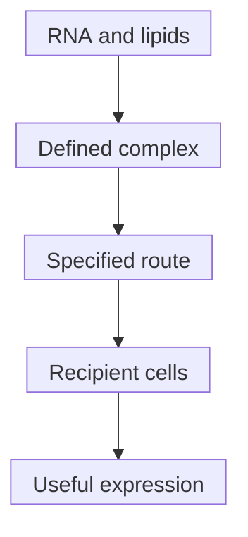

# RNA-lipoplex

## In one sentence

An RNA-lipoplex is a formulation in which RNA is complexed with lipids, with delivery behavior determined by the specific composition, preparation and route.

## The intuition

A message needs packaging for its journey. Lipids can associate with [ribonucleic acid (RNA)](/wiki/education/concepts/biology-basics/molecules/rna-and-mrna) to form a delivery complex. Think of a parcel chosen for particular conditions. The analogy stops at arrival: contacting a cell does not establish that the message reached the compartment where it can be used.

**Before you start:** [DNA → RNA → protein](/wiki/education/concepts/biology-basics/genetics/central-dogma) explains the payload; [lipid nanoparticles (LNPs)](/wiki/education/concepts/engineering-and-manufacturing/delivery-vehicles/lipid-nanoparticle) introduce lipid delivery.

## How it works

RNA has negative electrical charge. Positively charged lipid components can associate with it; other ingredients help organize the complex. **RNA-LPX** abbreviates RNA-lipoplex, a family of formulations rather than one interchangeable product. The final particle need not be positively charged: the balance of RNA and lipid charges, ingredients and preparation matters.

Lipoplexes can themselves be called lipid nanoparticles. Rojas et al.'s primary manufacturing methods describe their RNA-lipoplex vaccine as lipoplex nanoparticles. There is no consistently strict naming boundary that makes every “LNP” structurally distinct from every “LPX.” Read the formulation's actual properties rather than infer them from the acronym.

*The map lists questions to test, not guaranteed outcomes. Useful expression requires RNA release; an immune response needs additional evidence.*

Composition, charge balance and route affect which tissues and cells encounter the material. Kranz et al. adjusted a particular RNA-lipoplex formulation's charge for **intravenous** administration, into a vein. Their experiments supported delivery to [dendritic cells](/wiki/education/concepts/immunology/innate-and-unconventional-cells/dendritic-cells) and macrophages in lymphoid compartments without adding a cell-binding ligand. This does not mean all lipoplexes enter those cells exclusively or share that route.

For **messenger RNA (mRNA)**, entering an **endosome**, a membrane-bound uptake compartment, is not enough. Usable RNA must reach the **cytosol**, the fluid part of the cytoplasm outside membrane-bound compartments, for protein production. A formulation can also affect **innate immune sensing**, the body's early detection of molecular signals. Measuring that response does not by itself measure antigen expression, antigen-specific immunity or clinical benefit.

## Why it matters in cancer

A vaccine can intentionally deliver instructions to an antigen-presenting cell rather than directly to the tumor. Expression still needs [antigen processing and display](/wiki/education/concepts/immunology/antigen-presentation/antigen-processing-machinery), compatible recognition and downstream function. [Delivery targeting versus cancer targeting](/wiki/education/concepts/engineering-and-manufacturing/delivery-vehicles/delivery-targeting-vs-cancer-targeting) separates these jobs.

Rojas et al. studied a particular intravenous RNA-lipoplex vaccine after surgery for pancreatic cancer, within a phase I sequence also containing other treatments. It supplies product-specific methods and immune observations. It does not establish a lipoplex-versus-LNP superiority ranking or isolate a universal treatment benefit.

## What to measure

**Assay card — a named lipoplex preparation**

- **Input and consumption:** Defined RNA, lipid ingredients and prepared-lot aliquots; cell or tissue samples collected at specified times. Testing consumes material.
- **Readouts and units:** Particle size in nanometers, size distribution, RNA integrity and associated/protected fraction; surface-charge measurements such as zeta potential in millivolts under stated solution conditions. These are different from identifying cells that make protein.
- **Thresholds and failures:** Product-specific methods and acceptance criteria matter. A charge measurement depends on the measurement conditions; a favorable particle measurement does not prove cytosolic release. Labeled lipid location alone cannot establish antigen production.
- **Validation boundary:** Add expression, relevant immune readouts and viability controls in the intended populations. Results from one preparation, route or model cannot certify another product's stability, safety or benefit.

## Try it

A fictional RNA-lipoplex study uses intravenous administration. Another product uses a different lipid formulation **intramuscularly**, into muscle. Both encode the same antigen windows. Can the second product inherit the first product's stability, immune-response or safety claims?

**Answer:** No. Shared sequences do not establish equivalent products. The carrier, preparation, route, analytical tests and clinical protocol need their own evidence. Neither category is universally better. Even matching particle size would not settle functional delivery.

## Common confusions

- **Positive ingredient versus positive particle:** Net charge depends on the whole preparation and conditions.
- **Lipoplex versus fixed route:** A category name is not an administration instruction.
- **Innate activation versus tumor recognition:** They answer different biological questions.
- **Carrier signal versus useful delivery:** Identify RNA use in the intended cells, not only where labeled material appears.

## Explain it back

“This lipoplex contains ___, was tested by ___ route in ___ model, and showed ___; it has not yet shown ___.”

## Takeaway

**Treat the formulation, route and measured recipient-cell task as part of the evidence, not interchangeable packaging details.**

## Related concepts

- [Targeted LNPs](/wiki/education/concepts/engineering-and-manufacturing/delivery-vehicles/targeted-lnps) compare delivery strategies.
- [Antigen-processing machinery](/wiki/education/concepts/immunology/antigen-presentation/antigen-processing-machinery) connects protein production to display.

## Sources and scope

Source check: October 10, 2026; expert and learner review pending. These sources concern particular preparations and models, not a general recipe or dosing recommendation.

- [Kranz et al., 2016: systemic RNA-lipoplex delivery and immune observations](https://pubmed.ncbi.nlm.nih.gov/27281205/).
- [Rojas et al., 2023: manufacturing methods and a phase I pancreatic-cancer vaccine study](https://www.nature.com/articles/s41586-023-06063-y).
- [Paramasivam et al., 2021: separate particle-property, uptake and RNA-delivery measurements](https://pubmed.ncbi.nlm.nih.gov/34882187/).

<!-- BEGIN GENERATED USED IN -->
## Used in

- [How to engineer T cells inside the body](/wiki/education/cellular-therapies/06-in-vivo-delivery)
- [How a personalized vaccine is manufactured](/wiki/education/designing-a-vaccine/05-how-vaccines-are-manufactured)
- [Turn selected targets into an mRNA message](/wiki/education/guides/personalized-cancer-vaccine/06-writing-the-message)
- [How a personalized cancer vaccine is designed](/wiki/education/guides/personalized-cancer-vaccine/index)
<!-- END GENERATED USED IN -->
