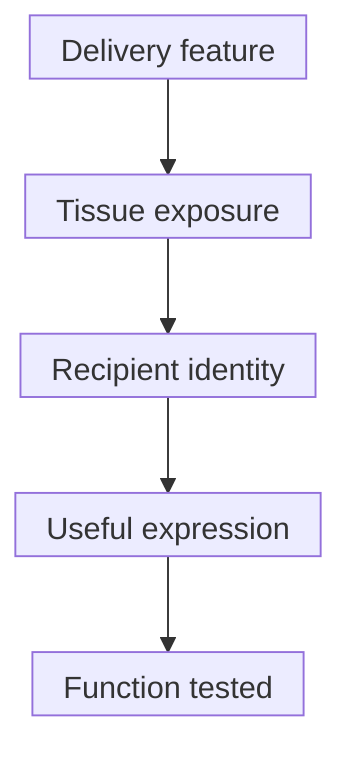

# Targeted lipid nanoparticles

## In one sentence

Targeted lipid nanoparticles use formulation or surface features to favor delivery to particular tissues or cells, but enrichment must be distinguished from selective functional expression.

## The intuition

An address on a parcel helps delivery, but does not prove that every parcel reaches the right person or that the contents are used. [Lipid nanoparticles (LNPs)](/wiki/education/concepts/engineering-and-manufacturing/delivery-vehicles/lipid-nanoparticle) need more than an address: useful cargo must reach the right cellular compartment. The analogy misses competition from other tissues and differences between recipient cells.

**Before you start:** [DNA → RNA → protein](/wiki/education/concepts/biology-basics/genetics/central-dogma) explains expression; [ligands and receptors](/wiki/education/concepts/biology-basics/signaling/ligand-and-receptor) explain binding.

## How it works

One strategy adds a **ligand**, a binding molecule such as an antibody or antibody fragment, to the particle surface. It recognizes a marker on intended cells. Binding still needs to support uptake and useful cargo release, and the marker may occur on other cells. Adding a ligand does not erase the formulation's other distribution pathways.

Another strategy changes lipid composition to favor an organ's delivery profile. **Selective organ targeting (SORT)** describes Cheng et al.'s formulation approach: changing an added lipid component shifted protein expression among liver, spleen and lung in mouse experiments. This is measured performance in those models, not a universal composition-to-organ rule for patients. Formulation targeting and ligand targeting can overlap.

**Biodistribution** asks where administered material goes. **Functional delivery** asks whether its cargo reaches a usable location and performs the intended job. **Messenger RNA (mRNA)** must reach the **cytosol**, the fluid part of the cytoplasm outside membrane-bound compartments, to be translated. Material inside an **endosome**, a cellular uptake compartment, can be detected without useful expression.

*Each stage needs a suitable measurement. An organ signal cannot substitute for cell-specific expression, and no arrow establishes a clinical benefit.*

In Rurik et al.'s mouse cardiac-injury experiments, particles directed to the cell marker CD5 delivered RNA encoding a [chimeric antigen receptor (CAR)](/wiki/education/concepts/therapeutics/cell-therapies/car-anatomy) recognizing fibroblast activation protein. CD5 was the delivery address; the encoded receptor had another target. The study also detected liver expression: “targeted” did not mean exclusive T-cell delivery. This was a fibrosis model, not a human cancer trial.

Hunter et al. subsequently tested targeted RNA engineering in human cells, humanized mouse tumor models and monkeys. Those experiments answer different questions. Human-cell experiments are not human clinical benefit; mouse tumor control and monkey B-cell depletion do not establish benefit in human solid tumors.

## Why it matters in cancer

For cell engineering, ask **which cell should make which receptor**. For a vaccine, the intended recipient may instead be an antigen-presenting cell. [Delivery targeting versus cancer targeting](/wiki/education/concepts/engineering-and-manufacturing/delivery-vehicles/delivery-targeting-vs-cancer-targeting) separates recipients from the targets recognized later.

Ordinary CAR-encoding RNA generally supports transient expression. RNA encoding a genome editor can cause lasting [DNA](/wiki/education/concepts/biology-basics/molecules/dna) changes. A temporary message does not guarantee a temporary intervention or an immediate immune off switch.

## What to measure

**Assay card — delivery selectivity**

- **Input and consumption:** Defined carrier and RNA lots, sampled tissue or blood, and identified cell subsets at stated times. Recovery consumes material and may miss populations.
- **Readouts and units:** Material per tissue amount; protein amount or percent protein-positive cells within each live subset. [Flow cytometry](/wiki/education/concepts/measurement/immune-monitoring/flow-cytometry) can identify recipients. Report intended and unintended populations, not just whole-organ fluorescence.
- **Thresholds and failures:** There is no universal enrichment ratio proving exclusive delivery. A lipid label, bound particle or internalized RNA does not independently prove cytosolic release or expression. Compare matched untargeted formulations, viability and relevant function.
- **Validation boundary:** Species, cell-marker expression, cell state, dose, route and sampling time bound the result. Laboratory selectivity does not establish whole-body selectivity, clinical safety or benefit.

## Try it

A fictional particle raises whole-lung fluorescence but the report does not identify expressing cells. Has it shown selective T-cell engineering?

**Answer:** No. It has located the label. Identified-cell expression and unintended populations still need assessment.

A follow-up samples 100 live T cells and 100 live non-T cells at the same time: 20 T cells and 15 non-T cells express the encoded protein. How should the result be described?

**Answer:** Expression occurred in 20% of sampled T cells and 15% of sampled non-T cells: some enrichment, not exclusive T-cell expression. The populations sampled, uncertainty and matched control matter. These numbers alone establish neither selective delivery throughout the body nor protein function.

## Common confusions

- **Organ targeting versus cell targeting:** An organ contains many cell types.
- **Binding versus expression:** Recognition of a marker does not settle later delivery steps.
- **Targeted versus safe:** The expressed protein and immune response have their own risks.
- **More uptake versus better delivery:** Usable release can remain the bottleneck.

## Explain it back

“The delivery feature recognizes or favors ___; functional expression was measured in ___; unintended expression was assessed in ___.”

## Takeaway

**Read targeting as a measured, bounded preference. Then check useful expression, unintended recipients and the intended task separately.**

## Related concepts

- [RNA-lipoplex](/wiki/education/concepts/engineering-and-manufacturing/delivery-vehicles/rna-lipoplex) explains another lipid-formulation label.
- [CAR anatomy](/wiki/education/concepts/therapeutics/cell-therapies/car-anatomy) explains what an engineered cell makes.

## Sources and scope

Source check: October 10, 2026; expert and learner review pending. These primary studies support defined delivery strategies, not proof of human solid-tumor efficacy or universal tissue selectivity.

- [Cheng et al., 2020: SORT composition changes and organ delivery in mice](https://pubmed.ncbi.nlm.nih.gov/32251383/).
- [Rurik et al., 2022: CD5-directed RNA delivery in a mouse cardiac-injury model](https://pubmed.ncbi.nlm.nih.gov/34990237/).
- [Hunter et al., 2025: targeted RNA engineering in human-cell experiments and animal models](https://pubmed.ncbi.nlm.nih.gov/40536974/).

<!-- BEGIN GENERATED USED IN -->
## Used in

- [How to engineer T cells inside the body](/wiki/education/cellular-therapies/06-in-vivo-delivery)
<!-- END GENERATED USED IN -->
