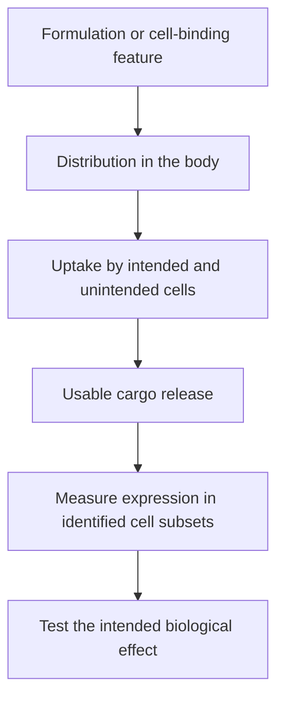

# Targeted lipid nanoparticles

## In one sentence

Targeted lipid nanoparticles use formulation or surface features to favor delivery to particular tissues or cells, but enrichment must be distinguished from selective functional expression.

## The intuition

Putting an address on a parcel helps it reach a destination, but does not prove that every parcel reaches the right person or that its contents are used. [Lipid nanoparticles (LNPs)](/wiki/education/concepts/engineering-and-manufacturing/delivery-vehicles/lipid-nanoparticle) need more than an address: they must survive the journey, enter cells and release useful cargo. The analogy also misses competition from other tissues that can take up particles.

**Before you start:** [LNPs](/wiki/education/concepts/engineering-and-manufacturing/delivery-vehicles/lipid-nanoparticle) introduce the carrier; [DNA → RNA → protein](/wiki/education/concepts/biology-basics/genetics/central-dogma) explains expression.

## How it works

One strategy attaches a **ligand**, a binding molecule such as an antibody fragment, to the particle surface. The ligand recognizes a molecule on the intended cell. Another strategy changes lipid composition to favor delivery to an organ. These strategies can overlap, but “more delivery to the lung” and “selective engineering of a T-cell subset” are different claims.

**Biodistribution** describes where administered material goes. **Functional delivery** asks whether its cargo reaches a usable location and performs its intended job. Messenger RNA (**mRNA**) must reach the cytoplasm to be translated. Material trapped inside an **endosome**, a cellular uptake compartment, may be detectable without producing enough protein.

*An organ signal cannot substitute for a cell-specific expression measurement.*

Primary studies have demonstrated organ-enriched delivery by changing particle composition, and receptor-guided delivery of [chimeric antigen receptor (CAR)](/wiki/education/concepts/therapeutics/cell-therapies/car-anatomy)-encoding RNA to T cells. Those are results in specified systems. Cell-marker expression, cell state, species, route and dose can all affect performance. A ligand binding its marker in a dish is insufficient evidence of selective delivery throughout a patient.

## Why it matters in cancer

An LNP can carry instructions to an immune cell that will later recognize a tumor. The delivery target and the tumor target can be entirely different. For a vaccine, the intended recipient may instead be an antigen-presenting cell. Ask which cell must make which protein, and how that was measured.

The payload also matters. Ordinary CAR-encoding mRNA generally provides transient receptor expression. RNA encoding a genome editor can cause lasting DNA changes. A temporary RNA molecule does not guarantee a temporary biological intervention.

## Try it

A fictional particle carries a fluorescent lipid and a receptor-encoding RNA. Whole-lung fluorescence rises, but the report does not identify expressing cells. Has it shown selective T-cell engineering?

**Answer:** No. It shows distribution of the label. The team needs identified-cell measurements of useful cargo delivery and receptor expression, including unintended cell populations.

## Common confusions

- **Targeted versus exclusive:** Favoring a population is not proof of zero off-target delivery.
- **Organ targeting versus cell targeting:** An organ contains many cell types.
- **Particle uptake versus endosomal escape:** Entry into a compartment is not successful RNA use.
- **Delivery specificity versus clinical safety:** The expressed protein and downstream immune response have their own risks.

## Related concepts

- [Delivery targeting versus cancer targeting](/wiki/education/concepts/engineering-and-manufacturing/delivery-vehicles/delivery-targeting-vs-cancer-targeting).
- [CAR anatomy](/wiki/education/concepts/therapeutics/cell-therapies/car-anatomy) explains what an engineered immune cell makes.

## Sources and scope

Source check: October 9, 2026; expert and learner review pending. These are primary preclinical studies, not proof of human solid-tumor efficacy.

- [Cheng et al., 2020: selective organ targeting by LNP composition](https://www.nature.com/articles/s41565-020-0669-6).
- [Rurik et al., 2022: targeted RNA delivery to generate CAR T cells in a mouse cardiac-injury model](https://pubmed.ncbi.nlm.nih.gov/34990237/).
- [Hunter et al., 2025: targeted LNP engineering in human-cell experiments and animal models](https://pubmed.ncbi.nlm.nih.gov/40536974/).

<!-- BEGIN GENERATED USED IN -->
## Used in

- [How to engineer T cells inside the body](/wiki/education/cellular-therapies/06-in-vivo-delivery)
<!-- END GENERATED USED IN -->
