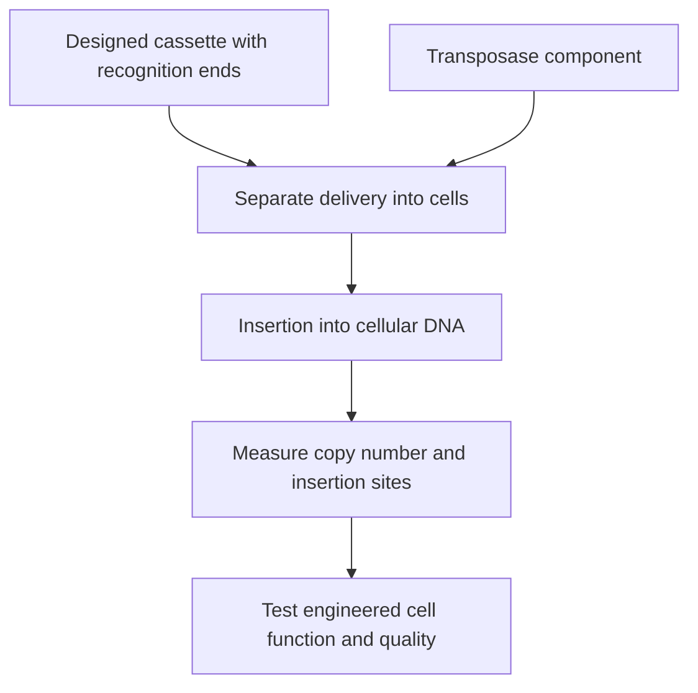

# Transposon for cell engineering

## In one sentence

An engineered DNA transposon is a gene-insertion system that uses a transposase enzyme to place a designed cassette into cellular DNA after a separate method delivers the required components.

## The intuition

A transposon system is closer to a filing tool than a shipping container. It can insert instructions into a cell's chromosome, but the tool and instructions must first reach the cell. Calling it “nonviral” tells you something about the method; it does not mean the instructions stay outside the genome.

**Before you start:** [DNA → RNA → protein](/wiki/education/concepts/biology-basics/genetics/central-dogma) explains gene expression; [ex vivo versus in vivo engineering](/wiki/education/concepts/engineering-and-manufacturing/cell-manufacturing/ex-vivo-vs-in-vivo-engineering) separates where cells are modified.

## How it works

Natural transposable elements can move genetic material in several ways. This page concerns engineered **DNA transposon** systems used for cell modification, not every kind of natural mobile element.

The designed cassette is flanked by recognition sequences. A **transposase** enzyme recognizes those boundaries and catalyzes insertion into cellular DNA. The gene cargo and the transposase are different components. The latter can be supplied as a protein or through instructions for producing it. Its persistence and activity need control; continued activity can be undesirable.

*The insertion system does not solve the delivery problem by itself.*

One delivery method is **electroporation**, which uses electrical pulses to help material enter cells. In an ex vivo workflow, researchers can modify collected cells, grow them and test the resulting population before administration. Directly delivering components inside a patient would be a different workflow with additional distribution and unintended-cell questions.

Insertion can allow a cassette to be copied when an engineered cell divides. It does not guarantee that the cell survives, maintains expression or controls a tumor. Integration sites, cassette copy number and the behavior of individual cell clones matter. A **clone** is a population descended from one cell; a mixed product may contain many clones with different insertion patterns.

## Why it matters in cancer

Transposons have been used to generate [chimeric antigen receptor (CAR)](/wiki/education/concepts/therapeutics/cell-therapies/car-anatomy) T cells outside the body. An early-phase study of one system supports the feasibility of its tested manufacturing and clinical process. It does not prove that all nonviral systems are safer, that insertion is directed to a universally safe location or that the same components work by direct injection.

## Try it

A fictional report says “nonviral CAR engineering” and describes collecting T cells, electroporating DNA components and infusing the expanded cells. Did it deliver a nonintegrating therapy directly into the patient?

**Answer:** Neither claim follows. The engineering occurred ex vivo, and a DNA transposon intentionally supports genomic insertion. What was administered was a manufactured cell population.

## Common confusions

- **Nonviral versus nonintegrating:** Carrier type and genetic fate are different axes.
- **Transposon versus transposase:** One is the bounded cassette; the other is the insertion enzyme.
- **Insertion versus cell targeting:** A system can insert successfully in the wrong cells if delivery is poorly controlled.
- **Persistent cassette versus permanent benefit:** Genetic persistence is not a clinical endpoint.

## Related concepts

- [Lentiviral vector](/wiki/education/concepts/engineering-and-manufacturing/delivery-vehicles/lentiviral-vector) offers another route to genomic insertion.
- [Good manufacturing practice (GMP) and batch release](/wiki/education/concepts/engineering-and-manufacturing/cmc-and-quality/gmp-and-batch-release) explains product-level checks.

## Sources and scope

Source check: October 9, 2026; expert and learner review pending. Primary sources establish a specific insertion mechanism and an ex vivo clinical workflow, not a general direct-delivery protocol.

- [Ivics et al., 1997: reconstruction of a DNA transposon and transposition in human cells](https://pubmed.ncbi.nlm.nih.gov/9390559/).
- [Kebriaei et al., 2016: phase I trials of transposon-engineered CD19 CAR T cells](https://www.jci.org/articles/view/86721).
- [FDA, 2020: long-term follow-up questions for persistent gene-therapy products](https://www.fda.gov/regulatory-information/search-fda-guidance-documents/long-term-follow-after-administration-human-gene-therapy-products).

<!-- BEGIN GENERATED USED IN -->
## Used in

- [How to engineer T cells inside the body](/wiki/education/cellular-therapies/06-in-vivo-delivery)
<!-- END GENERATED USED IN -->
