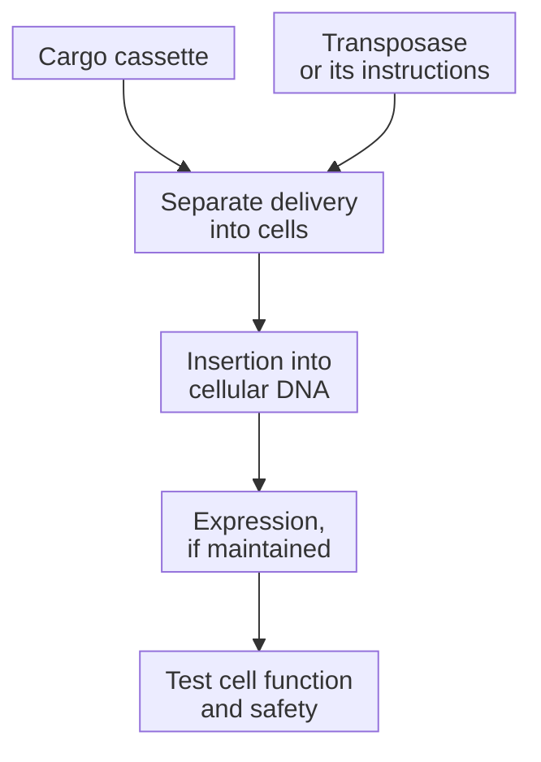

# Transposon for cell engineering

## In one sentence

An engineered DNA transposon is a gene-insertion system that uses a transposase enzyme to place a designed cassette into cellular DNA after a separate method delivers the required components.

## The intuition

A transposon system is closer to a filing tool than a shipping container. It can place instructions into a cell's genetic archive, but something else must bring the tools and instructions to the cell. The analogy misses insertion-site preferences, DNA repair and the possibility of disrupting other instructions.

**Before you start:** [DNA → RNA → protein](/wiki/education/concepts/biology-basics/genetics/central-dogma) separates the cassette from its product. [Ex vivo versus in vivo engineering](/wiki/education/concepts/engineering-and-manufacturing/cell-manufacturing/ex-vivo-vs-in-vivo-engineering) names the engineering location.

## How it works

This page concerns engineered **DNA transposons** used for gene insertion, rather than every naturally occurring mobile genetic element. Systems such as Sleeping Beauty and piggyBac use two essential parts:

1. A **cargo cassette** bordered by sequences the insertion machinery recognizes.
2. **Transposase**, an enzyme that recognizes those boundaries and catalyzes DNA movement and insertion. It may be supplied as protein or through instructions that make the enzyme.

The cell must receive both in a useful form. **Electroporation**, brief electrical pulses that facilitate cell entry, can deliver components into collected cells. Other delivery designs need their own distribution and entry evidence. Naming the insertion system does not identify a carrier or an administration route.

*Delivering components, inserting a cassette and expressing functional protein are distinct steps.*

Once inserted, a cassette can be copied with the chromosome during cell division. Expression still depends on the cassette's regulatory elements, insertion context and cell state. Continued transposase activity can raise remobilization concerns: the machinery may move an inserted cassette again. Transposase persistence and cargo persistence therefore need different measurements.

Insertion preferences differ among systems and conditions. “Not aimed at one chosen genomic site” does not mean every site is equally likely. A lack of observed hotspots in one sampled product does not certify all insertions or all later clones as harmless. [Insertional-mutagenesis assessment](/wiki/education/concepts/therapeutics/toxicities-and-supportive-care/insertional-mutagenesis) examines this separate safety question.

## Why it matters in cancer

A transposon can introduce receptor instructions into an immune cell. Early Sleeping Beauty phase I studies used two DNA plasmids, ex vivo electroporation and expansion before cell infusion. This establishes a specific manufacturing route. It does not establish direct injection of those components into patients or universal superiority over viral manufacture.

“Nonviral” describes a method's relationship to a viral carrier. It does not mean nonintegrating, temporary, harmless or clinically effective.

## How it is measured

**Measurement card — insertion and downstream activity**

- **Input and consumption:** Samples of components, engineered cells and follow-up material. DNA extraction and functional testing consume aliquots.
- **How and output:** Copy-number assays report cassette copies per stated denominator; insertion-site sequencing identifies recovered junctions and clonal patterns. Expression assays report receptor-positive cells. Separate tests examine retained transposase and antigen-dependent activity.
- **Thresholds and failures:** Product-specific acceptance limits require validated methods. Average copy counts hide cell-to-cell differences; insertion-site recovery is incomplete and method-dependent.
- **Limits and validation:** A sequence-positive sample is not a map of every insertion or proof of expression. Expression is not killing. Phase I feasibility in one cell product is not comparative safety or efficacy for every transposon design.

## Common confusions

- **Transposon equals carrier:** The components still need delivery.
- **Temporary transposase equals temporary insert:** The enzyme can disappear while the cassette remains.
- **More insertions equals more benefit:** Copy number, expression, function and risk must be assessed together.

## Try it

A fictional report describes nonviral, ex vivo transposon-engineered [chimeric antigen receptor (CAR) T cells](/wiki/education/concepts/therapeutics/cell-therapies/car-anatomy). Someone rewrites this as “a nonintegrating product injected to engineer cells inside the patient.” Which parts changed?

**Answer:** Both genetic fate and engineering location. The original describes cells engineered outside the body using an insertion system, then administered. It supports neither nonintegration nor in vivo delivery of the components.

## Explain it back

“The delivery method gets ___ into cells; transposase then ___.” One answer: “the components; catalyzes cassette insertion.”

## Takeaway

**Treat delivery, insertion, expression and antitumor function as separate claims, even when the process is called nonviral.**

## Related concepts

- [Lentiviral vector](/wiki/education/concepts/engineering-and-manufacturing/delivery-vehicles/lentiviral-vector)
- [Delivery and cancer targeting](/wiki/education/concepts/engineering-and-manufacturing/delivery-vehicles/delivery-targeting-vs-cancer-targeting)

## Sources and scope

Source check: October 10, 2026; expert and learner review pending. The sources establish defined mechanisms and an early ex vivo workflow, without ranking platforms.

- [Ivics et al., 1997](https://pubmed.ncbi.nlm.nih.gov/9390559/) — reconstructed Sleeping Beauty cut-and-paste activity in defined cells.
- [Kebriaei et al., 2016](https://www.jci.org/articles/view/86721) — phase I ex vivo electroporation, expansion, cell and integration-site assessments.
- [Huang et al., 2010](https://pubmed.ncbi.nlm.nih.gov/20606646/) — differing insertion preferences in specified human primary T-cell experiments; not a universal clinical safety ranking.
- [FDA, January 2020: long-term follow-up](https://www.fda.gov/media/113768/download) — integration and potential transposase remobilization concerns.

<!-- BEGIN GENERATED USED IN -->
## Used in

- [How to engineer T cells inside the body](/wiki/education/cellular-therapies/06-in-vivo-delivery)
- [How engineered immune cells can attack a solid tumor](/wiki/education/guides/engineered-cell-therapy/index)
<!-- END GENERATED USED IN -->
